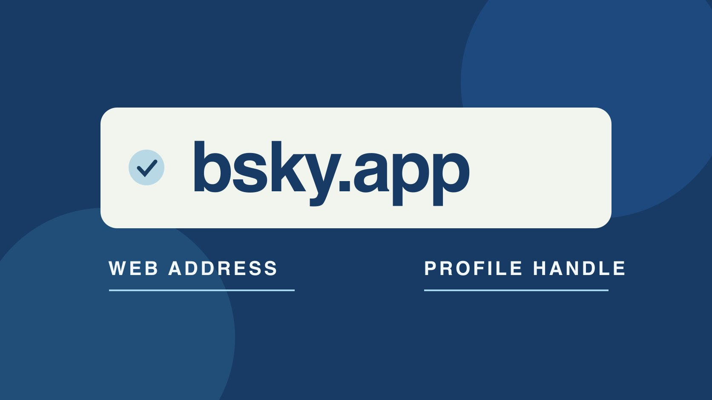

# App.Bluesky: Check the Official Bluesky Entry Point

Status: local review draft; confirm the publication date before release.

When a brief says “app.bluesky,” confirm bsky.app from the official site and distinguish the website, profile handle and identity signals.

QuickKOL editorial graphic; not actual account metrics or a platform interface.

For Bluesky’s official web app, follow the official Bluesky site’s link to bsky.app. “app.bluesky” may be a reversed string or shorthand in a note. Treat it as an unresolved destination until checked. The web address and a public handle are different fields. An account may use .bsky.social or a domain it controls. A brand should also confirm the account through its own website and established owner, with verification markers as one piece of identity evidence.

## Verify the browser destination first

The [Bluesky official overview](https://bsky.social/about) links its web app to bsky.app and provides mobile entry points. When a note says app.bluesky, preserve the words and identify whether they came from a browser field, an account signature or an internal note. Use the link from the official overview before entering account information. Check the host shown by the browser and the public page you actually opened. If an internal document reverses the address, correct the runbook and save the verified entry for later shifts. Suggestions, similar text and sponsored results are leads. Suppose a new editor receives a screenshot with the browser bar cut off. Ask for the trusted source of the link and open the official entry independently. You can confirm a destination without assuming the screenshot identified the genuine site. Keep the confirmed URL and date in the handoff so the next person does not repeat the ambiguity. An application bookmark should use the actual official destination, separate from the URL of a particular brand’s profile.

## Distinguish website, handle and organization domain

bsky.app is the web app host. An @ handle in a public profile points to an account. The [Bluesky domain handle guide](https://bsky.social/about/blog/4-28-2023-domain-handle-tutorial) explains how a team can use a domain it controls as a handle, while profiles can also use the default suffix. The organization’s own website may share that domain or use a longer address. Put the app, profile URL, handle and organization website in separate fields. A dotted string in a note is not enough to identify a login page. If a brand uses its domain as a handle, it can still link to the public profile from its website and name the market the account serves. A campaign directory can contain separate entries for headquarters, help and local teams. Verify that the account you intend to mention is the correct one. If the organization renames its handle, update the public link and preserve a dated note about the previous name so a later reviewer can reconcile older references.

## Read verification and domain evidence at its own scope

The [Bluesky verification announcement](https://bsky.social/about/blog/04-21-2025-verification) describes app badges and Trusted Verifiers alongside domain handles. A domain relationship, a displayed badge and authority to enter an agreement answer different questions. Compare the organization’s known website, published account directory and established contact route. If a profile says it represents a brand in a deal, confirm the market and commercial authority separately. A badge or familiar portrait cannot replace that check. An account without a badge may simply have a different verification status. Leave the identity question open until a reliable source confirms it. Suppose an account has a matching display name and shares the brand’s posts but the organization’s website links elsewhere. Verify through a known organization contact and record the conflicting links. If the profile is a regional affiliate or a support account, the parent organization may be able to explain its scope. Keep the conclusion precise so readers know whether you confirmed the profile’s relationship, access or authority to speak for a specific project.

## Independently confirm a login or invitation request

[FTC phishing guidance](https://consumer.ftc.gov/articles/how-recognize-avoid-phishing-scams) recommends checking unexpected requests through a website or contact route you already trust. If a message asks for a password, sign-in code, domain transfer or app connection, have the actual account owner verify it independently. A marketing colleague can route the issue to the organization’s responsible owner without forwarding sensitive information beyond that process. Before authorizing a service, verify the business task, requested access and revocation route. Complete authorized steps through the official flow. Store the app entry, hosting-related account route and public profile separately. Suppose a supposed collaborator offers to confirm the brand’s profile after the social manager signs in through a supplied page. Check the contact via the known organization and open the platform independently. If the message is legitimate, the owner can still describe the task without sharing a code. Document the verification outcome and any step taken by the account owner. This helps the next shift distinguish a resolved check from an invitation that still needs review.

## Include hosting and recovery in the handoff

The [Bluesky account management documentation](https://docs.bsky.app/blog/account-management) distinguishes the app from hosting and explains that some management functions depend on the host. In the operations record, name the account owner, domain administrator, third-party app approver and offboarding owner. Use public links for customer directions and keep recovery details in the approved internal system. Use the [social media operating plan](https://www.quickkol.com/blog/social-media-marketing-operating-plan/#answer) to assign publishing, response, escalation and corrections. Keep passwords and recovery codes out of briefs and public issue trackers. After an ownership change, confirm who can publish, control the domain and recover the account. These powers may belong to different people. If an agency helps write posts, give it only the access approved for that job and record when the assignment ends. A domain owner can verify the domain relationship without granting an editor control of DNS. Review the public profile link after any change and identify the owner who can correct an old link in press materials.

## Apply the checks to three common situations

In the first situation, a client leaves only app.bluesky in a brief. Verify the official app entry and ask for the public profile URL. In the second, a regional profile has a name close to the headquarters account. Check their stated scopes against the website directory and known contacts. In the third, a vendor claims it needs a sign-in code to post. Have the account owner review the official tool and approve only the necessary access. Keep the code with its holder. Put facts, open items and evidence in separate columns. For a commercial contact check, use the [creator identity verification workflow](https://www.quickkol.com/blog/verify-creator-brand-safety/#answer) to log public work and established contact routes. Keep that identity decision separate from any performance review. If someone resolves one of the three questions, update the relevant row without treating it as approval for the others. The brief can contain the right app address before the organization identifies a particular account. Record what was actually confirmed so the next person can continue from it.

## Leave a traceable internal destination note

Use one row for the app URL, public profile, organization evidence, review date and owner. If you have verified only the app, leave the profile unresolved. Before publishing a destination, have another person open it through the same evidence and check language, market and profile. If the brand renames, retain the previous observation and change date. If an app or product entry changes, put the new verified link in the maintained runbook. The old screenshot can remain useful as a dated record, while the current document gives staff a route they can use. For a business handoff, list what the receiving editor is actually authorized to do. A public profile URL can be shared with a client even if no editor has access to it. Any change in control should be verified by the account owner. Include the route to flag a mistaken link without sharing credentials or recovery information.

## Narrow the issue when something differs

If the app opens but a brand profile does not, check the link, any rename and access conditions. If the profile is public but the editor cannot enter the account, route the issue to the account or hosting owner. Report what was observed and keep the cause open until it is supported. After a fix, open the approved address from the intended viewer’s perspective. A short record of the original problem, what was changed and who verified the result is more useful than a screen capture with no date.

## Keep everyday bookmarks separate from incident checks

Maintain a short list for everyday work with the official app, the brand profile, the organization’s account directory and the actual host’s support route. Before a handoff, have a second person reopen the sources independently so autocomplete does not hide a reversed or misspelled address. In an incident, use the record to find the account owner and verify the invitation. Suppose a vendor operating a brand profile sends a new domain and asks an editor to sign in. Establish whether it belongs to the brand, the vendor’s own tool or an approved account route. Have the actual owner handle access changes with a defined term and revocation process. Record the check date, reviewer and verified official URL in the maintained list. It can also help to label bookmarks by task. Opening a public profile for review is different from reaching an account management screen for a change. A new staff member should be able to choose the correct one without copying an address from a screenshot. For an unresolved invitation, keep the requested action and the review owner in the record. If the request is later confirmed, update only the relevant route and scope. Leave the access decision separate from the evidence that established the public identity.

## Bluesky destination and identity check

| Field | Evidence | Separate question |
| --- | --- | --- |
| App entry | Direct link from official site | Brand account identity |
| Public account | Website, profile and verifiable domain | Contract and editing authority |
| Hosting and management | Actual account owner | Third-party tool access |

Use this for destination and identity checks without storing account secrets.

## Bluesky destination checklist

Verify a trusted route before signing in.

- [ ] Open bsky.app from the official overview.
- [ ] Record the handle and profile separately.
- [ ] Check against the organization’s website.
- [ ] Verify unexpected invitations independently.
- [ ] Hand off scope and ownership.

## Research date and limitations

Sources reviewed November 5, 2026. Methods, tables and decision rules are editorial recommendations. Hypothetical examples are not actual client results or industry benchmarks. Source geography and periods are specified where relevant. This draft is in independent local review; confirm its publication date before release.

## Start creator research with a clear task

Use QuickKOL to interpret a brief, discover relevant creators and research their work and contact routes. Verify data, commercial terms and outcomes at their source.

[Explore QuickKOL](https://www.quickkol.com/#capabilities)

## Sources

- [Bluesky official overview](https://bsky.social/about)
- [Bluesky domain handle guide](https://bsky.social/about/blog/4-28-2023-domain-handle-tutorial)
- [Bluesky verification announcement](https://bsky.social/about/blog/04-21-2025-verification)
- [FTC phishing guidance](https://consumer.ftc.gov/articles/how-recognize-avoid-phishing-scams)
- [Bluesky account management documentation](https://docs.bsky.app/blog/account-management)
