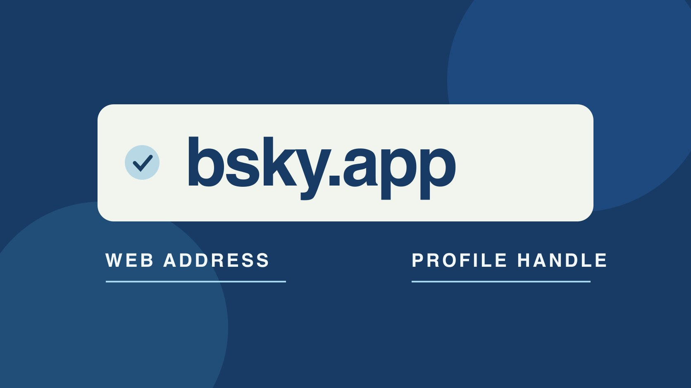

# App.Bluesky：核对官网和账号入口

状态：本地审阅稿；正式发布日期待确认。

遇到 “app.bluesky” 时，从官方来源找到 bsky.app，再分辨网站、公开账号与身份标记。

QuickKOL 编辑图形；不呈现真实账号指标或平台界面。

如果你在找 Bluesky 的官方网页版，从 Bluesky 官网所链接的 bsky.app 进入。“app.bluesky” 可能是便签里的反写或简称，不把它当作已核实的网址。网页地址和用户名分开检查：公开账号可能用 .bsky.social 或自己控制的域名。品牌运营者还需通过自有官网及内部账号持有人确认身份和权限，认证标记只是其中一项线索。

## 先把浏览器入口核对清楚

[Bluesky官方介绍](https://bsky.social/about)将网页应用链接到 bsky.app，也提供移动端入口。遇到 “app.bluesky” 这样的字样，保存原文，并问它来自浏览器、账号签名还是内部便签。通过官方介绍重开应用，不需要在一个猜测出来的地址里试着输入账号。用浏览器实际显示的主机名与打开的公开页面核对。若团队在内部文件写了反序地址，修订操作说明并保留有效官方入口，方便以后直接找到。浏览器自动补全、类似文字或广告结果只是线索。

## 区分网页地址、账号名和组织官网

bsky.app 是应用域名。公开资料中的 @ 名称用于指向账号。[Bluesky域名账号指南](https://bsky.social/about/blog/4-28-2023-domain-handle-tutorial)介绍可用团队控制的域名做账号名，而不是必须使用 .bsky.social。组织官网可能是同一域名，也可能是更完整的访问路径。把 App、公开主页、账号名、组织官网写成四个字段。只看到一个带点号的字符串时，不把它自动当登录入口。假设品牌把域名用作账号名，仍用官网页链接到公开主页，并在资料里写明该账号负责哪个市场。

## 认证和域名各自提供哪类证据

[Bluesky认证标记说明](https://bsky.social/about/blog/04-21-2025-verification)介绍应用内认证徽章与可信认证方，同时保留域名账号。域名与组织有关、平台显示徽章及合同授权是三个不同判断。通过已知官网、公司发布的账号目录及现有联系路径交叉核对。假设一个账号声称代表品牌谈合作，先确认对方是否负责这个市场及有权签约。徽章或匹配的头像不能替代业务审批。没有徽章也不意味着冒充，保持待核验状态并请已有联系人确认。

## 遇到邀请或登录请求时独立确认

[美国FTC防钓鱼指南](https://consumer.ftc.gov/articles/how-recognize-avoid-phishing-scams)建议通过已知网站或联系渠道核验意外的链接与请求。对突然要求密码、登录验证码、转移域名或连接第三方工具的消息，由实际账号负责人先走独立渠道。营销同事可以把报文转给内部安全或项目负责人，按规定避免扩散敏感信息。需要给服务授权时先核对业务任务、权限及撤销方式，并在官方流程确认。登录网站的地址、App 的托管登录体验和对外公开账号的地址都应单独保存。

## 交接要覆盖账号托管和恢复

[Bluesky账号托管说明](https://docs.bsky.app/blog/account-management)区分 App 与托管服务，部分账号管理动作由实际托管方提供。运营清单写明组织谁是账号持有人、谁能改域名、第三方工具由谁审批、谁负责离职时回收访问。把公开网址用于客户指引，将恢复信息留在受控的内部记录。用[社交媒体运营计划](https://www.quickkol.com/zh/blog/social-media-marketing-operating-plan/#answer)指定回复、发布、移交和纠错责任。不要把密码或恢复码写进文章 brief 或公共工单。权限变化后复核能发帖、能管理域名和能恢复账号的实际人员。

## 用同一套核对处理三个真实场景

第一种是客户在简报只留了 “app.bluesky”。先核对官方入口并请对方给公开主页。第二种是地区号与总部名相似。通过官网目录和已有联系人分别确认服务范围。第三种是供应商称必须转交验证码才能发稿。由账号负责人核实实际工具需要的授权，验证码留在账号持有人手中。将这些事实、待办和证据各写一列。若你在筛查商用联系方式，可用[创作者身份核验方法](https://www.quickkol.com/zh/blog/verify-creator-brand-safety/#answer)记录公开作品与官方联系来源，不把身份结论扩大成账号表现评价。

## 交付一条带证据的内部链接说明

用一行写应用地址、公开账号、官网证据、核验日和负责人。若只有官网确认了 App 入口，账号栏仍记为未确认。对外发布地址前，请另一位同事按相同来源打开，核对语言、市场和资料。若品牌后来更名，保留旧名称的观察与改名日期。若服务或产品入口发生变化，将新的已验证链接放在维护文档里，避免从旧截图回推。

## 发现异常时缩小要核对的范围

若 App 正常但品牌主页无法打开，核对链接、改名与访问条件。若主页可见但编辑无法进入，交给拥有账号及托管权限的人核对。记录实际所见，不因一个入口失败就认定品牌账号不存在。修复后从用户视角重新打开已批准的地址。

## 把日常书签与应急核对分开

日常运营可以维护一个短清单，放官方 App、品牌公开主页、官网账号目录和实际托管帮助。交接前由另一位同事从已知网站重新打开，避免错拼字母被自动补全。应急时从记录中找到账号持有人并核对收到的邀请，而不是在群里贴更多不明地址。假设品牌外包账号运营，供应商发来新的域名要求登录。先问这是否是对外域名、工具门户还是已经授权的账号入口。若需要修改权限，按实际负责人的流程处理，标明到期与撤销。完成后在清单里留日期、检查人和可打开的官方网址。

## Bluesky 地址与身份核对

| 字段 | 证据 | 需另行核对 |
| --- | --- | --- |
| App 入口 | 官网直接链接 | 品牌账号身份 |
| 公开账号 | 官网、主页和可验证域名 | 签约和编辑权 |
| 托管和管理 | 实际账号负责人 | 外部工具权限 |

示例用于识别入口和身份，不记录账户秘密。

## Bluesky 入口核验清单

打开登录页之前先核对可信来源。

- [ ] 从官方介绍打开 bsky.app。
- [ ] 分开记录账号名与公开主页。
- [ ] 与组织官网交叉核对。
- [ ] 通过独立渠道核对意外邀请。
- [ ] 交接实际权限与负责人。

## 研究日期与使用边界

资料核验于 2026 年 11 月 5 日。文中方法、表格和决策规则为编辑建议，标为假设的示例不是实际客户结果或行业基准。外部资料的适用地区与时期按各段说明；本稿处于独立本地审阅阶段，正式发布日期待确认。

## 用清楚的任务开始达人研究

用 QuickKOL 理解 Brief、发现相关达人并研究作品与联系路径；数据、合作条件和结果仍需核验。

[了解 QuickKOL](https://www.quickkol.com/#capabilities)

## 来源

- [Bluesky官方介绍](https://bsky.social/about)
- [Bluesky域名账号指南](https://bsky.social/about/blog/4-28-2023-domain-handle-tutorial)
- [Bluesky认证标记说明](https://bsky.social/about/blog/04-21-2025-verification)
- [美国FTC防钓鱼指南](https://consumer.ftc.gov/articles/how-recognize-avoid-phishing-scams)
- [Bluesky账号托管说明](https://docs.bsky.app/blog/account-management)
