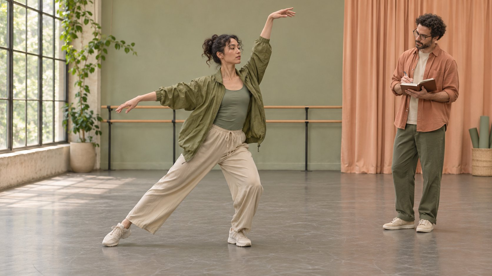

# Dancer Collaborations: Write a Movement Brief

Status: local review draft; confirm the publication date before release.

Separate performance, choreography and instruction so casting, filming and licensing share a reviewable scope.

AI-generated editorial illustration, not an actual creator, client, product or event.

Start a dancer collaboration by deciding which movement the audience needs to see, from which angle, and who will perform, choreograph and teach it. Specify wardrobe, location, retakes and usage in the same brief. Suppose a brand wants to show room for movement in a lightweight jacket. Ask for one continuous take with a side step, a turn and a reach, framed to show the dancer’s whole body. Viewers can see what happens to the shoulder and hem in that fitting. Keep any claim about other sizes, dancers or sports separate from what the footage shows.

## Scope performance, choreography and teaching separately

A performer delivers repeatable movement against an agreed direction. A choreographer solves transitions, tempo and formations and identifies where any existing material enters the routine. A teacher designs demonstration, verbal cues, speed and orientation. One dancer can take all three roles. Ask the quote to identify the outputs, review rounds and handoffs for each one. If viewers need to learn the sequence, request a continuous take at normal speed, a slower breakdown and cues that establish which foot to move first. If the assignment only needs a transition, buy the production work it requires. Use [a useful campaign brief](https://www.quickkol.com/blog/write-a-useful-campaign-brief/#answer) to align the movement objective with the runtime and the review owner. A two-person formation added on set also changes rehearsal, casting and the delivery date. Record that change as a scope decision before the performers spend time rehearsing it. The person approving the look and the person judging whether a cue is teachable can review the same take against different criteria. Give them a shared timecode and reserve a review window before the final export.

## Ask for a sample that tests the shot

Start with public work close to the assignment and mark timecodes for visible foot placement, the garment’s position after a turn and the clarity of a cue. Translate camera control into things you can observe. Can the dancer land near a floor mark? Can they repeat the tempo at a front and side angle? Does the verbal cue arrive early enough to follow? If you need a new sample, state the fee, use, deadline and retention plan. Comparable wardrobe is sufficient for a movement test if the exact product has not shipped. Share the floor type, usable space and expected repetitions so the dancer can flag a constraint before the booking. A hand hidden behind a sleeve could be an issue with framing, wardrobe or direction. Identify which of those the next take is meant to test. Use the same sample prompt for comparable candidates and record where one of them adapted the movement for a tighter floor. That adjustment is evidence about production judgment. A polished reel can be useful for style reference while a fixed wide shot is better evidence for the specific review.

## Connect each shot to movement and product evidence

Write the critical movement as verbs and mark the starting pose, finish and body parts that need to stay visible. For the jacket example, capture a short neutral stance, an uninterrupted reach and turn, and a beat after landing. Lock a wide frame before collecting an insert of the shoulder seam or zipper. Log the size, layers, lighting and camera direction. A cut can make two different fitting conditions look like one continuous test. If the hem shifts or the closure is obscured, retain the take and record where it happened. The copy can describe what that shot supports. Review the video with audio muted, on a phone in portrait and in any other crop planned for delivery. Mark the timecode where text, a foot or a hand leaves the safe part of the frame. Keep a clean wide export if a later cut might need the full motion. Agree which statements the reviewer can substantiate with the visible sample. A factual caption can specify the observed movement and fitting conditions even if the brand cannot generalize the outcome to a whole product line.

## Confirm floor, speed and boundaries before rehearsal

Put usable floor dimensions, surface, shoes, props and camera positions in the rehearsal note. Agree who can call a stop and how the performer can propose a smaller range of motion. Have the dancer confirm a sustainable speed for the planned takes, and schedule breaks and a lower-impact alternative. Partner contact, lifts, impact and floor work belong in the agreed scope and an appropriate space before rehearsal starts. Mark the intended contact points and the fallback version for a duet. On the shoot log, identify whether a retake is for foot placement, sound, light, wardrobe, a logo or movement safety. This prevents camera or lighting problems from becoming an open-ended request for the same physical effort. When the space is too narrow for a turn, review whether a different angle can still show the feature. Test the alternative against the original visual objective and note the changed movement in the handoff. For a teaching cut, check the safety of what a viewer may attempt with the information actually included in the edit.

## Clear music, choreography and footage individually

The [U.S. Copyright Office choreography circular](https://www.copyright.gov/circs/circ52.pdf) distinguishes potentially copyrightable choreography fixed in a tangible form from ordinary steps or simple routines. That is a U.S. framework. Record the movement source and market so a reviewer can examine the actual arrangement and jurisdiction. Clear the soundtrack and the footage separately. For each shot, note whether the material comes from a commissioned sequence, an existing work or an improvisation. Specify credit, editing, media, duration, territories and renewal. [TikTok commercial music guidance](https://support.tiktok.com/en/business-and-creator/creator-and-business-accounts/commercial-use-of-music-on-tiktok) recommends its commercial library for promotional content on TikTok. If the same take will become an ad on another platform, review music rights for that use before exporting it. Use [creator raw footage rights](https://www.quickkol.com/blog/creator-raw-footage-rights/#answer) to define what the client receives and where it can be stored or reused. Record who can approve later alternate music or a shorter cut, and keep that contact with the license. A shared folder containing a rough cut is evidence that the team reviewed it. The approval record should separately state which version and distribution scope the rightsholder authorized.

## Make cues legible through sound and picture

Separate the movement the viewer needs to see from the spoken cues and the background beat. The [W3C captions guide](https://www.w3.org/WAI/media/av/captions/) includes meaningful non-speech audio in captions. A footfall can matter when it signals the transition. Put that cue where text will leave the feet visible. For a lesson, explain whether the viewer should mirror the performer before the first instruction. Watch the cut muted and then check cue timing with audio restored. For sponsored TikTok content, consult [TikTok commercial disclosure guidance](https://support.tiktok.com/en/business-and-creator/creator-and-business-accounts/promoting-a-brand-product-or-service) and include the disclosure in the release review. Use one timecode reference for captions, sound versions and movement notes. A review might flag a cue that appears after the action or a tag that covers a shoe. Correct the timing or placement and play the actual revised export on the intended device. Keep the final filename and version next to the approval. If the alternate aspect ratio required a different frame, run the same review on that file before it is sent out.

## Accept deliverables against intended uses

List the wide take, hero edit, clean master, caption file and raw clips by version. Give each an intended use, reviewer, end date and any remaining approval needed for ads. Suppose the vertical edit is twelve seconds and crops a wrist during the reach. Check whether the lost detail affects the key visual claim. That tells you whether to reframe or request another take. For multilingual captions, translate the approved cues and have a reviewer check counts, direction and dance terminology. Keep the approved disclosure and clip version together in the handoff. After release, log whether the asset met its brief separately from reach, click or purchase results. If the fitting is visible and viewers still ask about a different size, assign that question to the next demonstration. Preserve the shot notes alongside the published link so someone can check what actually ran. Reusable handoff details include the lens or distance used, the speed at which the dancer could repeat the sequence and the approvals that expire first.

## Cost the fallback shot in the schedule

Before booking, have the producer reserve time for rehearsal, transitions, wardrobe changes, camera setup and any remote client review. For a complex sequence, schedule a fixed wide take first. Once the team has a usable complete performance, it can collect close-ups and lighting variations against that reference. Suppose the venue has another booking in the afternoon. Agree when the camera stops, what space is available for packing and which location, crew and performer costs need approval if the team returns. Give the fallback shot an acceptance test of its own. If a continuous turn matters to the product explanation, a smaller turn may still show the relevant garment behavior. If the remaining shot is a static insert, update any copy that depends on observing motion. At the end of the day, name the conditions and approval status for each version. Keep unresolved takes distinct from cleared footage. This lets the editor work from the material that has already passed review and plan only the extra work that the next cut needs. A single person can compare the visual claim with the fallback, then document the choice in the schedule before the production team commits time and cost.

## Dancer collaboration shot review

| Task | Evidence | Limit to record |
| --- | --- | --- |
| Continuous reach and turn | Body, shoulder and hem in one frame | Sample size and layers |
| Lesson breakdown | Slow movement, direction and timed cues | Mirrored or same-side demo |
| Ad recut | Music, choreography and footage approvals match version | Media, term and territory |

Adjust this editorial template to the movement and intended use.

## Dancer collaboration shoot checklist

Confirm with production and the performer before rehearsal.

- [ ] List performance, choreography and teaching work.
- [ ] Name the essential movement and details to keep in frame.
- [ ] Confirm floor, shoes, breaks and fallback movement.
- [ ] Record separate clearances for music, choreography and footage.
- [ ] Review final framing, captions, disclosure and version.

## Research date and limitations

Sources reviewed November 5, 2026. Methods, tables and decision rules are editorial recommendations. Hypothetical examples are not actual client results or industry benchmarks. Source geography and periods are specified where relevant. This draft is in independent local review; confirm its publication date before release.

## Start creator research with a clear task

Use QuickKOL to interpret a brief, discover relevant creators and research their work and contact routes. Verify data, commercial terms and outcomes at their source.

[Explore QuickKOL](https://www.quickkol.com/#capabilities)

## Sources

- [U.S. Copyright Office choreography circular](https://www.copyright.gov/circs/circ52.pdf)
- [TikTok commercial music guidance](https://support.tiktok.com/en/business-and-creator/creator-and-business-accounts/commercial-use-of-music-on-tiktok)
- [W3C captions guide](https://www.w3.org/WAI/media/av/captions/)
- [TikTok commercial disclosure guidance](https://support.tiktok.com/en/business-and-creator/creator-and-business-accounts/promoting-a-brand-product-or-service)
