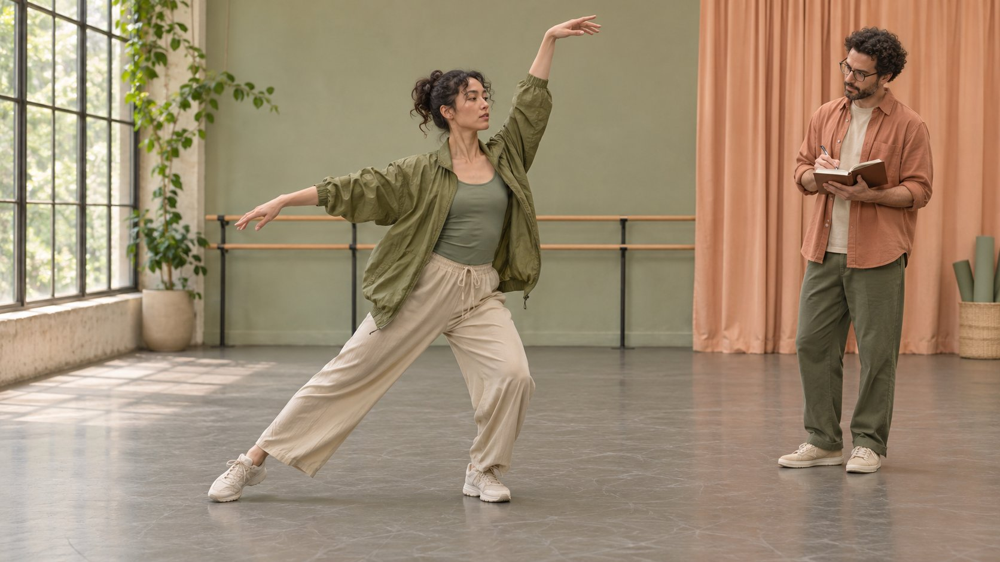

# 舞者合作：从动作要求到制作Brief

状态：本地审阅稿；正式发布日期待确认。

把舞者的表演、原创编舞和教学任务拆开，给选人、拍摄和授权一个可验收的工作范围。

AI 生成的编辑示意图，不是真实达人、客户、产品或活动。

找舞者合作时，先决定观众需要看见什么动作、从哪个角度看，再明确谁负责表演、编舞和教学。把动作、服装、场地、重拍及使用权写进同一份Brief。假设品牌要展示轻量外套穿着时的活动空间，可以安排跨步、转身、抬臂的连续镜头，并保留一条没有转场的全身画面。让观众看到肩线和下摆在该次试穿中的表现，避免从一次演出推断所有尺码或运动场景。

## 先拆开表演、编舞和教学

表演者按已约定的动作完成可重复的镜头。编舞者要解决动作衔接、节奏与队形，同时交代哪些段落来自既有作品。教学型创作者还要设计逐步示范、口令、速度和镜像方向。一个人可以承担三项，报价里应逐项列出交付件和修订轮次。例如，既要成片又要观众照着做，就要求正常速度的连续画面、慢速分解和针对左右脚的口令。只拍转场时只买需要的制作工作。用[实用的合作简报](https://www.quickkol.com/zh/blog/write-a-useful-campaign-brief/#answer)对齐动作目标与片长。拍摄中临时追加双人队形时，也要把排练、第二位表演者和交付日期一并调整。

## 试拍要验证镜头任务

先看与本次任务接近的公开作品，按脚位可见性、转身后服装的位置和口令清晰度记下时间点。把镜头控制拆成可以观察的行为，比如在固定地面标记处落脚，正侧两个角度速度一致，或口令先于动作。需要额外试拍时说明用途、报酬、截止日和删档安排。候选人可以用相近服装展示连续动作，品牌应同时交代场地宽度、地面条件和预计连拍次数。检查一个动作被遮挡的原因是取景、服装还是动作方向，再决定要补哪个角度。

## 用分镜把动作和产品证据连起来

把关键动作写成动词并标记开头、结束和可见部位。以外套为例，拍三秒站姿、连续抬臂转身、落地后停一拍。摄影者先锁定全身，再拍肩缝或拉链的近景。记录衣服尺码、叠穿、光线和拍摄方向，避免剪接让不同条件看起来像一次连续测试。下摆移位或扣件被遮挡时，保留原片并记明原因。广告只谈该次镜头支持的观察结果。审核人在静音、手机竖屏和计划使用的其他裁切中各看一次，标记文字、脚或手离开安全区的时点。

## 在排练前确认地面、速度和边界

在排练通知写清楚场地大小、地板、鞋、道具、机位和谁可以要求停拍。由舞者提出当日能稳定完成的速度和动作幅度，制作方安排休息和更换动作的预案。需要人托举、碰撞或高冲击落地时，应在约定工作范围与合适场地确定后再排练。双人节目提前说明接触点与替代版本。现场把重拍原因分为脚位、声音、光线、服装、品牌标识和动作安全，避免同一个人反复承担所有错误。

## 把音乐、编舞与影像授权分开

[美国版权局舞蹈编排说明](https://www.copyright.gov/circs/circ52.pdf)区分可能获得版权保护且已固定的连贯舞蹈编排，与常见舞步或简单例行组合。美国规则与其他市场可能不同，需要确认具体来源与使用地区。音乐和表演影像单独核验。在镜头表写下动作来自委托编舞、既有作品还是临场动作，并列清署名、可否剪辑、媒体、时长、地域及续期。[TikTok商业音乐说明](https://support.tiktok.com/en/business-and-creator/creator-and-business-accounts/commercial-use-of-music-on-tiktok)建议推广内容使用平台商用音乐库。要把同一素材剪成其他平台广告时，再查相应音乐许可。用[创作者素材权利说明](https://www.quickkol.com/zh/blog/creator-raw-footage-rights/#answer)明确原始视频可交付、保存和使用的范围。

## 用字幕与画面分别传达信息

把必须看见的动作、必须听见的口令和辅助节拍分开。[W3C字幕指南](https://www.w3.org/WAI/media/av/captions/)把关键非语言音频也纳入字幕考虑。若落脚声决定动作时机，可在字幕中标注，但不要盖住脚；字幕可以在镜头切换前给出方向。教学视频还要先说明画面是否镜像。先按静音看一次，再打开声音复核是否对拍。商业内容按[TikTok商业披露说明](https://support.tiktok.com/en/business-and-creator/creator-and-business-accounts/promoting-a-brand-product-or-service)处理，品牌身份及合作关系要在发布时可辨认。品牌改稿时用同一时间码记录字幕位置、声音版本和动作修订，避免批准了一条片却误传另一条。

## 按用途验收交付件

交接表按版本列出宽镜头、主片、无字幕母版、字幕文件和原片。每条写明用在哪、谁确认、何时到期，以及剪成广告前还需谁批准。假设品牌收到12秒竖版，但抬臂时手腕被裁掉。先看被裁掉的部位是否影响关键证据，再决定重新构图或补拍。若需要多国字幕，从已批准的口令稿翻译，核对计数、方向和专业术语。上线后，把素材是否满足Brief与流量和购买表现分开复盘，并把下一次要验证的动作交回给制作负责人。

## 把备用镜头和追加费用写入排期

签约前由制片把排练、转场、换装、留给摄影设置的时间和客户远程审片分列。动作复杂时，可将一个固定全景作为底片，团队拍到可接受的完整表演后再追求近景和不同灯光。假设场地在下午有另一档预约，约定在关闭时间前多久停拍，以及改期要确认的场地、摄影和舞者费用。备用镜头仍需满足原目的。比如连贯转身是产品说明的一部分，减小角度可检验动作是否仍清晰。若换成只有静止特写，就应把原稿中关于动态表现的句子删掉。当天给每个版本加上准确的条件和状态，不将未验收的素材标记为可用。

## 舞者合作镜头验收表

| 任务 | 验收证据 | 需记录的限制 |
| --- | --- | --- |
| 连续抬臂与转身 | 全身、肩线与下摆同框 | 样衣尺码及叠穿 |
| 教学分解 | 慢速动作、方向和口令同步 | 镜像或同侧示范 |
| 广告改剪 | 音乐、编舞和素材许可对应版本 | 媒体、期限、地区 |

表中是编辑建议。按动作复杂度和实际用途调整。

## 舞者合作拍摄清单

排练前由制片和表演者一起确认。

- [ ] 列清表演、编舞和教学工作量。
- [ ] 写清关键动作及需要看见的部位。
- [ ] 锁定场地、鞋、休息安排和替代动作。
- [ ] 逐项记录音乐、编舞和素材的许可。
- [ ] 复核最终画幅、字幕、披露与版本。

## 研究日期与使用边界

资料核验于 2026 年 11 月 5 日。文中方法、表格和决策规则为编辑建议，标为假设的示例不是实际客户结果或行业基准。外部资料的适用地区与时期按各段说明；本稿处于独立本地审阅阶段，正式发布日期待确认。

## 用清楚的任务开始达人研究

用 QuickKOL 理解 Brief、发现相关达人并研究作品与联系路径；数据、合作条件和结果仍需核验。

[了解 QuickKOL](https://www.quickkol.com/#capabilities)

## 来源

- [美国版权局舞蹈编排说明](https://www.copyright.gov/circs/circ52.pdf)
- [TikTok商业音乐说明](https://support.tiktok.com/en/business-and-creator/creator-and-business-accounts/commercial-use-of-music-on-tiktok)
- [W3C字幕指南](https://www.w3.org/WAI/media/av/captions/)
- [TikTok商业披露说明](https://support.tiktok.com/en/business-and-creator/creator-and-business-accounts/promoting-a-brand-product-or-service)
