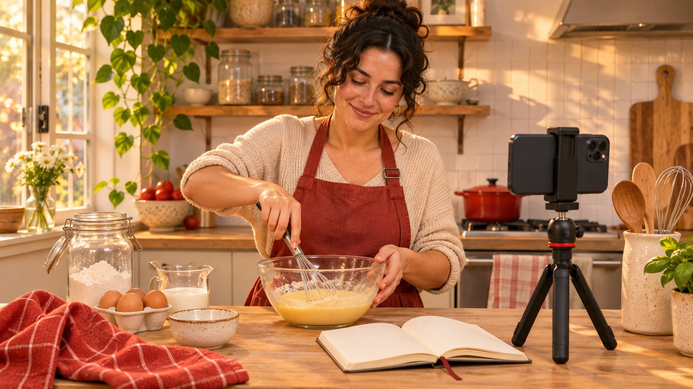

# Free TikTok Followers: Build a Reason to Follow

Status: local review draft; confirm the publication date before release.

Use a zero-media-budget TikTok publishing experiment to learn why viewers choose to follow and whether the interest lasts.

AI-generated editorial illustration, not an actual creator, client, product or event.

To earn TikTok followers without buying them, start a repeatable series that gives people a reason to return. Publish with the equipment you already have, record production time and observe organic reach, profile visits, follows and subsequent posts. Keep paid promotion separate from organic distribution. For an offer promising free TikTok followers, check the claimed source, access requested and platform policy before engaging. A single growth number cannot establish an account’s authenticity.

## Give viewers a concrete reason to follow

Pick a problem viewers encounter more than once and make the series promise concrete in one sentence. Imagine a small baking account explaining a different use or care question about the same tool each week. The first video addresses sticky dough, the second shows cleanup and the third compares two storage setups. Each video answers a complete question and accurately previews what the next one will cover. Open with the problem or the result and tie the follow invitation to the next useful topic. Keep the series name consistent on the profile so an interested visitor can find the previous episode. Ask whether the production team can maintain the same standard next month before adding elaborate props and transitions to the first episode. Use the [useful campaign brief](https://www.quickkol.com/blog/write-a-useful-campaign-brief/#answer) to define the viewer question and production commitment. If the first run covers people in a small kitchen, make that context clear. They can recognize the relevance before they have to evaluate the account as a whole. The team can then plan episodes around the questions those viewers actually ask.

## Track what zero media spend actually costs

List the phone, lighting, props, scripting, production, moderation and review as existing or incremental costs. Measure the time from the production log. A campaign can have zero paid media spend while using significant labor. For a two-week pilot, plan only as many topics as the team can film consistently, with time to respond to viewer questions. If there are four hours available, test how much editing follows one shared shoot before promising daily releases. Leave capacity for accessible captions or an additional review. If the brand later pays to promote one episode, record its start, objective, spend and results separately and mark the affected observation window. This allows a later editor to identify what the organic experiment can still teach. One team member can track actual labor in a simple weekly sheet with planning, recording, editing and reply work on separate lines. At the review, compare those costs with useful viewer questions and repeatable production. A series that generates modest interest and is sustainable may be worth extending while a complicated spike is harder to reproduce.

## Find the next topic in relevant questions

The [TikTok recommendation guide](https://www.tiktok.com/support/faq_detail?id=7655285288050104852&category=web_account) describes inputs such as user interactions, content information and user information, with weighting that can vary by surface. Make the subject and use case legible, then look for a useful next episode in related comments and search signals. The [TikTok Creative Center Trends guide](https://ads.tiktok.com/resources/help/article/how-to-use-trends?lang=en-GB) explains how to inspect trends for a region and window. Use that information to generate a testable topic. A popular tag that has no connection to the footage gives the editor little to learn about audience fit. Classify questions as requests for instructions, misunderstandings, price or another project-relevant group. Pick a question the team can answer with a reliable demonstration. A comment establishes what was asked, and it may give direction for the next edit. It cannot identify which viewer later chose to follow or why. Suppose people ask how to clean the tool, while a wider trend centers on unrelated recipes. Film the cleanup response and compare the kinds of questions it attracts with the earlier video. Record the prompt and timing so that another person can review what changed.

## Compare episodes at the same age

Decide the check-in age, source account and organic scope before the first post. Record the topic, release date, distribution source, views or reach, profile visits, attributable follows where available and any promotion. A post-level follows field and daily net growth for an account measure different things. Use the [creator campaign measurement guide](https://www.quickkol.com/blog/creator-campaign-measurement/#answer) to note the source and denominator for each row. Keep the full-account change separate from any result attributed to a video. If videos A and B were published on Monday and Friday, compare them at the same age while retaining day of week as a possible difference. Leave unavailable fields open with a clear note about why. If a teammate captures the account total three days later than planned, log the actual date rather than entering the number into the planned window. A useful first report can show the main comparable rows and a second group for exploratory observations. Review whether the account and topic stayed similar enough for the comparison, and mark any major change that would matter to the next test.

## Read volume and rate in a hypothetical example

Suppose two tutorials use the same post reporting surface and seven-day observation window. They show 1,200 and 600 reported views, with 18 and 15 post-attributed follows, respectively. If the dashboard actually provides both fields at that scope, division yields about 1.5 and 2.5 follows per 100 views. A generated more follows in total and B had a higher ratio in this sample. A view event is distinct from a person, so the ratio cannot establish an individual follow probability. The numbers also leave timing, topic and traffic mix open as explanations. To learn which creative choice matters, choose the difference you can reproduce and test it with comparable topics. Keep comments and later episode performance as separate evidence. If a post reports views while the available follows figure comes from the whole account, drop the post-level calculation and preserve the account number in the correct column. Hypothetical figures illustrate arithmetic only. They do not predict a new account’s expected growth, and a small change in the numerator can move a small-sample ratio substantially.

## Evaluate the source behind an offer

Ask whether the offer is for content planning and editing or claims to add followers through an undisclosed source. If it requests a password, sign-in code or unclear app permission, use the official account surface to review access. The [TikTok deceptive behavior overview](https://newsroom.tiktok.com/how-tiktok-counters-deceptive-behaviour?lang=en-150) describes how the platform approaches fake engagement. A platform rule is useful context for assessing an offer. It cannot prove that an individual account or growth curve was manipulated. Use factual reporting language such as missing distribution data or paid promotion running in the same period. Keep unresolved claims open and avoid attributing intent from a trend line. Suppose a teammate forwards a screenshot offering a guaranteed quantity without explaining acquisition. You can record that the claim lacks a verifiable source and decline to use the screenshot as campaign evidence. That conclusion concerns the evidence provided. If a past team shared access, have the account owner check connections and security in the official app. Record any verified change with the relevant owner and avoid circulating credentials in the production file.

## Check whether there is a reason to return

Give the second round a decision, such as whether to continue promising a weekly answer to a recurring question. Profile visits, questions about a follow-up, repeat discussion themes and later post data describe different parts of the audience response. They do not identify a cohort unless the reporting surface actually provides one at that scope. Use aggregates and questions the team is allowed to retain. Suppose follows increase, but many people mistake the next installment for an ad and stop discussing the topic. Review the preview language, publishing schedule and actual post before inferring why. Mark which episodes are part of the organic pilot. At the end, decide to continue, revise the series promise or stop. Record one concrete reason and how the next episode will check it. For example, change the final cue from a broad follow request to a specific invitation to see a storage test next week. Keep the subject comparable and watch whether more viewers ask about the relevant use case.

## Give the next round a measurable starting point

Close the pilot with an observation, an open question and one next change. If several comments ask about cleaning, summarize the question in the next brief and schedule an episode that can actually show the cleaning steps. Keep the observation window and definitions comparable. Hand over production time and moderation load so the next producer can schedule the work. The team can learn from a useful content response even when the account adds few followers. Record what viewers understood and which parts of the production process the next team can repeat.

## Flag changes you cannot repeat

If the first installment coincides with a store opening or a mention from another account, record the external activity and timing. An aligned window helps with comparison while leaving the context difference visible. Review the episode affected by the event separately from those published under steadier conditions. In the next test, change one choice in the hook or closing cue and keep the subject and observation window comparable. Give the next editor the question to retest and preserve both the plan and the actual cut. If a later jump again coincides with an outside event, repeat the measurement with another episode before estimating what the format can deliver on its own. Record unknown sources as unknown in the report.

## Organic follow learning log

| Record | Source | Purpose |
| --- | --- | --- |
| Window and effort | Post and production log | Check comparability and effort |
| Post and account data | Authorized account aggregates | Distinguish post follows and net change |
| Promotion and events | Media and event log | Mark mixed windows |

Align definitions. The hypothetical example is not a benchmark.

## Organic follow experiment checklist

Set the observation plan before publishing.

- [ ] Choose a recurring viewer question.
- [ ] Track filming, editing and reply time.
- [ ] Agree on a fixed observation window.
- [ ] Log promotion separately.
- [ ] Choose one change to test next.

## Research date and limitations

Sources reviewed November 5, 2026. Methods, tables and decision rules are editorial recommendations. Hypothetical examples are not actual client results or industry benchmarks. Source geography and periods are specified where relevant. This draft is in independent local review; confirm its publication date before release.

## Learn from verifiable observations

Record follows, views, profile visits and audience questions separately before planning the next episode.

[Read the measurement guide](https://www.quickkol.com/blog/creator-campaign-measurement/)

## Sources

- [TikTok recommendation guide](https://www.tiktok.com/support/faq_detail?id=7655285288050104852&category=web_account)
- [TikTok Creative Center Trends guide](https://ads.tiktok.com/resources/help/article/how-to-use-trends?lang=en-GB)
- [TikTok deceptive behavior overview](https://newsroom.tiktok.com/how-tiktok-counters-deceptive-behaviour?lang=en-150)
