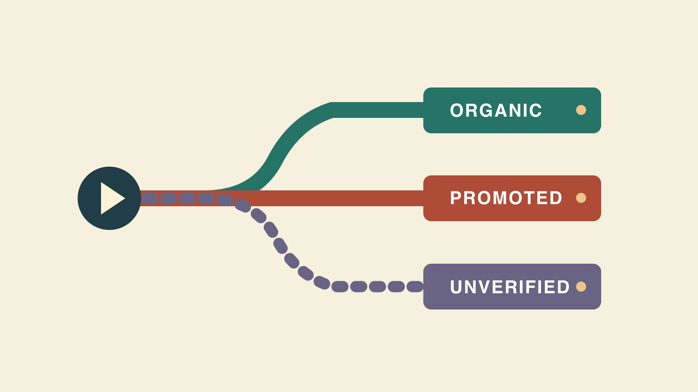

# Free TikTok Views: Understand Sources and Tradeoffs

Status: local review draft; confirm the publication date before release.

Use the free TikTok views question to distinguish organic discovery, paid promotion and views of unverified origin.

QuickKOL editorial graphic; not actual account metrics or a platform interface.

For TikTok views without media spend, run an organic test around a specific viewer question. Record video results at the same observation age and include production cost. TikTok Promote is an advertising tool, so track its delivery separately. For offers of free views, verify the source and requested access before including the counts in an organic report. A view event is distinct from a unique viewer and cannot by itself establish interest, sales or manipulation.

## Define the cost the word free refers to

Separate media spend from scripting, equipment, props, editing, captions and comment work. A team can publish with no ad budget and still spend production hours. Imagine a small team with three hours available for the week. It can use an existing phone to film two posts about questions viewers ask about the same product. Record actual time and retakes before deciding whether the results justify another batch. Use [a useful creator brief](https://www.quickkol.com/blog/write-a-useful-campaign-brief/#answer) to give each post one specific purpose, such as explaining when a filter needs replacement. If a campaign uses ad credit, record the delivery as paid and note how the media cost was funded. The underlying source of distribution is still advertising. A production estimate can show that one format uses more review time even when both videos receive similar view counts. Record why the difference arose, such as an extra shoot or language review. This gives the brand a defensible basis for choosing a repeatable format without equating an unpaid view with a costless one.

## Test organic viewing with a repeatable change

The [TikTok recommendation guide](https://www.tiktok.com/support/faq_detail?id=7655285288050104852&category=web_account) describes inputs such as user interactions, content and user information, with weighting that varies by surface. Use a clear opening and a visible action to answer the viewer’s question, then choose one change to test. For example, both posts can demonstrate a filter change in similar footage and runtimes. One opens with the problem and the other opens with the result. Record publication time, visuals, audio, caption and known outside sharing. Choose a fixed post age for reviewing the same metric. A small sample helps plan the next edit but does not establish a universal platform rule. To get more useful observations, write down what you expect the different openings to change. A problem-first hook might generate relevant questions while a result-first edit might attract quick viewing. Compare those outcomes separately if data is available. If the team changes topic and runtime as well as the hook, call it a comparison of two versions and narrow the causal claim. Repeat a promising change on another relevant topic before using it as a default.

## Give Promote its own objective, budget and window

[TikTok Promote documentation](https://ads.tiktok.com/resources/help/article/about-promote-on-tiktok?lang=en) describes Promote as an in-app advertising tool for videos and LIVE, with different campaign goals. Record the campaign ID, timing, audience, objective, budget, reporting surface and owner. If a post begins organically and is promoted later, preserve the last pre-promotion observation and the reporting window during promotion. Use a same-scope organic and paid breakdown when the reporting surface provides one. Otherwise label the total as mixed. Subtracting a paid number from a public counter yields a defensible organic figure only if definitions, time windows and exclusions align. Suppose the post’s public counter updates more slowly than the campaign export. A negative difference could be an alignment issue. Keep the underlying numbers and check their sources before publishing a subtraction. Record a second observation if the team needs a later reconciliation. If a brand tested two hooks and promoted only one, keep the pre-promotion comparison separate and label the promoted window so editors can see what each result actually represents.

## Verify where a third-party offer says views come from

When someone offers free views, ask whether they mean creative services, official ad credit, ordinary distribution or a view source they will not disclose. Keep account credentials and sign-in codes with the account owner. Use the platform’s official controls to review access. The [TikTok deceptive behavior overview](https://newsroom.tiktok.com/how-tiktok-counters-deceptive-behaviour?lang=en-150) describes how TikTok addresses fake engagement and deception. It can inform a policy check without establishing a violation by a specific account or vendor. Record that an offer did not supply a verifiable traffic source when that is what you observed. Exclude unsupported figures from claims while the source remains open. If the offer is for content editing, verify the service scope and assess the resulting post from its own data. If a teammate describes an unexplained spike, check publication timing, known shares, ads and changes in reporting before attaching a cause. A source review can close with a decision about whether a number belongs in the report. It does not require a public verdict about a person.

## Read the exact metric and observation window

[TikTok ad video play definitions](https://ads.tiktok.com/resources/help/article/video-play?lang=en-0) distinguish starts, two-second views, six-second views and other ad measures. A public post, promotion report and ad account can all display fields that look like views while counting different events. Record the surface, full label, reporting window and repeat or paid scope. Use the [creator campaign measurement guide](https://www.quickkol.com/blog/creator-campaign-measurement/#answer) to decide what is comparable. If A has 1,500 public views after one day and B has 2,000 after a week, the two observations cannot establish a stronger opening for B. Capture the next pair at the same age and keep paid reporting separate. A buyer who wants to know whether a demonstration held attention may need a more appropriate viewing measure than starts. An editor who needs a quick sense of distribution can keep the public view count in its own column. If the available export does not state whether repeat playback is included, mark the definition unresolved and use narrower wording. A clear source note lets another person read the report without interpreting every occurrence of the word views the same way.

## Connect views to a decision in a hypothetical pilot

Imagine A records 3,000 views and five relevant questions while B records 1,900 views and twenty-one questions. Both use a seven-day organic window, and one reviewer classifies questions with the same rule. A has more views and B produces more questions the team can answer. A service team updating an FAQ may start from B. A team testing exposure can retest A’s opening under similar conditions. Neither result proves that one format will always perform better. If the brand promotes A later, label that activity in a different window. The example illustrates how to make a decision from more than one observation. Also check whether the same user can ask several questions or whether comments include duplicates. If the report counts messages, keep the unit as messages. A short review can quote the themes without exposing personal details. Put the post versions and the definition of relevant in the record before repeating the trial. That gives the next reviewer the same starting point.

## Decide whether to continue, revise or wait

Close the pilot with what was observed, what still needs verification and the one change to make next. If people ask about the direction of an action, add a right-side angle in the follow-up and keep the observation window. If the view source is unknown, keep it out of any organic claim and avoid attributing manipulation without evidence. Route an asset or account setting issue to the person authorized to review it. Record the owner and timing, and keep the learning project separate from any procurement decision. Preserve the final versions and dates so another editor can compare creative and distribution changes. A change log might show an edit, a platform promotion and a retailer mention happened on three different days. Keep those facts distinct. If the activity is too mixed to identify a useful comparison, run a smaller test with the distribution plan specified in advance. The decision can be to wait for a properly scoped report before spending more.

## Assign the follow-up before release

Before release, assign who collects each metric and at what age, who logs promotion and how missing figures are labeled. When a post behaves differently than expected, check the reporting definition and published version before proposing an explanation. This keeps the review from changing the success criterion after seeing the result. If the first report raises a question about the source, mark a date and owner for the follow-up. Publish the decision with the evidence available at the time and revise it only when the source is established.

## Preserve source status when a report is updated

Suppose the team first receives a public counter screenshot and the media owner sends campaign dates several days later. Add the actual observation time to the earlier screenshot and preserve the number it showed. Mark whether it covers any paid window and attach the corresponding campaign report. Where a reliable breakdown is unavailable, label the number mixed. For a follow-up, reserve one clearly organic observation window and agree when the data will be collected. Change the classification only when reliable distribution evidence supports it. If the updated report has already been shared internally, give the recipient the revised scope and identify any affected comparison. A useful revision says the original figure combined multiple sources and can still describe the public counter at that time. It should also explain which decision now needs better data. Keep the two dates visible because a later extract can include more events without contradicting the first one. If the team reruns the test, give each creative version and delivery route a unique row.

## TikTok view source checks

| Source | Evidence | Reporting scope |
| --- | --- | --- |
| Organic test | Post, observation window and labor | Log known external sharing |
| Paid Promote | Campaign ID, dates, objective and budget | Separate ad results |
| Unknown source | Record claim, access and open questions | Exclude from verified organic results |

Examples are hypothetical and do not establish traffic or outcome expectations.

## TikTok view learning checklist

Start with a content question and collect evidence for it.

- [ ] Define zero media spend and production effort.
- [ ] Compare posts at the same age.
- [ ] Keep a separate Promote record.
- [ ] Keep unknown sources open.
- [ ] Choose one change to retest.

## Research date and limitations

Sources reviewed November 5, 2026. Methods, tables and decision rules are editorial recommendations. Hypothetical examples are not actual client results or industry benchmarks. Source geography and periods are specified where relevant. This draft is in independent local review; confirm its publication date before release.

## Learn to read views by source

Define the reporting surface and observation window before deciding what to film next.

[Read the measurement guide](https://www.quickkol.com/blog/creator-campaign-measurement/)

## Sources

- [TikTok recommendation guide](https://www.tiktok.com/support/faq_detail?id=7655285288050104852&category=web_account)
- [TikTok Promote documentation](https://ads.tiktok.com/resources/help/article/about-promote-on-tiktok?lang=en)
- [TikTok deceptive behavior overview](https://newsroom.tiktok.com/how-tiktok-counters-deceptive-behaviour?lang=en-150)
- [TikTok ad video play definitions](https://ads.tiktok.com/resources/help/article/video-play?lang=en-0)
