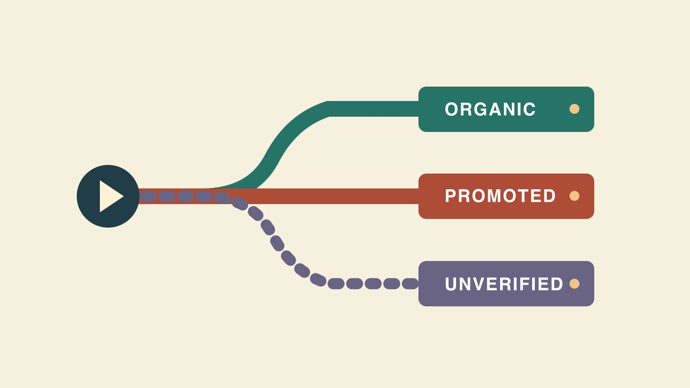

# 免费TikTok播放量：分清来源和代价

状态：本地审阅稿；正式发布日期待确认。

用免费 TikTok 播放量的搜索问题学习自然分发、付费推广和来源不明的播放该如何分别记账。

QuickKOL 编辑图形；不呈现真实账号指标或平台界面。

如果你想获得无需付媒体费用的 TikTok 播放量，可以发布一个面向明确问题的自然内容试验，记录同一窗口内的视频表现和创作成本。TikTok Promote 是广告工具，产生的付费分发另记。看到承诺免费播放的服务时，先核实播放来源和访问权限，避免把来源不明的数据混进自然结果。播放事件不等于独立观看者，也不能单独证明真实兴趣、销量或账号造假。

## 明确免费指的是哪项成本

先区分媒体费用、创作工时、拍摄设备、道具、剪辑、字幕和评论管理。零投放预算仍需要有人完成创作和发布。假设一个小团队一周有三小时，可用现有手机为同一产品录两条回答不同问题的帖子。记录实际用时和重拍，避免看到高播放就忽略成本。用[实用创作者简报](https://www.quickkol.com/zh/blog/write-a-useful-campaign-brief/#answer)给每条片设一个清楚目标，例如何时需要换滤芯。若收到广告额度，也按付费分发记账，另外说明实际结算或抵扣方式。

## 用可重复的改动测试自然播放

[TikTok推荐说明](https://www.tiktok.com/support/faq_detail?id=7655285288050104852&category=web_account)描述用户互动、内容和用户信息等推荐因素，权重会随入口变化。用清楚的开场和能验证的动作回应观众问题，再选择一个变量试验。例如两条片都演示换滤芯，用同一镜头与相近长度，一条先展示问题，一条先展示动作结果。记录帖子时间、画面、语音、说明和是否有外部转发。不要只用无关标签追逐短期曝光。确定在发布后第几天读同一指标，并说明内容样本少不能推断平台规律。

## Promote 应单列预算、目标和窗口

[TikTok Promote官方说明](https://ads.tiktok.com/resources/help/article/about-promote-on-tiktok?lang=en)将 Promote 定义为应用内广告工具，可按不同目标推广视频或直播。团队使用时，记录活动编号、起止、受众、目标、预算、报告和负责账号。若一条帖子先自然发布，后面开始付费，把起投之前的观测与投放期间分别保存。平台若能提供相同范围的自然和付费拆分，则用对应字段。只有混合总数时按混合报告。不要用累计播放减付费报表一个相似数字就称为准确自然播放，除非两者定义、窗口和排除规则都能对齐。

## 先确认第三方承诺的来源和权限

收到免费播放承诺时，先问它是内容服务、平台投放额度、公开分享还是不说明来源的播放。要求登录凭证或验证码时，由账号负责人走官方入口，不把凭证交给服务。[TikTok反欺骗行为说明](https://newsroom.tiktok.com/how-tiktok-counters-deceptive-behaviour?lang=en-150)介绍平台对虚假互动和欺骗行为的治理。它说明需要注意的行为，不能证明某个账号或供应商有违规。团队可把报价写为“未提供可核对来源”，把会影响对外报告的指标先排除，等证据齐全再决定用途。

## 核对统计字段和时间年龄

[TikTok广告视频播放定义](https://ads.tiktok.com/resources/help/article/video-play?lang=en-0)区分广告起播、两秒、六秒等统计口径。自然帖子、推广面板和广告账户字段即使都叫播放，也可能计不同事件。记录界面、字段全名、统计窗口、币种及是否包含重复或有偿分发。用[创作者活动衡量指南](https://www.quickkol.com/zh/blog/creator-campaign-measurement/#answer)写清楚哪里可比。假设 A 在发布后一天有1,500次公开播放，B 在发布后一周有2,000次，不能用它证明 B 开场更好。下次在相同年龄采样，并为广告另留一行。

## 用假设试验把播放与实际用途连起来

假设 A 有3,000播放和5条相关问题，B 有1,900播放和21条相关问题。两者使用相同七天自然窗口，问题由同一个人按同一标准分类。A 播放多，B 带来更多可回答的细节。若目标是制作 FAQ，可优先从 B 的提问找下一条题材；若目标是可比曝光，可复测 A 开头但保留其他条件。不能用一个数据证明哪种视频一定更好。若之后给 A 加了推广，则按另一段记录。标明此算例只解释报告口径。

## 用证据判断继续、修正还是等待

复盘写三行：看到了什么、还需要确认什么、下一轮改哪一项。比如后半段出现许多有关操作方向的问题，下一条补拍右侧角度，并保留同一观察窗口。若播放来源未知，不把它当成新增自然触达，也不作造假结论。若是素材或账号设置问题，交给有权限的人核对。记录负责人和日期，把教育问题与账号采购决策分开。保留最终版本和时间，使下一轮能复查创意与分发两类变化。

## 发布前先定下一次检查

在活动表里约定谁在第几天取哪些数据，怎么记录推广时点和没有数据的原因。若帖子表现偏离预期，先核对报告口径和内容版本，再解释原因。这样不会在看到结果后更换成功标准。

## 更新报表时留住来源状态

假设团队先收到一张总播放截图，几天后广告负责人补了投放日期。先给旧截图补观察时点，保留它当时看到的数值。再标注是否覆盖投放，加入对应广告报告。若无法获得可靠拆分，将其标为混合，不回填一个假精确的自然播放。对后续复测保留一个从始至终未投放的观察段，预先约定在何时取数。团队只有在获得可核对的分发证据后，才调整报告归类。

## TikTok 播放来源核对

| 来源 | 核对 | 报告口径 |
| --- | --- | --- |
| 自然试验 | 实际帖子、窗口、创作时间 | 记录已知外部分享 |
| 平台推广 | 活动 ID、时间、目标和预算 | 独立广告结果 |
| 来源不明 | 记录说法、权限和未决点 | 不作为已确认自然流量 |

算例为假设，不能用于估算购买流量或保证结果。

## TikTok 播放学习清单

先确定内容问题，再收集对应证据。

- [ ] 定义零媒体预算及创作投入。
- [ ] 在相同发布年龄观察。
- [ ] 单独保存 Promote 记录。
- [ ] 保留来源不明的待核验状态。
- [ ] 选择下一条可测试的改动。

## 研究日期与使用边界

资料核验于 2026 年 11 月 5 日。文中方法、表格和决策规则为编辑建议，标为假设的示例不是实际客户结果或行业基准。外部资料的适用地区与时期按各段说明；本稿处于独立本地审阅阶段，正式发布日期待确认。

## 按来源理解播放结果

先明确平台字段和观察窗口，再用可靠证据判断下一步内容。

[查看活动衡量指南](https://www.quickkol.com/zh/blog/creator-campaign-measurement/)

## 来源

- [TikTok推荐说明](https://www.tiktok.com/support/faq_detail?id=7655285288050104852&category=web_account)
- [TikTok Promote官方说明](https://ads.tiktok.com/resources/help/article/about-promote-on-tiktok?lang=en)
- [TikTok反欺骗行为说明](https://newsroom.tiktok.com/how-tiktok-counters-deceptive-behaviour?lang=en-150)
- [TikTok广告视频播放定义](https://ads.tiktok.com/resources/help/article/video-play?lang=en-0)
