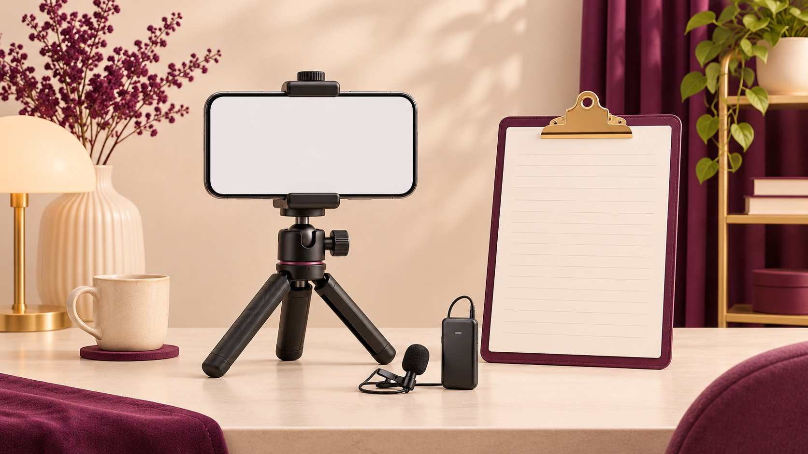

# How to Go Live on TikTok: Check Launch Readiness

Status: local review draft; confirm the publication date before release.

Confirm access on the account that will host the TikTok LIVE, then rehearse the room, moderators and fallback.

AI-generated editorial illustration, not an actual creator, client, product or event.

Sign in to the account that will host, tap the plus button in TikTok, find LIVE, set the title and options, then tap Go LIVE. TikTok says hosts must be at least 18 and lists 1,000 followers with regional variation. Have the host check access before advertising a date. For a brand broadcast, assign a chat moderator, confirm commercial disclosure and prepare a fallback for lost connectivity or unavailable LIVE access. Check Gifts eligibility separately when that feature matters.

## Check eligibility on the actual host account

The [TikTok LIVE eligibility and setup guide](https://www.tiktok.com/support/faq_detail?id=7543604790438451768) lists an age requirement, a region-dependent follower threshold and limited availability for LIVE and Gifts. Verify on the actual host’s account. A screenshot from a teammate establishes only what appeared for that teammate. Record the host handle, check date, operating market, device and control observed. If an age prompt appears, have the account holder use the official route. Keep identity documents out of the production chat. Treat hosting, Gifts and bringing on a guest as separate capabilities. The existence of a LIVE tab for viewers is also a different observation from the ability to start a stream. A marketer running two regional accounts can assign the rehearsal to the actual host instead of checking whichever profile is already signed in. Reserve the date with the production team and wait for an access check before publishing a viewer-facing announcement. Put a second check close to the broadcast so last-minute account or device changes reach the producer.

## Set up the broadcast before tapping Go LIVE

On the phone, tap the plus button and scroll through the creation modes to LIVE if needed. The [TikTok LIVE eligibility and setup guide](https://www.tiktok.com/support/faq_detail?id=7543604790438451768) puts the title, available tools and settings before the Go LIVE control. On the preview screen, have the host confirm the handle and title aloud. Check camera framing, microphone input, the visible background and any product identifiers. Leave a setup buffer before the advertised start. Reserve the public start for the real broadcast, or clearly label a separately scheduled public test. To close the broadcast, use End LIVE and confirm the ending in the app. A room may be ready before the account is ready, and the order matters when booking crew. Agree who decides that the phone is configured and who gives the go cue. For a livestream that spans markets, put the time zone in the production sheet and the viewer-facing announcement. Match the scheduled local time to the device clock so the crew can reconcile later screenshots.

## Rehearse the three minutes most likely to fail

Use the [creator live campaign runbook](https://www.quickkol.com/blog/creator-live-campaign-runbook/#answer) to agree on the opening, handoffs and close. Rehearse the first minutes offline and use a second device to see what viewers would see, including the product, text area and audio level. Ask the host to pick up the prop while delivering the key line so you can hear what happens when they turn away from the microphone. Simulate a lost microphone or late guest and agree on the signal to switch. Check backup power and a usable alternate connection. Turn off unrelated notification previews and keep the camera orientation stable. If a producer adds a product demonstration shortly before launch, check whether the shot and timing can support it. Rehearsal is a useful time to catch something that would be hard to correct in front of viewers, such as an unreadable package label or a quiet question from off camera. Log one issue, one owner and one time to retest each change so unresolved items stay visible before the go cue.

## Give the host and moderator different jobs

The host owns the performance and the moderator watches questions, abuse and broken or confusing links. Prepare the facts the host can repeat, issues that need a service handoff and circumstances that would justify stopping the demonstration. Test a cue channel the host can read without exposing it to viewers. Direct order numbers, addresses and other sensitive details to the approved service route. During the session, record the time of pinned information, product switches and unexpected incidents so someone can reconcile them against the replay and report. If the same question appears repeatedly, the host can pause to address it once and the moderator can record whether the information page needs an update. Give the moderator a short list of claims approved for use. For anything outside it, use a clear follow-up rather than improvising a promise about delivery or suitability. Assign one owner to close questions after the stream, with a public explanation only when the same answer belongs in front of everyone.

## Set commercial disclosure before launch

[TikTok commercial disclosure guidance](https://support.tiktok.com/en/business-and-creator/creator-and-business-accounts/promoting-a-brand-product-or-service) covers promotion of your own business and commercial content for a third party. In the mobile LIVE setup, check Content disclosure and select the option for the actual relationship before going live. Put the in-app setting and any planned spoken identification on the same launch checklist. Label any review capture with the account and version. Ask the brand to confirm the product, offer, eligible market and end time. If it plans to recut a replay into an ad, clear the footage, music, people and paid distribution separately. Use the [campaign brief template](https://www.quickkol.com/blog/write-a-useful-campaign-brief/#answer) to scope the new asset. A late offer change can affect the spoken script, a pinned comment and the link destination at once. Have one reviewer check all three against the approved facts so the livestream does not deliver conflicting instructions. Agree who saves the confirmed version of the disclosure and offer, and who records any change after the public start.

## Use the fallback if LIVE is unavailable

Confirm the account, device, region and app version when the LIVE option is missing. Use the [TikTok LIVE troubleshooting guide](https://support.tiktok.com/en/log-in-troubleshoot/troubleshooting/issues-with-tiktok-live) to check eligibility and follow the official issue-reporting route. Decide ahead of time whether the brand can accept a postponement, a cleared backup host or a recorded demonstration. A host switch can change permissions, script and disclosure. Suppose connectivity drops during the demonstration. The host and moderator agree when to try recovery and when to close the session, then give viewers a concise update through the agreed channel. Log original start time, return time, what was affected and what message the audience saw. Assign the landing page and any planned promotion to an owner who can update their status. A recorded replacement can preserve the useful demonstration while changing the customer experience, since live questions will arrive elsewhere. Make that route clear in the announcement and follow up through the service owner. Keep a copy of the version that actually went out with the incident notes.

## Reconcile the run and the report

Archive the account, title, actual timing, pauses, recurring questions and approved reuse scope. Keep session analytics and commercial claims separate. A session view count cannot identify everyone who watched a particular demonstration, and an order requires a source and measurement window. Compare the run log with moderation, service and purchase evidence to decide whether the next action is a clearer shot, an updated service note or a new session. If the host changed, keep both the plan and the executed version. Close the recap with an assigned change, such as verifying access before the date is public or putting one person in charge of the product link. Where a return after an outage created a second session, keep the two rows separate before aggregating them. Report the time basis and treat any deduplication as its own question. The next producer should be able to read the run log, see why the team took the fallback and reproduce the parts of the setup that worked.

## Test the action viewers should take

Write one viewer action into the launch sheet, such as asking a sizing question in chat or opening the approved product page through an available route. Test it from the perspective of someone who has none of the internal project material. Does the page the host describes match the link the operator shares? Does the destination agree on language, market and date? The camera preview helps check where a piece of text appears. The actual landing page still needs its own check. If the intended feature is unavailable to a viewer, record the fallback in the script and tell the moderator what to share. When an offer crosses time zones, name the time zone on the detail page and assign someone to retire the expired copy. A rehearsal may reveal the host is mentioning two links with different destinations. Decide which belongs in the opening, then put the other in a later segment or in the follow-up. A simple, accurate instruction makes it easier to understand what an audience member actually tried.

## Close the loop on off-camera work

Close with the follow-up that the team is ready to deliver. The moderator can hand off unresolved questions to service, and a reviewer can confirm which title, host and demonstration viewers actually saw. Record a later product change separately so an old replay does not appear to demonstrate a new version. If someone recuts the replay, record the source, edit and clearance. Keep aggregated evidence for the next launch decision. A production handoff can identify one question the host answered live, one issue service resolved later and one revision the producer needs before rebooking. That is enough to clarify which owner takes the next action without putting viewers’ personal details into the campaign record.

## LIVE launch gates

| Gate | Evidence | Owner |
| --- | --- | --- |
| Host account access | Log market and visible LIVE entry | Host |
| Setup and disclosure | Preview, audio and relationship | Producer |
| Fallback | Cleared alternate or recording | Operations lead |

Use this as a production check before the start.

## TikTok LIVE readiness checklist

Check eligibility before announcing and settings before the start.

- [ ] Confirm LIVE on the actual host account.
- [ ] Assign host, moderator and fallback communications.
- [ ] Rehearse audio, framing and a disconnect.
- [ ] Confirm disclosure, product details and start time.
- [ ] Archive the actual run and reporting definitions.

## Research date and limitations

Sources reviewed November 5, 2026. Methods, tables and decision rules are editorial recommendations. Hypothetical examples are not actual client results or industry benchmarks. Source geography and periods are specified where relevant. This draft is in independent local review; confirm its publication date before release.

## Start creator research with a clear task

Use QuickKOL to interpret a brief, discover relevant creators and research their work and contact routes. Verify data, commercial terms and outcomes at their source.

[Explore QuickKOL](https://www.quickkol.com/#capabilities)

## Sources

- [TikTok LIVE eligibility and setup guide](https://www.tiktok.com/support/faq_detail?id=7543604790438451768)
- [TikTok commercial disclosure guidance](https://support.tiktok.com/en/business-and-creator/creator-and-business-accounts/promoting-a-brand-product-or-service)
- [TikTok LIVE troubleshooting guide](https://support.tiktok.com/en/log-in-troubleshoot/troubleshooting/issues-with-tiktok-live)
