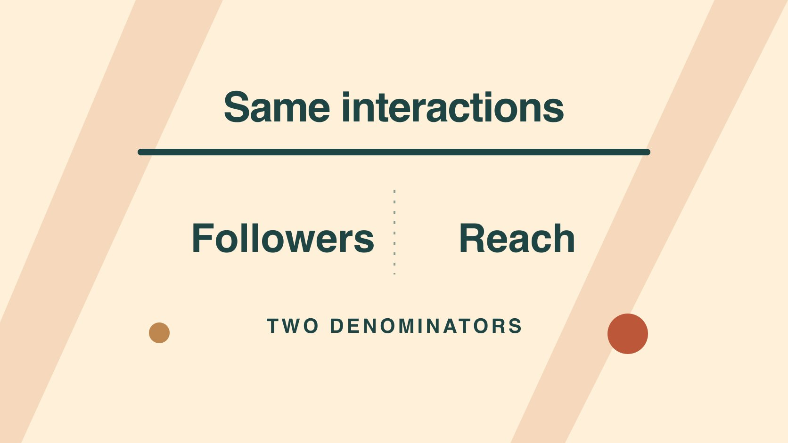

# Instagram Followers: Choose the Right Denominator

Status: local review draft; confirm the publication date before release.

Use the right denominator to explain what Instagram follower count, post reach and interaction rates each tell you.

QuickKOL editorial graphic; not actual account metrics or a platform interface.

An Instagram follower count is a stock of follows at one point in time. Reach describes distinct accounts reached by a post or within a reporting period, subject to the surface’s definition. Report interactions divided by followers and interactions divided by reach as separate measures with sources, scope and timing. To estimate the share of followers who saw a post, you need follower-only reach at the relevant scope. Total reach can include accounts outside the follower base.

## Start with the decision behind the figure

Keep a follower snapshot when the question is about account scale. Use actual post reach when reviewing how a published asset traveled. Read relevant replies, saves or visits when the decision concerns a viewer question. Write the report question in one sentence before requesting exports. Suppose the brand is choosing between another product demo and a service explainer. The follower count sets context while the content and audience response can inform the production choice. Use the [creator campaign measurement guide](https://www.quickkol.com/blog/creator-campaign-measurement/#answer) to agree on scope and relevant metrics. Give each observation a decision it can support instead of compressing different numbers into one account score. If the procurement form also asks for the follower count, include the date and keep that requirement separate. A reviewer may see that one post reached many accounts and still choose a narrower service video because the available feedback shows a concrete misunderstanding. Explain the decision and its source rather than assuming the largest count determines the next investment.

## Record the source and time of each snapshot

Record platform, profile, time zone, date, display precision and collection route together. The current follower count, month-end snapshot and 30-day net change are different fields. An abbreviated public label cannot be turned back into an exact value. Avoid attaching today’s count to an old post and presenting it as the audience at release. If you need the nearest dated historical observation, state how far it falls from the release date. Use a consistent time rule when comparing profiles. Snapshots on both sides of launch can explain why you chose one denominator. Their difference alone does not describe gross follows and unfollows. Suppose a profile shows 9.8k while the owner’s report has a more exact value from a prior day. Preserve the public string and the owner’s dated number separately. If exactness matters for a purchasing threshold, verify the required date and source. For the creative report, the exact count may be less important than keeping the same scope and showing when the observation was taken.

## Verify account and content scopes in the reporting surface

The [Meta Instagram API documentation](https://www.postman.com/meta/instagram/documentation/6yqw8pt/instagram-api) distinguishes professional account and authorized media and account access. The [Instagram creator best practices announcement](https://about.fb.com/news/2024/10/best-practices-education-hub-creators-instagram/) also describes guidance about reach and follower growth in the professional dashboard. For reporting, inspect the account’s actual definitions and separate distinct accounts reached by one post, account-level reach across a period and any repeat plays or displays. Adding reach across posts cannot deduplicate people who saw more than one post. Mark organic and paid data separately where the report supports it. Where a number combines them and you cannot separate the source, preserve the mixed scope. For example, a brand may send an account overview while an editor requests results for one sponsored Reel. Keep the account overview as context and ask the authorized owner for the post data. Also check the timezone and observation age. One month’s account number and a post’s first seven days can both be useful without belonging in the same formula.

## Calculate two different ratios from the same numerator

Suppose an account has 10,000 followers at the selected pre-launch observation, and a post reaches 4,000 accounts and records 120 selected interactions in seven days. Interactions divided by followers is 1.2 percent. Interactions divided by reach is 3 percent, or three actions per 100 accounts reached. The first scales the event total to account size at a given time. The second scales it to exposure at the post scope. If the numerator counts actions and a person can take more than one, the second ratio cannot identify the percentage of people who interacted. Use the [engagement rate formula metric contract](https://www.quickkol.com/blog/engagement-rate-formula-metric-contract/#answer) to define included actions and whether results are organic, paid or combined. If the historical snapshot is missing, omit the follower-based ratio or label a defensible substitute. Put both counts and dates under the calculation. In the hypothetical, a Reel’s views might be 6,500 as well. That would support a different per-view measure and would not change either of the two reported denominators.

## Use follower-only reach for follower coverage

Imagine the report splits 4,000 reached accounts into 1,500 followers and 2,500 non-followers for the same post and observation window. Relative to a pre-launch snapshot of 10,000 followers, the follower reach is equivalent to about 15 percent of that reference count. People can follow or unfollow in the interim, so the ratio does not prove that exactly 15 percent of the fixed starting cohort saw the post. If the report supplies only total reach, a figure of 4,000 cannot establish that 40 percent of followers saw it. Interactions may also come from outside the follower base. Keep the breakdown unavailable when the surface does not expose it. A team choosing whether to produce a more introductory edit might use the non-follower split as one clue and read relevant comments for context. It should preserve what the export says about classification and time. Even with the split, the report does not reveal each viewer’s previous relationship with the brand.

## Compare accounts only after aligning content and windows

The [Meta content ranking explanation](https://about.fb.com/news/2023/06/how-ai-ranks-content-on-facebook-and-instagram/) describes different distribution surfaces, including Feed, Stories and Reels. Group comparisons by format, purpose, market, post age and paid scope. A seven-day organic Reel and a 30-day Stories aggregate including ads cannot support a clean ranking. Request comparable reporting or show both with their limits. Within a consistent group, consider a median and sample count and preserve context for outliers such as an outside mention. A small sample can help pick a follow-up test without establishing a fixed benchmark. If a team intentionally compares formats, name what else differs and decide what the experiment can control. For example, a branded Reel and an evergreen organic tip may use a similar topic while serving different goals. If the question is how to explain a particular action, review examples with that action and the same reporting window. Be explicit if you are comparing efficiency, volume or audience composition. The same observations may favor different choices under those questions.

## Finish with an observation, limit and decision

A review could say that the post reached 4,000 accounts in its first seven days and recorded 120 actions. These aggregates leave individual retention and the exact coverage of a fixed follower cohort unresolved. The next version can keep the window, add a close-up and track questions about the detail. Hand over the raw labels, formula, observation date, market, known exceptions and reviewer. Where reach is unavailable, a follower denominator can be reported as a different measure with its own name. If an export arrives late or changes a figure, preserve the previous observation and date before appending the revision. This makes it easier for procurement and creative teams to use the same source without asking it to do the same job. A report owner can show what improved after the edit and keep open any question the data could not answer. Define the next check in the brief so a reviewer can reproduce it without relying on the previous analyst’s memory.

## Keep missing values and edge cases visible

Leave a ratio undefined when its denominator is zero or missing. If the interaction count includes late reporting, record the refresh time. If paid activity began during the post window, note when it started. Give the next reviewer a way to distinguish observations, assumptions and decisions in one record. If a report uses rounded percentages, preserve the underlying counts so the ratio can be reproduced. Make corrections at the source row and rerun dependent calculations so a client deck does not keep a stale value.

## Repair the business question when the denominator changes

Suppose last week’s deck divided by followers but called the result engagement by reach. First determine whether both counts exist for the same post and relevant observation windows. If they do, recompute each measure and correct the older label. Identify which prior conclusion may change. For example, a recut decision may have depended on actions per hundred accounts reached. If the old report only used follower totals, it cannot recover post reach from the ratio. Wait for the correct data or narrow the conclusion. In the next report, retain both rows so procurement can use the dated account scale and editors can use observed exposure. Put units and scope next to the figures rather than relying on a separate glossary. If the change affects a benchmark chart, state whether you recalculated the historical points or began a new series. The next analyst needs to know if a jump reflects a new denominator, different content or a reporting revision. When you share the correction, describe the old label, the revised calculation and which decision needs another look. Keep the old snapshot and the updated version together in the review record so the account team can reconstruct what was known at the time.

## Follower and reach denominators

| Denominator | Question | Record |
| --- | --- | --- |
| Follower snapshot | Actions relative to account scale | Account, date and precision |
| Post reach | Actions per account reached | Post, window and paid scope |
| Comparable follower base | Follower reach relative to base | Follower-only reach for the same scope |

Figures are hypothetical. Use the actual source definitions.

## Instagram denominator checklist

Write the unit and time in the report before calculating.

- [ ] Date the follower snapshot.
- [ ] Confirm reach scope and deduplication.
- [ ] Separate events from people.
- [ ] Record organic and paid scope.
- [ ] Assign the next check for open items.

## Research date and limitations

Sources reviewed November 5, 2026. Methods, tables and decision rules are editorial recommendations. Hypothetical examples are not actual client results or industry benchmarks. Source geography and periods are specified where relevant. This draft is in independent local review; confirm its publication date before release.

## Start creator research with a clear task

Use QuickKOL to interpret a brief, discover relevant creators and research their work and contact routes. Verify data, commercial terms and outcomes at their source.

[Explore QuickKOL](https://www.quickkol.com/#capabilities)

## Sources

- [Meta Instagram API documentation](https://www.postman.com/meta/instagram/documentation/6yqw8pt/instagram-api)
- [Instagram creator best practices announcement](https://about.fb.com/news/2024/10/best-practices-education-hub-creators-instagram/)
- [Meta content ranking explanation](https://about.fb.com/news/2023/06/how-ai-ranks-content-on-facebook-and-instagram/)
