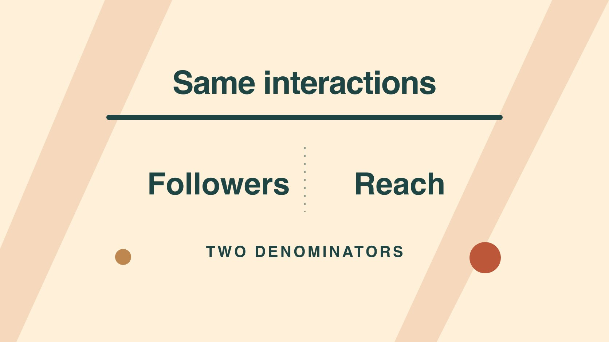

# Instagram粉丝数：何时适合作分母

状态：本地审阅稿；正式发布日期待确认。

用准确的分母说明 Instagram 粉丝数、帖子触达和互动率各自反映的情况。

QuickKOL 编辑图形；不呈现真实账号指标或平台界面。

Instagram 粉丝数是一个账号在某一时点的关注关系存量；触达描述一条内容或一个期间里看到内容的不同账号，具体定义以报告为准。报告应把互动÷粉丝和互动÷触达写成两个不同的比率，并注明各字段的来源、内容范围和时点。若要知道粉丝中有多少人看到某帖，需要同范围的粉丝触达分项。总触达不能直接当成粉丝触达。

## 先明确数字服务的决策

如果要估算潜在账号规模，保留粉丝快照；如果要比较发出的内容，记录帖子实际触达；如果要判断是否回答了观众问题，则检查相关回复、保存或访问。先写出本报告要回答的一句话。假设品牌正在决定把预算投给产品演示还是客服说明，粉丝数只能提供背景。用[创作者活动衡量指南](https://www.quickkol.com/zh/blog/creator-campaign-measurement/#answer)约定活动范围和对应指标。给每个结果指定下一步，避免把不同用途的数字压成一个“账号质量”分数。

## 保留快照日期与来源

把平台、账号主页、时区、日期、原始显示精度、采集方式一起保存。当前粉丝、月末快照和近30天净增各有含义。公开显示若四舍五入，不能精确还原原始数。也不要用今天的粉丝总数给三个月前的帖子补分母。若必须用最接近的历史数据，说明观察日与发布日期相差多少。对比不同账户时保持同样时间规则。发布前后都有快照可以解释时点选择，但不能用差值直接推算关注和取消关注的总次数。

## 从同一报告核对账号和内容范围

[Meta的Instagram API文档](https://www.postman.com/meta/instagram/documentation/6yqw8pt/instagram-api)描述专业账号及授权访问的不同范围。[Instagram创作者实践指南](https://about.fb.com/news/2024/10/best-practices-education-hub-creators-instagram/)也介绍专业面板中关于触达与关注增长的学习内容。做报表时还是要核对当前账号的实际字段，区分按单帖的去重触达、多个帖子的账号期间触达和重复播放或展示。多个帖子触达相加不能得到期间去重数。若自然与付费有独立报告，给每项加标签。若报表合并了投放与自然又无法拆分，就按混合范围如实保留。

## 同一互动量可以有两个合理比率

假设账号发帖前有10,000名粉丝，帖子发布七天触达4,000个账号，累计120次选定互动。互动÷粉丝为1.2%，互动÷触达为3%。第一个是相对于公开规模的活动频度；第二个是每100个触达账号约3次动作。互动若按事件计数，一个人可能有多次动作，因此不能说3%的人互动。用[互动率公式的口径约定](https://www.quickkol.com/zh/blog/engagement-rate-formula-metric-contract/#answer)说明纳入的动作类型以及自然、付费或合并数据。没有可比较的粉丝快照时，可不算第一种。

## 总触达无法直接量化粉丝覆盖

假设4,000个触达账号中有1,500个粉丝、2,500个非粉丝，且实际报告在同一帖子、同一窗口提供这组拆分。若粉丝基数为发布前10,000，可写与该快照相比，粉丝触达规模约15%。因为有人在窗口内加入或离开，不能把它解释成发布时粉丝这一固定群体的准确观看比例。若只有4,000的总触达，不要写40%的粉丝看到了。账号互动也可来自非粉丝，不能将所有事件都归为粉丝行为。缺少拆分时写未知。

## 比较账号时先核对内容与窗口

[Meta的内容排序说明](https://about.fb.com/news/2023/06/how-ai-ranks-content-on-facebook-and-instagram/)把不同内容入口分别说明。比较前按内容形式、目的、市场、发布年龄、付费情况分组。假设一个账号用七天自然 Reel 数据，另一个给出近30天包含投放的 Stories 汇总，不能根据比率排序。请双方按同一窗口给可比较的数据，或把不可比结果并排并说明原因。可用中位数和样本数描述同一组内容，保留异常值的业务背景，例如一次外部转发。若样本很少，用于下一步测试而非证明固定行业水平。

## 用三列收尾：观察、限制和决定

示例：第七天单帖触达4,000个账号，互动事件120次；此数据不能建立个体留存或固定粉丝群体的精确覆盖；下一条维持发布窗口，补拍特写并继续收集相关提问。交付报告保留原字段、公式、观察日期、市场、异常说明和审核人。缺少触达时不要用粉丝替代并保留同一指标名。后来出现迟到或修订的数字，保存旧值和日期再补充新值。

## 记录公式里的空值和异常值

分母为零或未知时，比例保留为未定义。若互动包含后来补记的事件，记录刷新时间；若该帖在中途开始投放，为付费开始时间加标记。让复核人能在同一文档区分所见、假设和结论。

## 分母选错时重新回答业务问题

假设上一版周报用粉丝数做分母，却将图表标成触达互动率。先确认两种计数是否在同一帖子与窗口可用。如果是，分别重算并改正旧标记。说明哪个旧结论可能受影响，比如复剪决策本来依赖每百个触达账号的互动。若旧汇总按全账户粉丝计算，无法从比例倒推出每帖触达，就等待实际数据。新周报保留两列，采购可看账号时点规模，内容团队可看实发触达。对外呈现尽量让单位和范围跟着数字，不把所有限制都放到另一个附录。

## 粉丝和触达的分母对照

| 分母 | 对应问题 | 需留证据 |
| --- | --- | --- |
| 粉丝快照 | 相对账号规模的动作量 | 账号、日期及显示精度 |
| 单帖触达 | 每个触达账号对应多少动作 | 帖子、窗口及付费范围 |
| 可比较的粉丝规模 | 粉丝触达相对规模 | 同范围粉丝触达拆分 |

示例使用假设数据；实际指标按报告来源定义。

## Instagram 分母核验清单

计算之前把单位和时间写进表里。

- [ ] 给粉丝快照加采集日期。
- [ ] 确认触达范围和去重定义。
- [ ] 分开事件与人数。
- [ ] 记录自然与付费范围。
- [ ] 给开放问题安排下次核对。

## 研究日期与使用边界

资料核验于 2026 年 11 月 5 日。文中方法、表格和决策规则为编辑建议，标为假设的示例不是实际客户结果或行业基准。外部资料的适用地区与时期按各段说明；本稿处于独立本地审阅阶段，正式发布日期待确认。

## 用清楚的任务开始达人研究

用 QuickKOL 理解 Brief、发现相关达人并研究作品与联系路径；数据、合作条件和结果仍需核验。

[了解 QuickKOL](https://www.quickkol.com/#capabilities)

## 来源

- [Meta的Instagram API文档](https://www.postman.com/meta/instagram/documentation/6yqw8pt/instagram-api)
- [Instagram创作者实践指南](https://about.fb.com/news/2024/10/best-practices-education-hub-creators-instagram/)
- [Meta的内容排序说明](https://about.fb.com/news/2023/06/how-ai-ranks-content-on-facebook-and-instagram/)
