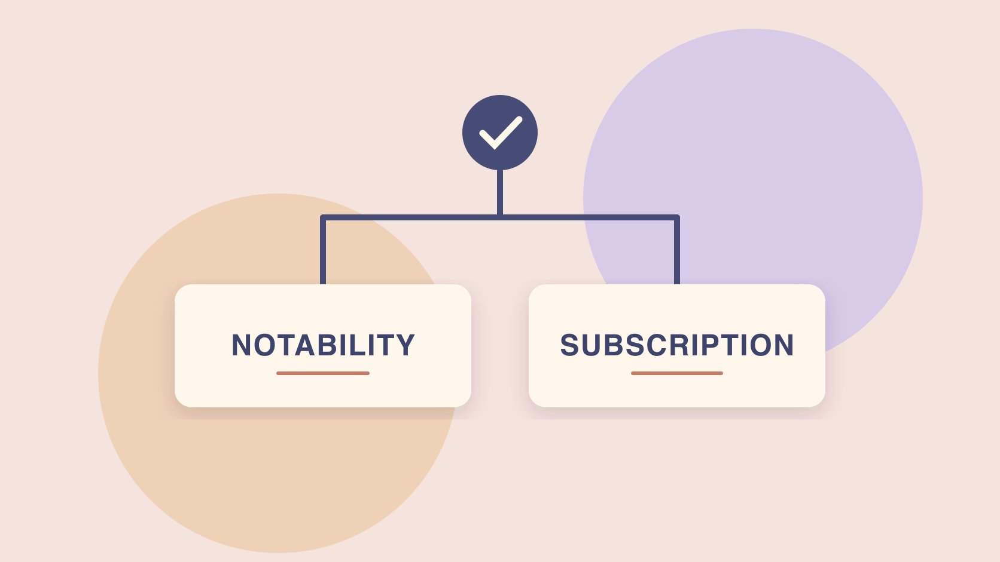

# How Can I Get Instagram Verification? Compare Routes

Status: local review draft; confirm the publication date before release.

Use Instagram’s official requirements to choose a verification route and review the account, identity evidence and follow-up.

QuickKOL editorial graphic; not actual account metrics or a platform interface.

Instagram has two common verification routes. Eligible public figures, celebrities and brands can request a badge through the mobile app using the notability route. Eligible personal or creator profiles can check the paid Meta Verified subscription and identity flow. Businesses can review their separate offering. Use the correct account and official app or Help Center, and prepare the identity or business evidence the current route requires. Submission does not guarantee approval. A badge cannot establish professional qualifications, endorsement or performance.

## Choose the route before collecting evidence

The [Instagram verified badge help](https://help.instagram.com/733907830039577) distinguishes accounts verified under notability requirements from accounts verified through Meta Verified. Start with the operational purpose. Does the organization need to help people identify its established public presence, or is it reviewing an eligible subscription and its support options? Personal, creator and business profiles can have different routes. Use [a social media operating plan](https://www.quickkol.com/blog/social-media-marketing-operating-plan/#answer) to identify the account owner, recovery owner and reviewer. Check eligibility and availability on the actual profile. A large following does not establish notability or enrollment. Keep the subscription separate from the conventional request. Suppose a team manages an organization account and the founder’s creator profile. Verify which identity the business wants to establish before collecting documents or starting an application. A legitimate founder account and a legitimate company account may serve different users. Record the actual public handle, role and application owner for each. If the goal is reducing confusion, also check whether the organization’s website points to the right profile before deciding how to proceed.

## Prepare evidence for a notability request

The [Instagram notability verification requirements](https://help.instagram.com/312685272613322) list authenticity, uniqueness, completeness and notability. Authenticity concerns the real person, registered business or entity. Review the current uniqueness rules and language exceptions. Check completeness against the actual profile. The help page says Instagram reviews accounts mentioned in multiple news sources and excludes paid or sponsored media as news evidence. Organize publicly accessible independent coverage with dates, names and how each story relates to the applicant. A website or company document can establish identity without establishing notability. If the organization renamed or uses several languages, record the name relationship and official account. Avoid filling the list with irrelevant or purchased coverage. Suppose one publication interviews the founder about a separate company. Identify which entity the source actually names. If a story is syndicated across several sites, preserve the originating report and distinguish copies. A reviewer can then see the evidence and scope without treating every matching result as independent coverage. Give each link a role in the file and keep unresolved identity matches open.

## Submit through the correct account on mobile

The iPhone version of the [Instagram mobile badge application guide](https://help.instagram.com/398038890351915/?cms_platform=iphone-app) says to sign in to the target profile, open the profile menu and find the professional dashboard under insights and tools, then go to its settings and Request verification. Enter the full name and provide the requested identity or business document as shown. Have the account holder follow the official prompts. Device and account interfaces can differ, so use the appropriate help variant. Record the date, profile, route and status without placing documents in an ordinary project folder. Instagram says eligibility does not guarantee approval and repeated requests before the same decision can cancel the application. Suppose the brand’s social editor can open the profile but does not own the account or the identity materials. Give the actual owner the verified route and a list of evidence still needed. The marketing team can prepare public references while keeping sensitive files in the approved process. Verify that the final submission names the intended person or organization and keep its confirmation state distinct from an approval.

## Check creator Meta Verified eligibility

The [Meta Verified creator eligibility guide](https://help.instagram.com/2419286908233223) lists an age requirement, supported locations, eligible personal or creator profiles and a government-issued photo ID. Check Instagram profile requirements including Advanced Protection in the actual guidance. The [Meta Verified creator subscription overview](https://help.instagram.com/738055111270671) describes a recurring paid subscription, with availability, plans and benefits that can vary by market and profile. Use the official onboarding to confirm current price, billing, identity review and cancellation. Earlier pilot prices do not establish the local cost. A purchase flow still involves verification. If the goal is impersonation protection or support, verify the benefit in the plan offered to the intended profile. Suppose a creator has an eligible personal profile and a separate business account. Review the profile type before budgeting and confirm which profile would receive the selected features. The account owner can inspect what information is requested without sending screenshots of an identity document to a collaborator. Keep the actual terms and review date in the organization’s record and assign someone to review any renewal.

## Review the business offering and ownership

The [Meta Verified for businesses announcement](https://about.fb.com/news/2023/09/meta-verified-for-businesses/) describes a separate business offering. Confirm eligibility, requested documents, verification route and current plans through the official surface for the actual business. Do not assume the creator subscription’s requirements apply. Verify the organization, profile and current administrators before applying. Have an authorized person review company records and account protection if required. If an agency manages the account, agree who pays, receives notices, handles cancellation and owns recovery. Avoid transferring control to a stranger promising a badge. Use the [creator identity verification guide](https://www.quickkol.com/blog/verify-creator-brand-safety/#answer) to understand how public and original sources support identity checks. Suppose a local business uses an agency to prepare copy. The organization can retain control of billing and proof while the agency updates the public description under its existing permissions. Record which decision is about verification and which is about access. If a current plan is unavailable, keep the status open and maintain the correct account directory so customers can still identify the organization.

## Keep sensitive evidence in the official flow

[FTC phishing guidance](https://consumer.ftc.gov/articles/how-recognize-avoid-phishing-scams) recommends checking unexpected requests through a route you already trust. If someone promises a guaranteed badge or asks for a sign-in code or document through an unfamiliar account, return to the Instagram app or official help. A marketing colleague can see a status such as submitted, waiting or further evidence requested without seeing the document itself. For an agency-operated profile, confirm who is authorized to manage it. If a message supplies a similar-looking site, verify independently rather than trying credentials on that page. Minimize the information retained in the work record. Suppose an employee is contacted about a pending request from a profile claiming to be support. Check the official status and preserve only the details needed to report it to the organization’s responsible owner. A verified account notice and a direct message are different evidence. If account access may be affected, use the official support and recovery routes. Keep credential handling separate from public identity work.

## Track the decision and maintain the public identity

Keep the application date, route, account, status and owner. When a decision arrives, verify the badge and official status on the actual profile. The [Instagram verified badge help](https://help.instagram.com/733907830039577) describes an identity signal. It does not establish a platform endorsement or professional qualifications, and the verification does not transfer to another account. Review the current rules before changing a username, organization name or subscription status. Maintain a public directory with working links and stated account scope. If an application does not succeed, record the actual decision and check what information or route remains relevant. Do not submit repeated requests while one is pending. A creator or brand can still make its identity easier to verify by keeping the website and profile aligned. If a branch account is used for service, label it in the directory. Give the next account manager the public source and relevant ownership record. Preserve a distinction between the account’s verified identity and any later campaign results.

## Use a hypothetical case to test the handoff

Suppose a company rebrands while people still visit its former Instagram profile. Check the name relationship through the website, corporate records and the actual account, then decide how to update public instructions and which route may apply. Have the authorized owner inspect any business subscription offer. For a notability request, confirm that independent coverage refers to the applicant. Retain the review date, route, evidence status and public outcome. Recheck website links and customer instructions after the name change. If multiple profiles remain active, identify the role of each one and assign someone to keep the directory current.

## Separate preparation, identity review and subscription maintenance

Suppose a creator selects the subscription route and notices a difference between the display name and the identity evidence they can provide. Read the current official requirements and let the account holder resolve any legitimate naming issue through the official process. The rest of the team can maintain the public profile link and status while waiting. A paid subscription also needs a billing and renewal owner, especially when staff or agencies change. Keep identity review distinct from the content plan. If the organization later chooses to end the subscription, review the current conditions and verify what the profile actually shows afterward. Do not tell customers a verification will remain or transfer without checking. Maintain the organization’s own directory and keep identity, support access and campaign performance in different records. A reliable handoff can show which route was used, who has authority to manage it and which source confirms the observed status. No identity document needs to appear in the marketing recap or in the content brief.

## Instagram verification routes

| Route | Review | Evidence handling |
| --- | --- | --- |
| Notability request | Authenticity, uniqueness, completeness and notability | Use the mobile app |
| Creator subscription | Market, profile and identity evidence | Check billing and review in the official flow |
| Business offering | Actual account and local eligibility | Have an authorized owner handle documents |

Use Instagram’s current rules and actual account decision.

## Instagram verification checklist

Confirm the profile and route before collecting evidence.

- [ ] Confirm the profile through the official route.
- [ ] Choose the applicable request or subscription.
- [ ] Prepare evidence under current requirements.
- [ ] Have the account owner handle identity documents.
- [ ] Record the result and maintain the public route.

## Research date and limitations

Sources reviewed November 5, 2026. Methods, tables and decision rules are editorial recommendations. Hypothetical examples are not actual client results or industry benchmarks. Source geography and periods are specified where relevant. This draft is in independent local review; confirm its publication date before release.

## Start creator research with a clear task

Use QuickKOL to interpret a brief, discover relevant creators and research their work and contact routes. Verify data, commercial terms and outcomes at their source.

[Explore QuickKOL](https://www.quickkol.com/#capabilities)

## Sources

- [Instagram verified badge help](https://help.instagram.com/733907830039577)
- [Instagram notability verification requirements](https://help.instagram.com/312685272613322)
- [Instagram mobile badge application guide](https://help.instagram.com/398038890351915/?cms_platform=iphone-app)
- [Meta Verified creator eligibility guide](https://help.instagram.com/2419286908233223)
- [Meta Verified creator subscription overview](https://help.instagram.com/738055111270671)
- [Meta Verified for businesses announcement](https://about.fb.com/news/2023/09/meta-verified-for-businesses/)
- [FTC phishing guidance](https://consumer.ftc.gov/articles/how-recognize-avoid-phishing-scams)
