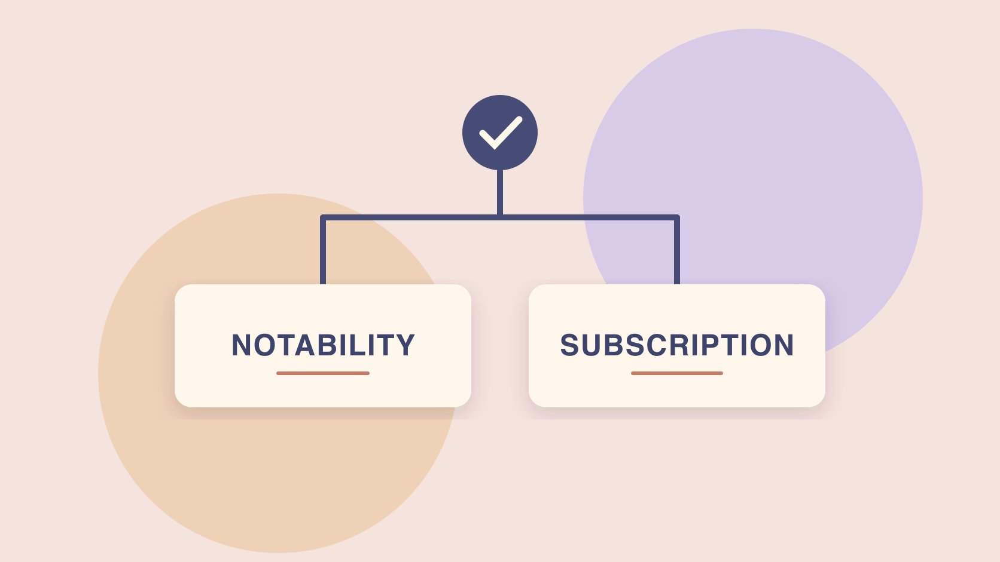

# Instagram怎么认证：准备两类申请资料

状态：本地审阅稿；正式发布日期待确认。

用 Instagram 官方帮助判断适合哪条认证路径，核对账号、身份材料、申请结果及后续维护。

QuickKOL 编辑图形；不呈现真实账号指标或平台界面。

Instagram 有两条常见认证路径：符合条件的公众人物、名人或品牌可通过手机 App 提交知名度认证申请；符合资格的个人或创作者账号可查看 Meta Verified 付费订阅及身份核验，商家查看对应商家方案。登录正确账号，从官方帮助或应用入口核对当前条件。准备身份或公司文件和实际所需材料。提交不保证通过，徽章也不证明专业资质、品牌背书或流量表现。

## 先选路径再准备材料

[Instagram认证徽章官方说明](https://help.instagram.com/733907830039577)指出，有些账号属于符合知名度要求的用户、品牌或实体，另一些属于 Meta Verified 订户。先问运营目的：是帮助用户找到知名组织的真实账号，还是需要符合资格的订阅方案及支持。个人、创作者和商家所用方案不同。用[社交媒体运营计划](https://www.quickkol.com/zh/blog/social-media-marketing-operating-plan/#answer)确认谁代表账号申请、谁掌握恢复信息、谁核对最终显示。实际入口、资格和可用性以对应账号为准。不要为有更多粉丝就认为符合知名度，也不要把购买订阅当成同一申请。

## 知名度认证需要哪些证据

[Instagram知名度认证条件](https://help.instagram.com/312685272613322)列出真实、唯一、完整和知名。真实需要代表实际个人、注册企业或实体；唯一及语言例外按现行帮助理解。完整要对照实际账号和官方要求。知名度审查会看多个新闻来源，付费或赞助媒体不计作新闻来源。整理可公开打开的独立报道、日期、相关名字及报道如何对应申请者。官网或公司文件可验证身份，但不自动证明知名度。若是改名或跨语言账号，留下名称对应和官方关系。不要为填数量而买稿或提交不相干链接。

## 在手机端用正确账号提交

[Instagram手机认证申请指引](https://help.instagram.com/398038890351915/?cms_platform=iphone-app)的 iPhone 版路径为登录要申请的账号，从个人主页菜单进入成效分析和工具下的专业面板，打开设置中的申请认证。按显示要求填全名并提交适当身份证件或公司文件，阅读提示后由账号持有人提交。不同设备或账号可能显示不同路径，使用适合自己的官方帮助。保存申请日期、账号、路径和状态，不把证件副本放进团队普通文档。官方也说明符合资格不保证通过，同一申请在结果出来前反复提交可能取消。

## Meta Verified 创作者版需要哪些条件

[Meta Verified创作者订阅条件](https://help.instagram.com/2419286908233223)列出年龄、支持国家或地区、符合条件的个人或创作者主页、政府签发照片身份证件等要求。Instagram 主页还需查看高级安全保护和具体资料要求。[Meta Verified订阅官方介绍](https://help.instagram.com/738055111270671)将其定义为付费自动续订服务，套餐、可用性和权益按市场、账号及产品而异。用官方订阅流程核对实际价格、付款、身份审核及取消条款。不要用早期试点价格做预算或假设订阅一买就获批。若目标是防冒充或支持，单列想核对的权益。

## 商家查看自己的资格和账户控制

[Meta Verified商家版公告](https://about.fb.com/news/2023/09/meta-verified-for-businesses/)说明存在专门面向商家的方案。其资格、资料、验证方式和当前套餐由实际账号与当地官方入口核对，不套用个人创作者条件。先确认组织、品牌主页和实际管理者。需要机构处理时由授权人核对公司材料与安全设置。若账号由代理商管理，提前写清谁付费、谁收通知、谁能取消或交接。不要为了获得徽章把控制权转给陌生人。可以用[创作者身份核验指南](https://www.quickkol.com/zh/blog/verify-creator-brand-safety/#answer)理解如何通过公开资料和原始来源核对身份。

## 让证件留在官方流程里

[美国FTC防钓鱼指南](https://consumer.ftc.gov/articles/how-recognize-avoid-phishing-scams)建议从独立可信的入口核验意外请求。如果收到“保证认证”“需要验证码”或要求把证件发给陌生账号的消息，从 Instagram App 或官方帮助重新开始核对。营销同事不需要看证件，可以拿到已提交、等待或需补材料等状态。若外包代运营，先确认谁有账号管理授权。假设对方给来一个类似官方的地址，按可信路线找真实入口，不在对方页面测试密码。核对信息最小化并记录状态。

## 提交后记录状态与后续维护

保存申请日、选择的路径、账号、待处理状态和下一步负责人。收到结果后核对实际账号是否显示徽章以及官方说明。[Instagram认证徽章官方说明](https://help.instagram.com/733907830039577)指出徽章代表身份核验，并不表示平台背书或专业资格，也不能转移到别的账号。变更用户名、组织名称或订阅状态前核对当前条件。对外目录中维护能打开的公开账号与范围。若没有通过，按实际结果记录，检查是否有需要补的资料或合适的路径。不要连续提交未决申请。

## 用一个假设案例检查组织交接

假设一间公司改名，旧品牌 Instagram 账号仍被用户访问。先用官网、公司记录和实际账号核对名称关系，再确定是否应该更新公开指引及申请哪条路径。若是商家订阅，由授权负责人看实际套餐；若是知名度申请，检查独立报道是否真的对应主体。团队只留复核日期、路径、材料状态与公开结果。改名后再核对网站链接和客户说明。

## 区分申请准备、身份审核和后续订阅

假设申请者选择创作者订阅，但在检查资料时发现显示名称和实际使用的身份文件不同。先查看官方接受的要求，不临时借用他人资料或让同事替交。若确有合法的名称差异，让本人从官方帮助核对适用文件和流程。若暂时不满足条件，保留官网到主页的公开链接和维护责任，等待资料确认。付费订阅还应记录续订日期与实际负责人，并在团队交接时核对。认证完成后的账号维护与增长计划分开。

## Instagram 认证路径对照

| 路径 | 主要核对 | 证据处理 |
| --- | --- | --- |
| 知名度申请 | 真实性、唯一性、完整性与知名度 | 通过手机 App 提交 |
| 创作者订阅 | 适用地区、账号和身份证件 | 按官方流程查看费用及审核 |
| 商家方案 | 实际账号与当地可用资格 | 由授权人核对公司材料 |

实际资格和结果由 Instagram 决定。

## Instagram 认证申请清单

先确认账号和申请路径，再准备材料。

- [ ] 从官方入口核对实际账号。
- [ ] 选择适用的申请或订阅。
- [ ] 用当前条件准备证据。
- [ ] 让账号持有人处理身份文件。
- [ ] 记录结果并维护官网入口。

## 研究日期与使用边界

资料核验于 2026 年 11 月 5 日。文中方法、表格和决策规则为编辑建议，标为假设的示例不是实际客户结果或行业基准。外部资料的适用地区与时期按各段说明；本稿处于独立本地审阅阶段，正式发布日期待确认。

## 用清楚的任务开始达人研究

用 QuickKOL 理解 Brief、发现相关达人并研究作品与联系路径；数据、合作条件和结果仍需核验。

[了解 QuickKOL](https://www.quickkol.com/#capabilities)

## 来源

- [Instagram认证徽章官方说明](https://help.instagram.com/733907830039577)
- [Instagram知名度认证条件](https://help.instagram.com/312685272613322)
- [Instagram手机认证申请指引](https://help.instagram.com/398038890351915/?cms_platform=iphone-app)
- [Meta Verified创作者订阅条件](https://help.instagram.com/2419286908233223)
- [Meta Verified订阅官方介绍](https://help.instagram.com/738055111270671)
- [Meta Verified商家版公告](https://about.fb.com/news/2023/09/meta-verified-for-businesses/)
- [美国FTC防钓鱼指南](https://consumer.ftc.gov/articles/how-recognize-avoid-phishing-scams)
