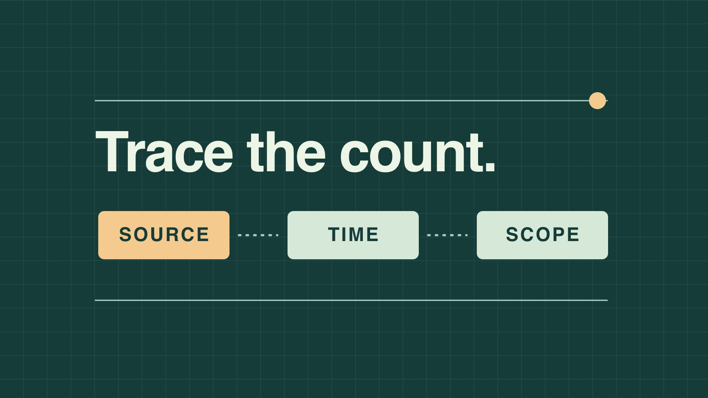

# Instamark Followers: Verify the Source of the Count

Status: local review draft; confirm the publication date before release.

When a report contains the label Instamark Followers, trace its origin, observation window and definition before deciding what the number supports.

QuickKOL editorial graphic; not actual account metrics or a platform interface.

Treat Instamark Followers as an unconfirmed label when it appears in a report, screenshot or search. It could be a spelling variant, internal column name, filename or source shorthand. The words alone cannot establish a provider’s identity or features. Ask for the original record, platform, account, observation time, collection method and metric definition. Reconcile it with a public source or authorized first-party aggregate, and separate possible explanations from verified facts.

## Trace the label before interpreting the count

Preserve the label as it arrived, with the filename, tab, position and receipt date. Ask whether it identifies a data source, internal project tag or manually entered value. For a platform claim, request evidence that identifies the account and time. For a vendor claim, ask for the actual product name, documentation and export field. Similar spelling does not establish a common origin. Keep the original value when correcting the label so a rename cannot make the old number appear newly verified. The first pass should lead to a traceable record. Analysis comes after that. Suppose a procurement sheet contains one column named Instamark Followers and three rows typed by different people. Start with the row tied to the decision and ask how that entry was made. A text label copied from the next column can be repaired without drawing a conclusion about the underlying account. Record when the answer arrived and whether it applies to the other rows. If nobody can identify the source, leave the label unresolved and tell the report owner which decision depends on it.

## Give each observation an account, time and scope

The same handle can appear on multiple platforms, and a rename can leave the same account under different labels. Record the actual platform and verifiable profile URL, plus a stable identifier if available through authorized access. Keep the capture time separate from the period covered. Current followers, ending followers, net growth and newly gained followers describe different quantities. Use an [Instagram follower change log](https://www.quickkol.com/blog/instagram-followers-check-change-log/#answer) to keep event dates distinct from capture dates. Preserve the original displayed string and surface when a value is abbreviated. Compare records only after aligning what they count and when. If one comes from a profile header and one from an owner’s monthly report, name both surfaces and identify the question they can support. A monthly reporting row may still have an extraction timestamp on the next day. Record the reporting time zone so the overnight difference can be explained. A missing account identifier is material when the report refers to two similarly named profiles. Ask for the link before spending time reconciling the numbers.

## Turn discrepancies into testable explanations

Imagine an external sheet says 12.5k followers and the account owner reports 12,100. Check whether the former is an abbreviated reading from the end of October and the latter an exact value observed on a different day in November. If they are supposed to refer to the same time, test alternatives with the original capture, export time or field documentation. Change the report only when the evidence supports the explanation. Keep an open discrepancy labeled as pending with a review owner and date. A difference between a rounded display and an exact count does not establish a precise number of departures. In the example, the reviewer might obtain the capture date but still be unable to verify which profile was open. That closes one question and leaves the account match unresolved. A useful evidence note records the question separately from the potential explanation. If a field describes a later observation, keep both rows as dated snapshots instead of silently replacing one number with the other.

## Keep policy and case evidence separate

The [Meta spam policy](https://transparency.meta.com/policies/community-standards/spam/) describes restrictions on artificially collecting followers or engagement. It helps readers understand the governing rules. A label, growth spike or unusual ratio in a report cannot establish that a person or service broke those rules. If an official notice is available, record the account, date and scope it actually covers. Keep the platform’s statement distinct from the team’s observations. An actionable note says which record lacks evidence, which fields reconcile and whether the count can support a stated decision. It can say that a source is unverified without calling the followers fake. That matters when a later reader inherits a spreadsheet with only a color-coded cell and no method. Give them the original value, definition and open question. If independent evidence confirms a simple date mismatch, close the discrepancy and remove unsupported suspicions from the decision memo. Apply the same standard to a screenshot that appears to show normal data. It needs an identifiable source and appropriate scope before it can support a claim.

## Reconcile data without handing over the account

If someone sends an unexpected link asking for an Instagram password, login code or approval for an unfamiliar app, contact the sender through a known route or navigate directly to the official platform. [FTC phishing guidance](https://consumer.ftc.gov/articles/how-recognize-avoid-phishing-scams) recommends an independently trusted route for checking unexpected requests. A follower reconciliation can usually use a public profile, an authorized export or a capture with unrelated material redacted. The account owner can retrieve the data themselves. Specify who can see the aggregate, where it is stored and when it should be removed. When data is unavailable, record that state. A vendor estimate may be useful in a separate column if its definition and limitations are known. Preserve the difference between the estimate and the platform observation. Suppose an analyst needs only a date and end count. A redacted crop paired with the account URL and capture time may be enough. If the assignment calls for audited data, ask the appropriate owner whether a permitted export is available rather than expanding account access.

## Decide whether the count is material

If the count is background context, mark it unverified and remove any precise conclusion that depends on it. If it controls payment or campaign eligibility, hold that decision while assigning an appropriate source and observation window. Use [creator engagement data analysis](https://www.quickkol.com/blog/read-creator-engagement-data/#answer) to check whether the business needs reach, questions, visits or sales evidence for the task. Keep the count’s unresolved provenance distinct from a judgment about an account. Suppose the brand needs to decide whether to recut a tutorial. Questions that viewers asked about the tutorial and its own organic metrics may be more relevant than the number in an imported follower column. If procurement still requires a profile count, put that check on a separate line with a reviewer. Avoid filling a blank with a number that refers to a different measure. Write exactly which approval is pending, who owns the source and when it will be revisited. A report can proceed on verified content observations while leaving the procurement condition open.

## Leave a correction the next reader can audit

Archive the original label and value, the replacement if any, the evidence location, reviewer and date. Mark whether you confirmed the source, corrected the definition, established a time difference or left the record unresolved. If someone already used the number in a decision, send the correction to the owner of that report through the normal internal process. In the next reporting cycle, add a data dictionary so the person importing the file knows who supplies the column, how it is populated and what missing means. Verify provenance again if the provider or export version changes. An example correction might say the earlier cell was a rounded profile observation and the revised cell is an exact month-end export for the same account. That sentence has more value than a status color. It lets a reader reproduce the comparison and prevents a later analyst from treating old and revised counts as two independent data points. Keep the separate timestamps visible when both observations remain useful.

## Label evidence quality at the row level

Use row-level statuses for verified observations, definitions pending confirmation and data not supplied. A public page can confirm which account exists while leaving a claimed month-end count unverified. A vendor document can explain a field without establishing that the export belongs to the intended account. Record each observation at the level it supports. If one row has both a verified handle and an unresolved measurement date, retain both facts. The reviewer can then request the missing date without repeating the account check or treating the entire row as false.

## Handle a count already used downstream

If the older count has already entered a client deck, identify the slide, use and conclusion it affected. Where the field indicated only scale, add the revised source and observation time to the relevant slide notes. Where the old value triggered a procurement condition, review the evidence against the stated threshold and required date. Suppose the condition had to be met on one named day. A trustworthy screenshot from several days later establishes only what was observed later. Ask for a dated capture or an authorized comparable export from the time in question. If the old material is unavailable, mark the historic condition unknown and make a new decision from current evidence if appropriate. Do not circulate unrelated account information or send the unresolved screenshot to people outside the review. Document the change with an owner and a review date. If the original label remains necessary for matching against an archived import, keep it in the source field and place the corrected label in the reviewed output. That preserves the audit trail while giving the current reader a usable report.

## Follower data verification table

| Field | Record | Unresolved by this field |
| --- | --- | --- |
| Original label | Preserve spelling and file location | Actual provider identity |
| Account and time | Record platform, profile, window and capture time | Reason for change |
| Correction | Keep original, evidence and reason | Accuracy of unreviewed rows |

Use the example for education and evidence logging.

## Data provenance checklist

Start with the row that affects the decision.

- [ ] Save the original label and file position.
- [ ] Confirm platform, account, window and definition.
- [ ] Record precision on each observation.
- [ ] Use the official surface or authorized export.
- [ ] Separate verified facts, hypotheses and open items.

## Research date and limitations

Sources reviewed November 5, 2026. Methods, tables and decision rules are editorial recommendations. Hypothetical examples are not actual client results or industry benchmarks. Source geography and periods are specified where relevant. This draft is in independent local review; confirm its publication date before release.

## Learn what a follower column can support

Start with metric definitions and evidence. Preserve the record and keep the question open when provenance cannot be confirmed.

[Read the engagement guide](https://www.quickkol.com/blog/read-creator-engagement-data/)

## Sources

- [Meta spam policy](https://transparency.meta.com/policies/community-standards/spam/)
- [FTC phishing guidance](https://consumer.ftc.gov/articles/how-recognize-avoid-phishing-scams)
