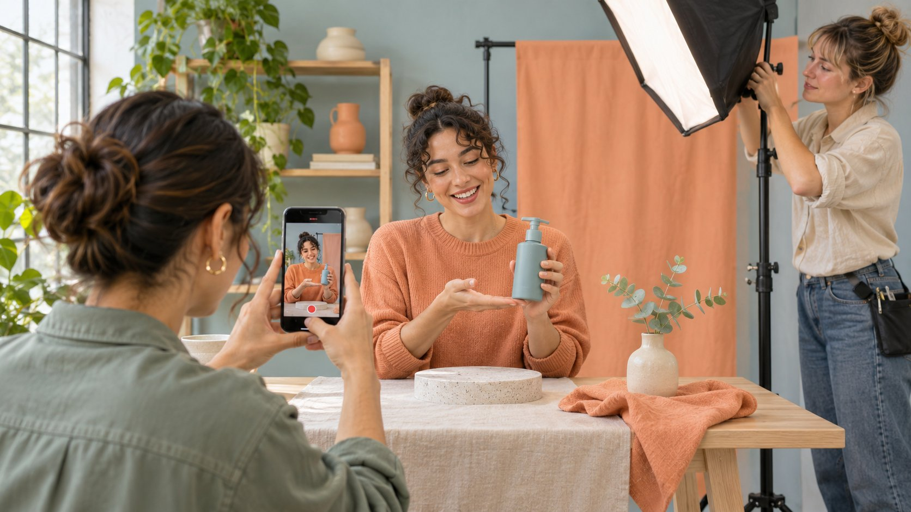

# How to Make a Reel on Instagram: A Production Review

Status: local review draft; confirm the publication date before release.

Create an Instagram Reel and review the shots, captions, cover, claims and publishing settings before release.

AI-generated editorial illustration, not an actual creator, client, product or event.

In the Instagram app, open the creation menu and choose Reel. Record clips or import your footage, arrange and trim them, review sound and captions, then choose a cover, write a caption, check the publishing settings and share. Available tools may vary by account and device. For a brand Reel, capture the one action the audience needs to see, keep a reviewable source take, and check audio, rights, disclosure and the final framing.

## Begin with one action viewers can see

Write what a viewer should be able to do after watching. For example, they should see how the package latch moves from closed to open. Put the opening question, key action and result on one page. Use [a useful campaign brief](https://www.quickkol.com/blog/write-a-useful-campaign-brief/#answer) to name the shoot, review, upload and reporting owners. If the client needs two colors shown, decide which shots must be repeated and which can share instructions. When a feature differs by model, state the actual version in the brief. A reviewer can judge one visible action more reliably when the editor preserves its beginning and end. Also decide where an interested viewer can find the next step. A brand might want a viewer to read assembly instructions while a creator wants them to comment with a question. Choose the primary action and give it enough time in the edit. For a demonstration, consider an alternate angle for any part a hand may cover. Decide how to identify the correct product on screen without placing text over the latch.

## Open the Reel creation flow on the publishing account

The [Meta Reels introduction](https://about.fb.com/news/2020/08/introducing-instagram-reels/) describes choosing the creation mode, recording one or more clips and importing video. The [Instagram Reel recording help](https://help.instagram.com/225190788256708) describes recording and editing availability as well as trimming, cover and share settings. In the mobile app, open creation, select Reel and record or choose media from the device. Use the controls actually present to organize and trim the clips. Check the signed-in account, media access, planned audio and picture before recording. If a producer prepares assets in a test account, confirm the publishing account can use the required tools. Keep a clean master for handoff. Suppose the team prepares a sound in one account and cannot select it from another. Inspect which audio rights and account tools apply, then choose an approved substitute if needed. Avoid making the publishing plan depend on a draft only one staff member can open. A separate source file can make a reshoot or correction practical if a draft is unavailable later. The current help also has a desktop route for uploading from a computer and reviewing cover and trim controls.

## Edit while preserving the before and after

Choose an uninterrupted reference take and then collect close-ups. Order the edit around the question, setup, action and result. Have a reviewer watch it at normal speed, then mark where a hand obscures the item or a caption passes too quickly. The [Meta Reels editing announcement](https://about.fb.com/news/2023/11/new-ways-to-create-content-on-instagram/) describes improvements to clip editing. Confirm the actual controls available to your account. Before speeding up a passage, check whether timing matters to the instruction. If a latch jams in one shot and opens in another, confirm the model and setup before joining them. Show a transition clearly if conditions changed. Suppose the second angle reveals a small safety catch. A cut that drops the first movement may make the instruction impossible to follow, so retain enough of both actions. Keep a review copy with timecodes so the producer can point to the exact moment that needs a new crop. Export the cleared file under a unique version and mark which one is approved. If a later edit changes the sequence, review the claim and captions again.

## Review captions, sound and the mobile crop separately

The [W3C captions guide](https://www.w3.org/WAI/media/av/captions/) treats captions as synchronized text for speech and meaningful non-speech sound. Watch muted and check whether the instruction, warnings and visual timing still make sense. Restore sound and review timing, volume and actual clearance for each track. Keep written instructions away from hands and product details. Inspect the phone preview for the publishing account, including overlays near the top, bottom and sides. If there are separate placement files, review each one in its planned crop. A voice cue may arrive before a hand moves in the wide edit and too late after a recut. Check the cue against the revision that will actually be uploaded. If auto-generated captions are used, correct names, measurements and terms from the demonstration. A second viewer who has not seen the script can help identify where the visual information is unclear. Record their observation and the timecode rather than revising every shot at once.

## Select an honest cover and review sharing settings

The [Instagram Reel recording help](https://help.instagram.com/225190788256708) describes cover, trim and publishing fields in its desktop workflow. Before sharing from a phone, review the cover, caption, relevant tags and audience controls actually shown. Choose a cover that represents an action or result in the video. If a cover shows a closed product before the demonstration, check that it makes sense on the profile and at playback. Give the caption a verifiable model, scope and next step where appropriate. For a material relationship, review the applicable platform and market disclosure requirements. [FTC influencer disclosure guidance](https://www.ftc.gov/business-guidance/resources/disclosures-101-social-media-influencers) stresses placing the disclosure where people will see and understand it. Test the opening frame and caption at the intended language and size. Do not allow a polished cover to promise a feature the clip never shows. If a Reel will later be promoted, save the agreed version and ensure there is a separate review for paid use. The title, cover and cut may go through different reviewers, so confirm that the published combination is the one that was approved.

## Check posting authority and asset permission separately

A publisher needs authority to post for the brand. Each asset also needs clearance for its intended use. Use the [creator footage rights guide](https://www.quickkol.com/blog/creator-raw-footage-rights/#answer) to record the video, edit, music, imagery, people and any paid placement. Upload the cleared version through the assigned account. Before re-editing, distributing to a different platform or running the video as an ad, review the relevant term and scope. If a track is cleared for organic use only, retain a clean master so the team can choose another approved track later. Use file names and review notes to identify what can be used. The handoff should say who published, where the assets are stored and who can approve a change. Suppose the team makes an alternate subtitle edit after the first approval. Confirm that the same music scope applies and check whether the disclosure remains intact. The creator can send a cleared file without giving the brand general permission to use every take. Keep a readable record of the actual agreement.

## Verify what published and collect viewer questions

Open the published link and check the picture, caption, cover, account and actual destination. Save the post URL, cleared file, release date and market. If someone reports that the captions omit a limitation, confirm the issue and route it to the publisher. Observe relevant replies, saves, reach or visits at a stated age. If viewers ask where to put a finger, show that detail from the side in a follow-up. Playback totals alone do not establish that the instruction was understood. A referral or promotion can also affect traffic. Record the first observation, the source and one question the editor can act on. If a correction is required, preserve the originally reviewed version and distinguish it from the corrected one. If the audience replies show a different misunderstanding than the brief expected, update the next brief rather than overexplaining every possible condition in the current Reel. The release record should support both the next creative decision and the brand’s ability to answer what actually ran.

## Hand off any unavailable publishing option

If the required control is missing, record the device, account, version and actual option absent. Check the official help and preserve the master and cover for the review. Give the publishing owner one question to resolve. If a change to footage or audio is needed, review that version before sharing. Until the post is available, keep the delivery state at the appropriate review stage. The production log should distinguish an exported file, an app draft and a verified published link.

## Keep a version map for each approved use

When the same Reel has an organic cut, a silent master and a later ad cut, list runtime, crop, audio, captions, reviewer and destination for each. Suppose the short ad retains the product action but removes a limitation explained in the organic version. Have the reviewer inspect the short cut in the planned placement and confirm what claim it still supports. If the action is too complex to shorten, keep the full explanation available and revise the new cut to lead people to it. Archive the version that actually published and its change time. That helps the service team identify what a viewer saw when a question arrives. If a clean master is handed to another producer, include the approved edits and source permissions, with unresolved items visible. Keep the permissions record with the file instead of relying on a note in a chat. If the brand changes its landing page, test the result with the published Reel’s current wording so the viewer’s next step remains clear. Assign a person to verify the update and log its date.

## Instagram Reel release review

| Stage | Reviewable output | Check |
| --- | --- | --- |
| Recording | Continuous action and inserts | Consistent item and conditions |
| Edit | Cleared captions and framing | Action and disclosure visible |
| Release | Published link and version | Cover, account and destination |

Check actual account and device options.

## Instagram Reel publishing checklist

Review the actual version on the intended device.

- [ ] Capture one reviewable action.
- [ ] Confirm the recorded or imported sequence.
- [ ] Test both sound-on and muted playback.
- [ ] Review cover, disclosure and asset rights.
- [ ] Open the published link and log the result.

## Research date and limitations

Sources reviewed November 5, 2026. Methods, tables and decision rules are editorial recommendations. Hypothetical examples are not actual client results or industry benchmarks. Source geography and periods are specified where relevant. This draft is in independent local review; confirm its publication date before release.

## Start creator research with a clear task

Use QuickKOL to interpret a brief, discover relevant creators and research their work and contact routes. Verify data, commercial terms and outcomes at their source.

[Explore QuickKOL](https://www.quickkol.com/#capabilities)

## Sources

- [Meta Reels introduction](https://about.fb.com/news/2020/08/introducing-instagram-reels/)
- [Instagram Reel recording help](https://help.instagram.com/225190788256708)
- [Meta Reels editing announcement](https://about.fb.com/news/2023/11/new-ways-to-create-content-on-instagram/)
- [W3C captions guide](https://www.w3.org/WAI/media/av/captions/)
- [FTC influencer disclosure guidance](https://www.ftc.gov/business-guidance/resources/disclosures-101-social-media-influencers)
