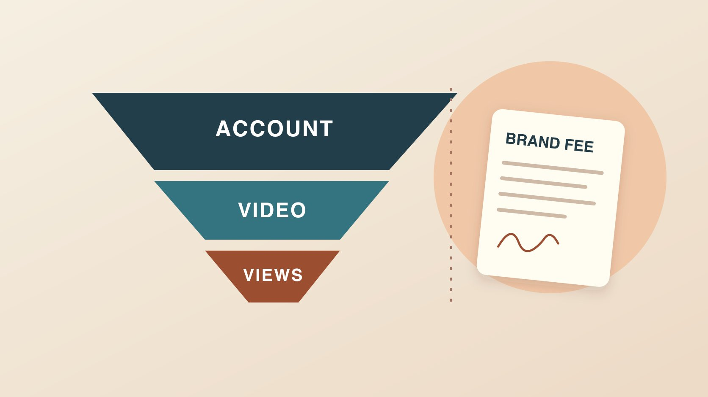

# TikTok Creator Rewards Program: Separate Brand Fees

Status: local review draft; confirm the publication date before release.

Separate admission, eligible videos, qualified views and settlement before building a brand’s creator budget.

QuickKOL editorial graphic; not actual account metrics or a platform interface.

The TikTok Creator Rewards Program pays eligible creators for qualifying original videos. Check the region, account type, age and entry criteria first. Then review eligibility and qualified views for each video. TikTok lists ads, paid promotions and sponsored content among its exclusions. Budget production, publishing, licensing and any brand performance bonus as separate commercial terms. For program earnings, reconcile the creator’s own official dashboard estimates with settlement. Multiplying public views by an RPM found online cannot establish a creator’s payout.

## Check account admission first

As reviewed November 5, 2026, the [TikTok Creator Rewards Program requirements](https://www.tiktok.com/support/faq_detail?id=7581821550694013452) list an account registered in an eligible region, a Personal Account, a minimum age of 18 or 19 in South Korea, at least 10,000 followers and at least 100,000 video views in the last 30 days. TikTok also checks account standing and other eligibility requirements. The public follower count and recent views are entry criteria. The applicant needs the official account flow and a decision. A brand can ask the creator to confirm their status, date checked and operating region without collecting identity documents or sign-in details. Keep that information in the relevant project record and request an update only when it affects a decision. If a screenshot refers to an earlier fund, the [TikTok comparison with the former Creator Fund](https://support.tiktok.com/en/business-and-creator/creator-rewards-program/how-is-the-creator-rewards-program-different-from-the-tiktok-creator-fund) can help identify the change. Use the current program rules and account screen for eligibility. Two creators with the same follower total can have different access because of their market, account type or status. A screenshot of one creator’s dashboard cannot settle the other creator’s case.

## Review video eligibility after admission

The [TikTok Creator Rewards Program requirements](https://www.tiktok.com/support/faq_detail?id=7581821550694013452) say a qualifying video is posted after admission, made by the creator, at least one minute long and subject to originality, quality and policy rules. The documentation lists ads, paid promotions, sponsored content and videos linked to a Series as exclusions. It also identifies Duets, Stitches and other examples outside its originality definition. A sponsored edit can be more than a minute long because that duration supports a demonstration. Its runtime does not settle its Rewards eligibility. Keep a record of commissioned work and independent editorial work with the payer, asset sources, release date and disclosure. That way the creator knows which brief is being approved. If an editor suggests reusing a sponsor’s opening shot in a different video, review asset rights and the nature of the new piece before planning any program earnings. Treat a platform decision as specific to the account and video. A request for a new version should specify whether it is a client deliverable, independently editorial work or another clearly defined assignment.

## Qualified views use their own source and exclusion rules

The [TikTok Creator Rewards Program requirements](https://www.tiktok.com/support/faq_detail?id=7581821550694013452) describe qualified views as eligible unique views from the For You feed with exclusions that include paid, promoted, artificial, fraudulent and disliked views and views that fail the watch threshold. Its detailed rule says a view must last longer than five seconds. A video starts accruing rewards after it reaches 1,000 qualified For You views. A public counter can include other sources or viewing events that do not qualify. Imagine an independent video showing 18,000 public views and 7,500 qualified views in the program dashboard. Label both numbers and their sources. The difference alone cannot tell you how many viewers came from each entry point or how many events triggered a particular exclusion. Keep the video URL, date range, region if shown and timestamp of the observation in the same row. Ask only for data the creator is authorized to share. If a later export revises the qualified number, retain the original estimate date and explain which observation now supports the decision. A single dashboard figure belongs to the named video and reporting window.

## Distinguish estimates, settlements and receipts

The [TikTok rewards calculation guide](https://support.tiktok.com/en/business-and-creator/creator-rewards-program/how-rewards-work) separates a Standard Reward tied to qualified views and RPM from an Additional Reward tied to qualities such as how engaging, specialized and well-crafted content is. RPM expresses rewards per thousand qualified views. Even with a qualified-view total, use the account’s official estimate and the later settlement for the applicable reporting period. A rate shared online without a date, account market or eligible video scope has little value for forecasting a deal. Reconcile the earnings month, currency, estimate, settlement status and payment receipt date as separate columns. Tax treatment depends on the creator’s circumstances. For a brand assignment, keep any platform estimate out of the client’s invoice review unless a contractual reporting need genuinely calls for it. Suppose a creator exports estimated earnings before month end and receives a different amount later. Record both states, check whether they refer to the same month and mark any known adjustment. A bank receipt confirms a payment from its stated source. The dashboard describes which reporting period and program activity it may correspond to.

## Price the work in the brand agreement

Use [creator rates and usage rights](https://www.quickkol.com/blog/creator-rates-usage-rights/#answer) to separate concept, filming, editing, publishing, revisions, media, term, territory and exclusivity. For one organic placement, spell out any media budget or ad permission as its own line. If a brand wants a performance bonus, name a source, window and exclusion rule for the eligible action, such as validated landing-page sessions attributed to the project. Record who provides the data and how corrections or duplicates will be handled. For a partnership ad, identify the approved asset, permission scope and end date separately. Both sides should keep the quote, signed version and proof of delivery. Changes in estimated platform earnings leave the actual brand obligation governed by the agreement. A creator may also invoice for a clean edit the brand never posts. Confirm whether the fee is earned on delivery or publication so finance does not wait for a platform figure the asset was never designed to generate. Where several creators share one shoot, split each line item by the person or usage it covers.

## Walk through a hypothetical budget review

Imagine a brand commissions a short demonstration and a clean master, while the creator independently runs a longer tutorial series that may qualify for Rewards. The brand’s purchase record covers samples, production, delivery and license. Its recap uses the link and visitation definitions agreed for the commissioned project. The creator reconciles tutorials in a separate revenue record. If the client later wants to run the clean master as an ad, use [a brand deal memo](https://www.quickkol.com/blog/brand-deals-commercial-memo-content-brief/#answer) to confirm the exact asset, duration, any outcome-based fee and reporting access before activation. If someone asks for a Rewards screenshot as proof of ad delivery, supply the ad or content report appropriate to the claim instead. Consider what the report would have to show for a real decision. A buyer approving additional edits needs evidence that the existing asset answered the product question. A finance reviewer needs dates and invoices. Neither task requires inferring the creator’s overall income from one public post. Write the decision each figure supports in the recap, and mark information that is still pending rather than copying an estimate into the final amount.

## Handle changes and disputes with the account owner

Route account eligibility, video status and payment questions to the account holder and keep the issues separate. Save the notice date, video link, approved version, project scope and dashboard state at the time. The creator can use the reasons and appeal process described in the [TikTok Creator Rewards Program requirements](https://www.tiktok.com/support/faq_detail?id=7581821550694013452). The client should supply evidence when the question concerns delivery, rights or the commercial relationship. Avoid changing the edit in a way that destroys the record of what was originally delivered or promising replacement footage will earn Rewards. In the closeout, list the commercial amounts agreed, any figures awaiting update and the next review owner and date. If an updated decision arrives after the campaign recap, add it to the specific row with its date. A creator may choose to pause a future independent series if the underlying economics change. The brand can still decide whether its current asset met the commissioned brief. Document both decisions where the relevant owners can see them so the same uncertainty does not recur at the next booking.

## Review a creator quote without a payout assumption

If a creator wants some compensation tied to campaign performance, ask which decisions they can control. Suppose they finish the shoot and two revision rounds, while the brand postpones the post. Delivery status and ad start date are now different facts. The performance bonus window should still follow the signed agreement. If a rights review pauses the asset after launch, separate the brand delivery issue, the creator’s eligibility for independent editorial rewards and the contract’s terms for correcting a problem. A quote can make the fixed production fee clear and list optional items with their own approval gates. Keep versions and markets on separate lines so a later reviewer can see which scope changed. A creator who has an established series may choose a different release date for commissioned work because of the audience’s expectations. Record the proposed schedule as a content and business decision. If the brand asks for an additional cut, agree whether it replaces a deliverable or adds one. A forecast about any separate income should remain in the creator’s planning record unless it is needed for an express term. That makes the invoice check possible even when a platform changes its reporting dates.

## Rewards and brand fee reconciliation

| Record | Evidence | Decision |
| --- | --- | --- |
| Account admission | Account notice and date | Program access |
| Video and qualified views | Program dashboard and window | Program estimate |
| Brand fees | Agreement, delivery and license | Procurement and settlement |

Track the three records separately. Examples are not payout rates.

## Rewards and brand agreement checklist

Collect the records needed for each decision.

- [ ] Check account region, type and status.
- [ ] Check video eligibility and qualified views per post.
- [ ] Separate estimates from final settlement.
- [ ] Scope production, publishing and rights in the agreement.
- [ ] Assign an owner and review date for open items.

## Research date and limitations

Sources reviewed November 5, 2026. Methods, tables and decision rules are editorial recommendations. Hypothetical examples are not actual client results or industry benchmarks. Source geography and periods are specified where relevant. This draft is in independent local review; confirm its publication date before release.

## Start creator research with a clear task

Use QuickKOL to interpret a brief, discover relevant creators and research their work and contact routes. Verify data, commercial terms and outcomes at their source.

[Explore QuickKOL](https://www.quickkol.com/#capabilities)

## Sources

- [TikTok Creator Rewards Program requirements](https://www.tiktok.com/support/faq_detail?id=7581821550694013452)
- [TikTok comparison with the former Creator Fund](https://support.tiktok.com/en/business-and-creator/creator-rewards-program/how-is-the-creator-rewards-program-different-from-the-tiktok-creator-fund)
- [TikTok rewards calculation guide](https://support.tiktok.com/en/business-and-creator/creator-rewards-program/how-rewards-work)
