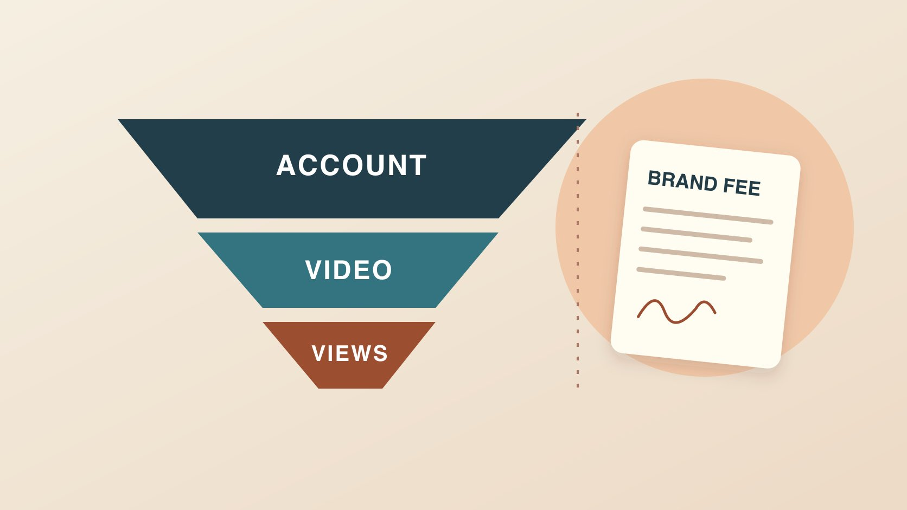

# TikTok创作者奖励计划：和品牌预算分开

状态：本地审阅稿；正式发布日期待确认。

拆解 TikTok 创作者奖励计划的入选、视频资格、合格播放和结算，再单独核算品牌采购费用。

QuickKOL 编辑图形；不呈现真实账号指标或平台界面。

TikTok Creator Rewards Program 是平台对符合资格的创作者及原创视频提供的奖励。先检查地区、账号类型、年龄和入选门槛，再逐条检查视频是否符合资格及其合格播放量。TikTok 官方规则排除了广告、付费推广和赞助内容；品牌项目要单列制作、发布、授权及奖励条款。用创作者当期官方面板核对估算与实际结算，报价不要用公开播放量乘一个网上看到的 RPM。

## 先检查账号能否加入计划

[TikTok创作者奖励计划规则](https://www.tiktok.com/support/faq_detail?id=7581821550694013452)在 2026 年 11 月 5 日核验时列出：账号注册于符合条件的地区，使用个人账号，年满18岁（韩国19岁），至少1万粉丝且近30天累计10万视频播放。账号还要符合平台规则和要求。粉丝数和播放量在这里用于申请资格；入选还要等官方审核。用实际账号在官方 App 查看申请和状态。品牌不必收集身份证件，也无需让创作者提供登录信息。交接只需记录账号持有人确认的状态、日期与适用地区。若对方说旧基金与新计划相同，应先查看 [TikTok奖励计划与旧基金对照](https://support.tiktok.com/en/business-and-creator/creator-rewards-program/how-is-the-creator-rewards-program-different-from-the-tiktok-creator-fund)，并以当前帮助页和账号界面为准。

## 账号入选后再判断单条作品

[TikTok创作者奖励计划规则](https://www.tiktok.com/support/faq_detail?id=7581821550694013452)要求符合条件的视频在加入后发布，由本人制作且至少一分钟，内容需符合原创、高质量与政策要求。广告、付费推广、赞助内容和关联 Series 的视频属于排除项目。平台也列出合拍、拼接及其他非原创情形。策划一条六十多秒的赞助视频时，片长可以是制作需求，但它不能代替内容资格。把计划内自制视频和客户订单分开管理，记录受委托方、素材来源、使用范围以及是否有品牌合作披露。团队讨论公开内容时，只需确认该片在商业预算中的归属。

## 合格播放有自己的去重与来源口径

[TikTok创作者奖励计划规则](https://www.tiktok.com/support/faq_detail?id=7581821550694013452)将合格播放定义为符合条件的 For You 信息流独立播放，并排除付费、推广、人工、欺诈、不喜欢和观看不足时长等情况。帮助页的细项写明观看需超过5秒。视频达到1,000次合格 For You 播放后才开始产生奖励。公开播放量可能包含其他入口、重复或非合格观看，不能直接代入。假设视频有1.8万公开播放，计划面板显示7,500次合格播放，预算讨论应记录两种数据来自哪里，而非推测差额中的每种原因。查看创作者是否有合适权限分享汇总，不要求提供个人级观看记录。

## 估算、结算和到账分别记录

[TikTok奖励计算说明](https://support.tiktok.com/en/business-and-creator/creator-rewards-program/how-rewards-work)将标准奖励与合格播放和 RPM 关联，并另设与内容制作、互动及专业性有关的额外奖励。RPM 是每千次合格播放的奖励口径。即使已知合格播放，也应以账号官方面板的实际估算为准。不要引用无日期、无地区和无视频范围的网络 RPM。财务对账可保留月份、币种、面板估算、最终结算状态和实际到账的日期，税务另由创作者按自身情况处理。若两项记录不同，先看覆盖期间、调整和各自所指的状态，避免重复确认收入。

## 单独核算品牌为哪些交付付费

用[创作者费率与使用权指南](https://www.quickkol.com/zh/blog/creator-rates-usage-rights/#answer)拆分策划、拍摄、剪辑、发布、修订、使用期限、媒体、地域和排他性。品牌如果只买一次自然发布，不应把媒体预算或广告授权自动并入制作费。绩效奖金可采用已约定来源、时间窗和排除规则的合格行动，例如能归因于本项目的有效访问。若另有合作广告，应单列批准素材、许可范围和结束日期。双方各自保存报价、签字版本和创作者交付的证明。当预估平台奖励发生变化时，按原合同核算品牌义务。

## 假设项目如何从预算走到复盘

假设品牌委托一条短演示与一份无字幕母版。创作者另有一个独立的长教程系列，在平台上可能符合奖励资格。品牌采购表只记录样品、制作、交付和许可，复盘按品牌项目使用的链接与访问口径。创作者则在单独的收入表核对教程数据。若客户后来想用母版投放，先补充约定，再用[品牌合作商业备忘录](https://www.quickkol.com/zh/blog/brand-deals-commercial-memo-content-brief/#answer)确认素材、使用期限、是否提供按结果计费和谁能看到报告。如果客户要求看奖励截图来证明广告触达，可以交付品牌投放或内容数据的合适报告。

## 有资格或数据异议时保留记录

账号资格、视频状态和结算问题分别交回创作者账号处理。先保存通知日期、视频链接、版本、项目范围及面板当时状态。创作者按[TikTok创作者奖励计划规则](https://www.tiktok.com/support/faq_detail?id=7581821550694013452)所列的面板路径查看原因和申诉时限。客户只有在与交付、版权或合作披露有关时才需补充证据。不要为了恢复资格删改证据或承诺补发一条能获得奖励的商业片。合作结案可写清哪些费项确定、哪些数据等待更新、下一次核对日期和负责人。

## 合作报价不需要平台收入假设

如果创作者希望部分费用与项目效果挂钩，先问他们能控制什么。假设一位创作者完成拍摄和两轮修订，但品牌推迟上线。交付状态与投放开始日期不同，奖金窗口也应按合同确认。若上线后因素材申诉暂停，请区分品牌投放问题、原创作品奖励资格和合同规定的可补救缺陷。准备一份以固定制作费用为核心、带有明确可选费用的报价，方便双方判断范围。不同版本或市场要分开列，方便后来核对哪项发生过变更。

## 奖励与品牌费口径对照

| 记录 | 证据 | 用于 |
| --- | --- | --- |
| 账号入选 | 实际账号通知及日期 | 能否参与 |
| 视频与合格播放 | 计划面板及窗口 | 奖励估算 |
| 品牌费用 | 合同、交付和许可 | 采购和结算 |

三类记录分别核算，示例不代表平台费率。

## 奖励计划与品牌合作交接清单

只收集支持对应决策的记录。

- [ ] 核对账号地区、类型和当前状态。
- [ ] 逐条核对视频的资格与合格播放。
- [ ] 区分面板估算和最终结算。
- [ ] 在合同写明制作、发布与使用权。
- [ ] 为未决状态记录负责人和核对时间。

## 研究日期与使用边界

资料核验于 2026 年 11 月 5 日。文中方法、表格和决策规则为编辑建议，标为假设的示例不是实际客户结果或行业基准。外部资料的适用地区与时期按各段说明；本稿处于独立本地审阅阶段，正式发布日期待确认。

## 用清楚的任务开始达人研究

用 QuickKOL 理解 Brief、发现相关达人并研究作品与联系路径；数据、合作条件和结果仍需核验。

[了解 QuickKOL](https://www.quickkol.com/#capabilities)

## 来源

- [TikTok创作者奖励计划规则](https://www.tiktok.com/support/faq_detail?id=7581821550694013452)
- [TikTok奖励计划与旧基金对照](https://support.tiktok.com/en/business-and-creator/creator-rewards-program/how-is-the-creator-rewards-program-different-from-the-tiktok-creator-fund)
- [TikTok奖励计算说明](https://support.tiktok.com/en/business-and-creator/creator-rewards-program/how-rewards-work)
