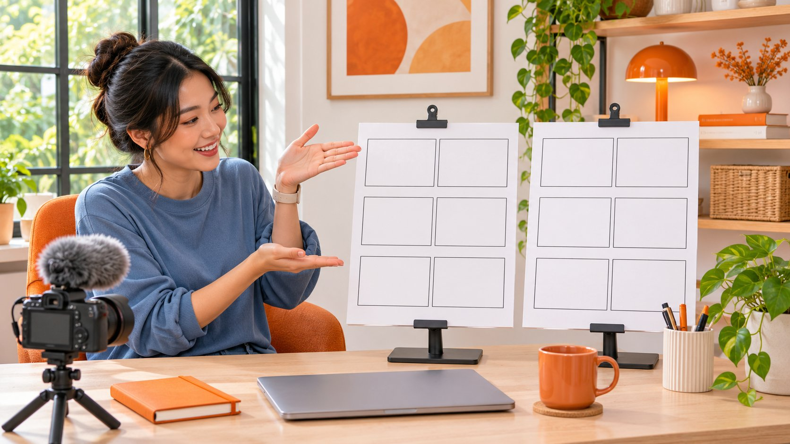

# How to Do a Duet on TikTok for a Brand Response

Status: local review draft; confirm the publication date before release.

Turn an original post into a useful brand response. Follow TikTok’s native Duet route and review framing, sound, disclosure and later usage.

AI-generated editorial illustration, not an actual creator, client, product or event.

Open the TikTok video you want to respond to, choose Share, then select Duet when it is available. Record your side, continue editing, and save a draft or publish. The original and the response play side by side. For brand work, inspect the exact source post and decide what your side adds at a specific moment. If the menu offers no Duet, check the source post and plan a separate response with material you can use. Review platform access, commercial disclosure, audio and later usage as distinct decisions before publishing.

## Start from the exact source post

The [TikTok Duet guide](https://www.tiktok.com/support/faq_detail?id=7636670084584512021) defines a Duet as two videos playing at the same time in a split screen. Open the exact post the team wants to address. Confirm the account, source link and the relevant passage. The original remains on its publisher’s profile. The response appears on the profile of the person recording it. That distinction determines who can revise the description, respond to comments and keep the publication record for each side.

In the mobile app, open Share and find Duet. Swipe across the available options if needed. Choose the camera tools appropriate to your response, record, and continue to editing. Use the next screen to check description, tags and privacy. Save a draft or post through the available controls. A team can stop at the draft stage and review picture and sound with the operator present. Agree what review material may be passed to collaborators if you use a separate review system.

Record the source link alongside the draft. Write a sentence about what the original creator was showing and a sentence about the addition. A usable note says the source demonstrates closing a case and the response explains how to inspect its latch at the moment it appears. The reviewer then knows which detail to inspect.

## Resolve permissions when Duet is unavailable

The [TikTok Duet privacy guide](https://support.tiktok.com/en/account-and-privacy/account-privacy-settings/duets) distinguishes account-level choices from reuse settings on an individual post. A publisher needs a public account to allow incoming Duets. Available controls can narrow participation to everyone or mutual followers and govern reuse on a particular video. Check the account actually doing the work and the exact post. Two clips that look nearly identical may have different permissions.

If Duet is missing, record what you observed and when. Ask the person responsible for the source post to confirm their choice. Keep any decision about making that account public with its owner. If the Duet route is unavailable, recreate the explanation with your own footage or arrange a new exchange with explicit deliverables. Preserve the production objective when the method changes.

Read the on-screen consequence before changing reuse controls. The bulk removal action described by TikTok can remove the source post along with associated Duets and Stitches. If a collaboration is ending, the owners of the respective accounts should identify the affected posts, the material to retain and any existing arrangements. Record a settings change separately from the disposition of already published material.

## Write a storyboard that follows the source

Use the [production brief guide](https://www.quickkol.com/blog/write-a-useful-campaign-brief/#answer) to define the audience question, deliverable and review point. A Duet also needs a timing relationship. Watch the source all the way through and mark the moment that calls for a response. In the storyboard, record the action on the source side, the reaction or demonstration on the response side, the audio on both sides and the information a viewer should take from that beat.

Imagine a source video demonstrating a portable display stand. The collaborator only needs to explain how to check whether a catch is seated. Show a close view and give the instruction when the catch appears in the source. A pitch delivered before viewers see the component has little connection to the picture. If the original already answers the question fully, select a detail that benefits from an addition.

Review the points at which a viewer might infer the wrong meaning. A hand may point outside the panel after the crop. The source may show one model while the response accidentally shows another. State the applicable version in the description and make it visible early enough for a reviewer to notice. Material that loses essential context in a split screen is better handled as a standalone piece.

Mark exceptions from the original in the storyboard too. A source demonstration of assembly without a load can support a response about assembly under that condition. Turning it into a load test would require separate evidence. Identify the objects that have to appear simultaneously in both panels so the editor knows when a different angle is needed.

## Check sound and framing on a small screen

Play the draft on a phone at a normal viewing distance. Check that both panels show the important object and that copy and player controls leave relevant gestures visible. For a movement explanation, simplify the response panel to leave space for the source action. A split screen becomes difficult when two concurrent demonstrations both need full-frame detail.

Decide which side carries the explanation before listening to a review cut. If the original includes dialogue, a short pause or a concise text response may be clearer than another voice. Review once with sound and once muted. Confirm that the essential step survives and that a readable caption conveys a meaningful sound cue. Check spelling of technical words, model names and sequence markers against the brief.

[TikTok commercial music guidance](https://support.tiktok.com/en/business-and-creator/creator-and-business-accounts/commercial-use-of-music-on-tiktok) recommends its Commercial Music Library for promotional material and describes the confirmation involved in using audio from outside it. Examine the source audio and the audio you plan to add. Verify each against this use. If the same cut may be used on another platform, in an ad or at an event, bring those uses into the review before the producer commits to the soundtrack.

## Handle disclosure and usage separately

[TikTok commercial disclosure guidance](https://support.tiktok.com/en/business-and-creator/creator-and-business-accounts/promoting-a-brand-product-or-service) describes enabling disclosure for promotion of a brand, product or service and distinguishes promotion of one’s own business from a third-party partnership. Identify the publishing party, the relevant exchange and the actual interface state used to check disclosure. Have the creator read the final description and check visible labeling and copy once published. Local rules, placement requirements and brand wording can add conditions in the target market.

The Duet switch governs one layer of in-app recording. The source footage, music, performance and likeness, brand reposting, paid distribution and further editing each carry a scope. Use the [usage-rights guide](https://www.quickkol.com/blog/creator-rates-usage-rights/#answer) to specify version, channel, market, duration and edits. Confirm the immediate deliverable first and record which later uses require a new agreement. A production conversation is useful when it becomes a range of actions the team can execute.

If the team plans to advertise on TikTok, consult the [Spark Ads authorization workflow](https://www.quickkol.com/blog/tiktok-spark-ads-authorization-lifecycle/#answer) and verify the actual post, account, authorization period and media owner. The approval a media team receives should point to an identifiable live post, alongside the edited file they reviewed. A filename alone leaves the placement and identity unresolved.

## Walk through a hypothetical review cut

Imagine a display-equipment company commissioning two adult contributors whose appearance has been agreed for the assignment. The source shows a partner assembling a stand correctly. The response explains where to see the alignment mark when the catch appears. The source retains the sound of the equipment, the response adds a short voice-over, and both panels must remain legible with captions.

In this hypothetical first cut, narration starts two seconds early and the hand covers the alignment mark. Align the cue with the moment the mark becomes visible, or ask the source owner to record a clearer angle. If a stakeholder wants to say all models work the same way, verify the product range. When the demonstration covers the current model only, identify it in the wording and give the reviewer the specification behind the distinction.

The collaborator agrees to organic publication for this release. A media buyer later wants the cut for an ad next season. Record the organic publication as a current deliverable and the later advertisement as a separate use awaiting review. Production can continue while the extra placement remains visible in the handoff. An editor can then see which visual elements would need a new version if the placement changes.

## Record what the response answered after publication

Record the final response URL, the source URL, publishing account and observation window. A report should identify whether its data describes the Duet or the original. Totals from two accounts cannot be merged into the result of a single piece. Look for evidence related to the assignment, such as whether viewers understood the location of the catch or repeatedly asked about the same step in the comments.

The [campaign measurement guide](https://www.quickkol.com/blog/creator-campaign-measurement/#answer) can connect an observation to the next decision. Use the account-level data you can obtain and the questions viewers actually raised. Label unavailable fields clearly. Put different observation windows side by side before comparing totals. A longer period can accumulate more activity even when the format made little difference to the behavior of interest.

Keep the version that the team approved, its permitted uses and ownership of the handoff. If the source settings change later, review the response post and the planned placements. Record what changed, which parts of the workflow it affects and who owns the next check. A specific access change and a wider commercial decision require different evidence.

## Four decisions in a Duet review

| Object | Evidence to check | Handoff record |
| --- | --- | --- |
| Source and entry | Source URL, account and available Duet menu | Owner and observation date |
| Split-screen draft | Source action, response cue, audio and captions | Cue times and reviewed version |
| Commercial post | Publishing account, disclosure and appropriate assets | Live URL and final state |
| Paid or later use | Object, channel, authorization and term | Permitted scope and next check |

Editorial review table. Check feature availability for the actual account and post.

## Duet release checklist

Have the publishing owner confirm each item.

- [ ] Record the source URL and response objective.
- [ ] Verify that Duet appears for this post on the publishing account.
- [ ] Align the source action and response cue.
- [ ] Review the draft on a phone with sound on and off.
- [ ] Assign owners for disclosure, music and later usage.

## Research date and limitations

Sources reviewed November 5, 2026. Methods, tables and decision rules are editorial recommendations. Hypothetical examples are not actual client results or industry benchmarks. Source geography and periods are specified where relevant. This draft is in independent local review; confirm its publication date before release.

## Start creator research with a clear task

Use QuickKOL to interpret a brief, discover relevant creators and research their work and contact routes. Verify data, commercial terms and outcomes at their source.

[Explore QuickKOL](https://www.quickkol.com/#capabilities)

## Sources

- [TikTok Duet guide](https://www.tiktok.com/support/faq_detail?id=7636670084584512021)
- [TikTok Duet privacy guide](https://support.tiktok.com/en/account-and-privacy/account-privacy-settings/duets)
- [TikTok commercial music guidance](https://support.tiktok.com/en/business-and-creator/creator-and-business-accounts/commercial-use-of-music-on-tiktok)
- [TikTok commercial disclosure guidance](https://support.tiktok.com/en/business-and-creator/creator-and-business-accounts/promoting-a-brand-product-or-service)
