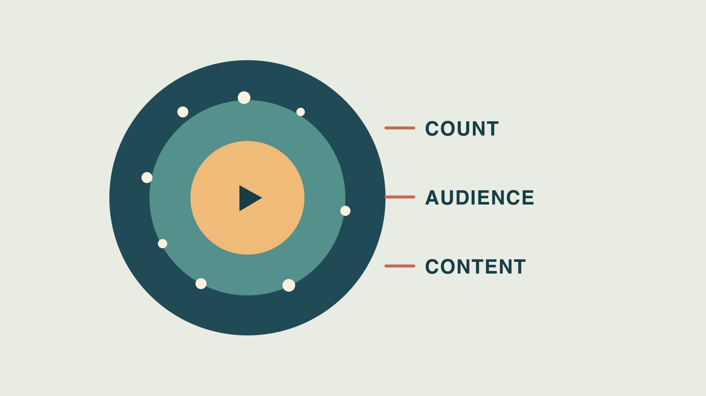

# TikTok Followers: Use Counts With Audience Evidence

Status: local review draft; confirm the publication date before release.

Use TikTok follower snapshots for account scale and verify market fit, content response and pilot delivery separately.

QuickKOL editorial graphic; not actual account metrics or a platform interface.

Start with a dated public TikTok follower snapshot for account scale. Use authorized creator aggregates to check market, language and audience scope, and inspect actual work for task fit. Total followers, post viewers, potential ad audiences and customers describe different groups. Define the evidence the brief needs, then run a pilot for a useful business action. A growth spike or a single engagement ratio cannot establish the source or authenticity of an account’s followers.

## Define the collaboration and market first

A brand looking for someone who can explain installation has a different task from one recruiting product testers in a specific market. Use [creator selection beyond followers](https://www.quickkol.com/blog/creator-selection-beyond-followers/#answer) to define language, availability, use case, deliverable and evidence. If a coffee equipment brand needs a Cantonese tutorial for Hong Kong, start by checking whether the creator can demonstrate the intended model and speak to that audience. Then review the available audience information. Follower scale can inform a budget discussion. It cannot replace a check on language or product availability. Give candidates the same questions and deadline so the next reviewer can reproduce the comparison. If a brand has two goals, such as education and retail visits, decide whether one brief or two pilots will answer them. A large audience for entertainment might fit a product story while leaving instructional skill untested. Ask for a comparable public example and give the reviewer an actual timecode and detail to inspect.

## Record the account, date and precision of the snapshot

Save the current profile, handle or stable identifier, observation date, time zone and displayed number. Keep current total, historical snapshot, new follows and net change separate. If a public count is abbreviated, retain the original string and precision. A difference of 500 between two snapshots cannot establish gross follows, unfollows or the source of growth. Log relevant known activity, such as a new series, event or promotion, with its dates. Request authorized account aggregates for any required breakdown. Treat the log as a starting point for checking evidence. Suppose the handle changed during the window and an agency has two screenshots. Match the actual profile before calculating a difference. If the source is verified but the date is missing, label the time unresolved. A buyer can still check the creator’s work while waiting for a comparable number. If the total is used for a contractual requirement, specify the accepted snapshot date and surface rather than expecting the producer to recreate an earlier value.

## Distinguish account audience from ad audiences

The [TikTok Web Business Suite guide](https://ads.tiktok.com/resources/help/article/navigate-web-business-suite?lang=en) describes examples of Business Account audience fields, including new followers, locations and activity. Ask the account owner what authorized aggregates they can share and check who and which period the report describes. The [TikTok Ads Manager Audience Insights guide](https://ads.tiktok.com/resources/help/article/audience-insights?lang=en) distinguishes platform-level potential audience from post-campaign reach and describes some dimensions as estimates. A potential ad audience is a different population from a specific creator’s followers. Retain the scope and missing fields when only top countries or a general summary is available. Avoid estimating a precise market headcount from a partial list. Keep credentials and individual follower records out of the request. Suppose a brand receives a chart with a regional share but cannot tell whether it is based on followers or video viewers. Ask for the label, reporting source and period. If the source cannot be verified, use the chart only to describe the question still open. A first-party export can be useful without establishing the nationality or location of any particular individual.

## Check recent relevant content against the brief

The [TikTok recommendation guide](https://www.tiktok.com/support/faq_detail?id=7655285288050104852&category=web_account) describes interactions, content and user information among recommendation factors. A public follower total cannot identify which audience a future video will reach. Choose recent examples close in topic, language and format. Record age, promotion, footage, relevant questions and any available audience aggregate. Use the [follower location evidence guide](https://www.quickkol.com/blog/how-to-see-followers-countries-evidence/#answer) to label geographic scope. A creator may have grown from a travel video while the brand needs a coffee equipment tutorial. Review tutorial samples first or commission a limited demonstration with a visible acceptance criterion. A production sample can show whether the creator explains a detail clearly even if the audience report remains pending. If a previous clip uses a different model, identify the relevant differences before using it as a substitute. Keep each piece of evidence attached to the task it supports. A viewer question about instructions can inform creative fit while saying little about overall follower composition. Make the brief clear enough for a reviewer to explain what they actually inspected.

## Keep account scale and target-market evidence in different columns

Imagine Creator A has about 80,000 followers and Creator B about 30,000. A supplies a public snapshot. B also shares a geographic aggregate for a comparable recent post. B’s evidence may justify a market-specific pilot. It does not establish that B has more followers in that market. Request comparable evidence from A or keep the strengths and unknowns separate. If geographic shares use different denominators, multiplying them by public follower counts will not fix the scope. Use a pilot criterion such as showing the intended product, speaking the relevant language and producing useful viewer questions. Suppose the brand needs a creator to reach an audience beyond followers. A recent post’s viewer mix may be useful, while an account-wide follower split may answer a different question. Put both fields in the handoff when available and explain which one supports the next decision. Preserve a blank where the second person could not provide a comparable report.

## Separate growth observations from explanations

If growth changes sharply, verify capture timing, renames, display precision, recent posts and known promotion first. The [TikTok deceptive behavior overview](https://newsroom.tiktok.com/how-tiktok-counters-deceptive-behaviour?lang=en-150) describes the platform’s work against artificial engagement. A policy cannot tell you what happened to one account’s curve. Report the observed change, any promotion you can verify and the traffic information that remains unavailable. Request matching aggregate data from the account owner if it affects the project. A change in growth, likes or reported region alone cannot establish behavior by an individual. Suppose there was a viral post and a Promote campaign in the same week. Both are observable events when you have the relevant dates. Neither alone explains all new follows without a compatible breakdown. Give the next decision owner a list of facts and open questions, and wait for evidence before characterizing the source. Where the pilot only needs a small group of relevant viewers, keep the production decision centered on the assignment and agreed report scope.

## Agree on one reviewable pilot decision

Put market, sample, content, rights, budget, disclosure, report window, fields and review owner on one page. Suppose the pilot explains a grinder setting and points people to instructions. After launch, verify the demonstration itself, comparable reach and relevant questions separately. Keep paid delivery distinct from what can be observed about organic followers. Decide whether to narrow or extend the work based on that evidence. If a field is missing, explain what is unavailable and when to check again. A review can close production acceptance while leaving geographic reach open, or it can establish local reach while the creative still needs another angle. Keep those conclusions in their own rows. Assign a named person to update each one. The next buyer should be able to compare this assignment to a similar pilot without mistaking a public count for every audience attribute. Where possible, use the same window and evidence checklist for the next creator.

## Preserve the original scope for a second review

Keep the original account snapshot, audience definition, exact asset and release window. Do not overwrite this project’s observation with next week’s total. When a market or model changes, update the comparison conditions. Give a second reviewer one verified public example and the permitted aggregate so they can reproduce the check. If a later export uses a different field, store it as a new observation with its own scope. That allows a team to revisit a choice without retroactively changing the evidence it relied on.

## Handle evidence that arrives at different times

Suppose procurement receives a follower screenshot without an audience breakdown while production has already reviewed a public video and commissioned a sample. Retain the creative review and mark geographic fit open. Request a permitted aggregate with a defined window and metric instead of asking for all account data. If that report is unavailable, the brand may run a limited market pilot to verify actual delivery. Its observations describe the test, not a sample of the creator’s entire following. If the two candidates’ delivery conditions differ, give each their own facts, open questions and pilot terms. Reassess if the project changes language or market. A report can mention that both creators showed the required product action, while only one supplied comparable target-market evidence. That statement is narrower and easier to verify than an overall score. If the decision cannot wait for additional evidence, specify the amount of work approved and the later condition for expansion. If the pilot uses paid distribution, record who selected the audience, the actual targeting and the reporting source. The next reader should be able to see how a paid sample differs from the public follower base. Leave each evidence line with its date and an owner who can reproduce it or update it if the creator supplies better information later through the agreed reporting and review process.

## TikTok follower and fit evidence

| Evidence | Question | Limit |
| --- | --- | --- |
| Public follower snapshot | Account size at observation | No location or unique reach |
| Authorized audience aggregate | Verifiable audience scope | Label population, field and date |
| Work and pilot | Fit for the assignment | Limited to observed scope |

Figures are hypothetical. Use the scope of actual reports.

## TikTok audience fit checklist

Choose evidence after defining the work.

- [ ] Save a dated profile and snapshot.
- [ ] Separate followers, viewers and ad audiences.
- [ ] Review work in the intended market and language.
- [ ] Mark known facts and unresolved sources.
- [ ] Define one pilot result and reviewer.

## Research date and limitations

Sources reviewed November 5, 2026. Methods, tables and decision rules are editorial recommendations. Hypothetical examples are not actual client results or industry benchmarks. Source geography and periods are specified where relevant. This draft is in independent local review; confirm its publication date before release.

## Start creator research with a clear task

Use QuickKOL to interpret a brief, discover relevant creators and research their work and contact routes. Verify data, commercial terms and outcomes at their source.

[Explore QuickKOL](https://www.quickkol.com/#capabilities)

## Sources

- [TikTok Web Business Suite guide](https://ads.tiktok.com/resources/help/article/navigate-web-business-suite?lang=en)
- [TikTok Ads Manager Audience Insights guide](https://ads.tiktok.com/resources/help/article/audience-insights?lang=en)
- [TikTok recommendation guide](https://www.tiktok.com/support/faq_detail?id=7655285288050104852&category=web_account)
- [TikTok deceptive behavior overview](https://newsroom.tiktok.com/how-tiktok-counters-deceptive-behaviour?lang=en-150)
