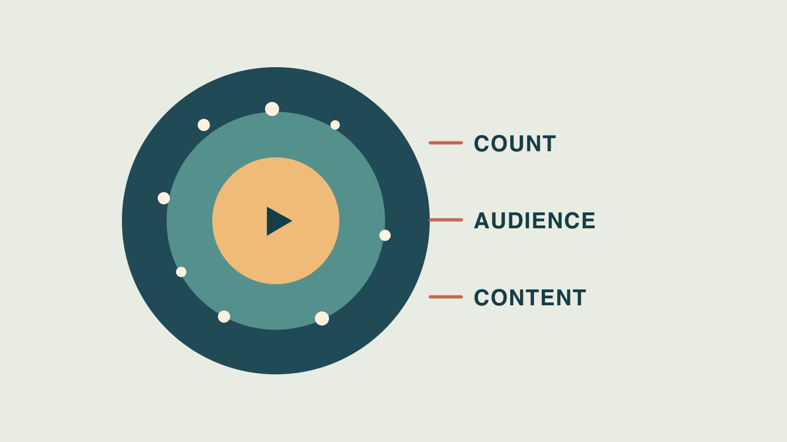

# TikTok粉丝数：从规模走到受众匹配

状态：本地审阅稿；正式发布日期待确认。

TikTok 粉丝数给出账号规模。将快照、市场覆盖、内容反应和试点结果分别用于合作判断。

QuickKOL 编辑图形；不呈现真实账号指标或平台界面。

评估 TikTok 粉丝时，先用注明日期的公开快照记录账号规模。再通过创作者经授权分享的汇总核对市场、语言与受众范围，用真实作品检查任务匹配度。粉丝总量、帖子观看者、广告潜在受众和成交客户是不同人群。先把需要哪类证据写进 Brief，再用一项小试点检查品牌真正关心的行为。一个涨幅或单一互动率不能证明流量来源或账号真实性。

## 先写清合作任务和市场

品牌要找能讲清安装的创作者，还是在特定市场招募新品试用？两个任务所需人群与作品不同。用[粉丝数之外的创作者筛选方法](https://www.quickkol.com/zh/blog/creator-selection-beyond-followers/#answer)定义语言、可购买地区、使用场景、交付和证据。假设一家咖啡器具品牌要做香港市场粤语教程，先看创作者是否能演示目标款、用所需语言清楚表达，再看受众信息。粉丝多寡可以帮助预算讨论，无法代替对语言和产品可得性的核验。给候选人同样的问题和截止时间，让下一位能复核比较标准。

## 给粉丝快照保留日期、精度和账号

保存当前主页、账号标识、观察日期、时区及显示数值。将当前粉丝、历史快照、期间新关注和净增分开。公开值若以万为单位显示，保留原样与精度。假设两次快照相差500，不能从差值确定有多少人关注、多少人取消关注或哪里来的增长。记录已知内容和活动日期，如新系列、线下活动或推广。若要核对具体分项，找经授权的账号汇总。记录只是后来验证的起点，避免形成关于个人的指控。

## 分别查看账号受众与广告人群

[TikTok网页商务套件说明](https://ads.tiktok.com/resources/help/article/navigate-web-business-suite?lang=en)列出 Business Account 可用的受众汇总字段示例，如新关注、热门地区和活跃情况。向实际账号持有人请求当前可以分享的字段，并核对所描述的是谁和哪段时间。[TikTok广告受众洞察说明](https://ads.tiktok.com/resources/help/article/audience-insights?lang=en)把投放前平台人群与活动触达分开，并指出部分维度是估算。不要把广告潜在人群写成某创作者粉丝的地区构成。若只有汇总或 Top 国家，保留范围和缺失情况，别用很小的市场占比计算确定人数。不要请求个人级关注名单或登录凭证。

## 用近期同题材内容验证合作场景

[TikTok推荐说明](https://www.tiktok.com/support/faq_detail?id=7655285288050104852&category=web_account)描述不同推荐入口使用的互动、内容与用户信息。公开粉丝数不能说明某条视频一定到达哪些人。选择同题材、同语言、同格式的近期样本，记录发布年龄、是否促销、画面、相关提问和可用的实际受众。用[查看粉丝地区的证据方法](https://www.quickkol.com/zh/blog/how-to-see-followers-countries-evidence/#answer)交接地区口径。假设旅行主题的热门视频带来很多关注，但品牌项目需要讲咖啡器具，先看器具或教程的样本。若没有相关作品，买一个范围明确的试拍，按画面和表达验收。

## 把规模和目标市场放在两列

假设创作者 A 约有80,000名粉丝，B 约有30,000。A 给的是全账户公开快照，B 另提供了同主题视频的地区汇总。如果 B 的证据支持目标市场试点，可以先试拍，不能断言 B 的目标粉丝更多。请 A 补同范围数据，否则分别标注强项与不确定项。若地区占比的分母不同，不能乘两个粉丝数比较。给小样本设清楚指标，例如是否展示目标产品、语言是否准确及是否带来相关问题。

## 增长异常先按事实和解释分开

如看到涨幅突然扩大，先核对采集时间、账号改名、公开显示精度、同周期发帖及已知投放。[TikTok反欺骗行为说明](https://newsroom.tiktok.com/how-tiktok-counters-deceptive-behaviour?lang=en-150)介绍平台治理人工互动的做法。政策不能证明一条曲线有问题。用“这一期间计数发生变化”“已核对到某次推广”“仍缺分发来源”分别描述。需要进一步核对时，向账号持有人请求同窗口汇总，记录哪些信息已确认。不要用单个增长、点赞率或地区变化判断个人行为或保证识别。

## 试点前写下一条可复查的决定

把目标市场、样品、内容、授权、预算、披露、报告窗口、字段与谁复核写成一页。假设试点目标是讲清磨豆机刻度，让观众能找到设置说明。发布后分别核对实际动作、可比范围的触达和相关问题。若有人想把一次投放推广结果写成粉丝基数的自然表现，保留分发区别。下次可缩小任务或扩大合作，取决于证据。如果数据缺失，在记录中解释缺什么及何时再看。

## 为下次复核保留原始范围

保存原始账号快照、受众定义、具体视频和实发窗口，避免下周数据替代本次。若市场或产品版本变化，更新比较条件。可以保留一个已核对的公开示例与批准的汇总，让另一位审阅人独立复现。

## 处理不同证据先后到达的情况

假设采购收到粉丝截图但没有受众拆分，制作组已经看了公开视频并完成试拍。保留创意验收结论，把地区匹配标为待核对。请对方提供授权汇总，说明需要窗口和定义，避免笼统索取全部账号数据。如果无法获得，品牌可用一个限定市场的试验验证实际交付，并写明试验观察不是对账号粉丝群的抽样。两个候选人若分发条件不同，报告别给一个综合排名。列出每人有哪些事实、需要什么核验和试点条件。计划更换语言或市场时再评估，不沿用旧结论。

## TikTok 粉丝与合作证据

| 证据 | 回答的问题 | 范围限制 |
| --- | --- | --- |
| 公开粉丝快照 | 账号在某日的规模 | 不说明地区与去重触达 |
| 授权受众汇总 | 可核对的受众范围 | 标注人群、字段和日期 |
| 作品与试点 | 与品牌任务的实际匹配 | 单次结果不能外推 |

人数为假设。实际报告以账号提供范围为准。

## TikTok 合作受众核验

先确定工作再选证据。

- [ ] 保存带日期的账号与粉丝快照。
- [ ] 区分粉丝、观看者和广告受众。
- [ ] 检查同市场、同语言的作品。
- [ ] 标明已知事实与待核验来源。
- [ ] 定义一项试点结果和审核人。

## 研究日期与使用边界

资料核验于 2026 年 11 月 5 日。文中方法、表格和决策规则为编辑建议，标为假设的示例不是实际客户结果或行业基准。外部资料的适用地区与时期按各段说明；本稿处于独立本地审阅阶段，正式发布日期待确认。

## 用清楚的任务开始达人研究

用 QuickKOL 理解 Brief、发现相关达人并研究作品与联系路径；数据、合作条件和结果仍需核验。

[了解 QuickKOL](https://www.quickkol.com/#capabilities)

## 来源

- [TikTok网页商务套件说明](https://ads.tiktok.com/resources/help/article/navigate-web-business-suite?lang=en)
- [TikTok广告受众洞察说明](https://ads.tiktok.com/resources/help/article/audience-insights?lang=en)
- [TikTok推荐说明](https://www.tiktok.com/support/faq_detail?id=7655285288050104852&category=web_account)
- [TikTok反欺骗行为说明](https://newsroom.tiktok.com/how-tiktok-counters-deceptive-behaviour?lang=en-150)
