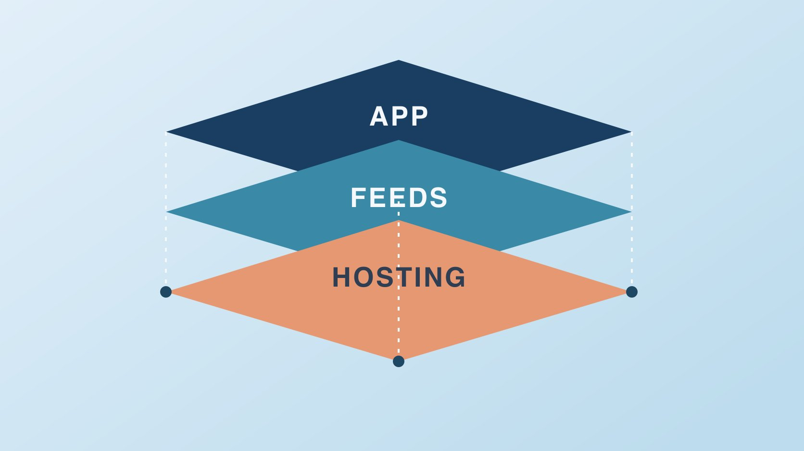

# What Is Bluesky? Separate the App and the Protocol

Status: local review draft; confirm the publication date before release.

Understand Bluesky, AT Protocol, hosting, feeds and public data through decisions a brand team can verify.

QuickKOL editorial graphic; not actual account metrics or a platform interface.

Bluesky is a social app for web and mobile built on AT Protocol. The app presents the user experience. The protocol defines underlying structures for identity and data, with account hosting, feeds and other services able to have distinct operators. For a brand, verify the public identity, who controls the domain and account hosting, which feeds are useful, and what public records a report covers. The open infrastructure provides options whose availability depends on the applications and services involved.

## Distinguish the Bluesky app from the protocol

The [Bluesky official overview](https://bsky.social/about) links to bsky.app as its app and lists AT Protocol separately. Reading, following and posting usually happen in the app. The [AT Protocol architecture overview](https://atproto.com/guides/overview) describes how components can work together across services. A brand does not need to run a server just to post. It still needs to know who manages its account and which client staff use. A viewer might read a post in the Bluesky app while a research team uses another approved interface to inspect the same public record. Different interfaces can expose different features and data. Classify a question as app use, account management, public data or distribution before choosing where to look. Suppose a colleague can open a public thread but cannot update the profile. That observation tells you that the viewing surface worked. Editing authority is a separate question for the account owner. Give operators the official entry and keep a named support route for the provider used by the organization.

## Identify the host and the application

The [Bluesky account management documentation](https://docs.bsky.app/blog/account-management) distinguishes the user-facing app from account hosting. The [AT Protocol architecture overview](https://atproto.com/guides/overview) describes the Personal Data Server layer and components such as relays and application views. A brand can record its actual host, account owner, recovery route and authorized clients. Before considering a migration, have the account owner verify support in the destination service and review the data and features the team needs. A design for portability does not establish that every service implements a complete one-step migration. For a third-party client, inspect the permissions, revocation route and operational owner. Suppose a vendor contract ends next month. Ask which access belongs to the vendor, which account is controlled by the organization and what approved exports are available. The public profile could remain visible while access needs to be transferred. Treat continuity as a task to verify on the actual service. Write down who can open the recovery route if the main editor changes teams, and who can update the organization’s approved client list.

## Separate public identity from internal control

The [Bluesky domain handle guide](https://bsky.social/about/blog/4-28-2023-domain-handle-tutorial) describes using a controlled domain as a readable handle. The [Bluesky and AT Protocol paper](https://bsky.social/about/bluesky-and-the-at-protocol-usable-decentralized-social-media-martin-kleppmann.pdf) explains that a separate decentralized identifier underlies protocol identity. Publicly, compare the organization’s website and profile links. Internally, record who can change DNS, who owns the account and who approves communications. A domain relationship helps verify an association. It cannot settle contract authorization or professional credentials. If headquarters and a regional desk have different accounts, label their coverage on the organization’s site rather than relying on names alone. Before a rename or migration, save old links and the identity record, then update customer directions. If a third party claims to manage the brand account, confirm through the organization’s established channel. A communications team can publish a reliable account directory without exposing recovery details. A technical owner can maintain the private control record independently. Both records should point to a review date so a later employee can tell whether an apparent discrepancy is simply an outdated public link.

## Separate feed choice from data sampling

The [Bluesky custom feeds guide](https://bsky.social/about/blog/7-27-2023-custom-feeds) describes a choice among feeds. A feed can be relevant to a subject, community or language without representing the whole platform. Record the feed name, operator, selection criteria, window and original posts in the sample. Define the evidence needed before asking whether a topic merits a response. If a local discussion feed contains several questions about packaging, check the market and current product version. Use the [social media operating plan](https://www.quickkol.com/blog/social-media-marketing-operating-plan/#answer) to assign someone to read, respond or keep watching. Keep discoveries from different feeds labeled separately. A post appearing in one editor’s chosen feed may be absent from another’s. That observation can explain why staff surfaced different examples without requiring a claim about the platform’s total distribution. Suppose a regional brand wants to understand one recurring service question. Select a feed and time window based on that goal and check the actual posts, rather than using whichever feed produces the largest count. Ask a second reader to verify the source if the report drives a public response.

## Define the scope and responsibility for public data

The [AT Protocol architecture overview](https://atproto.com/guides/overview) explains how public records can flow among services. A brand can log public originals, observation times and relevant facts. A third-party dataset can still have coverage gaps, delays, filters, language limits and records that later change. Use the [campaign measurement guide](https://www.quickkol.com/blog/creator-campaign-measurement/#answer) to describe the data source, extraction time and unit. Collect only the fields needed for the work. Separate an original post, a reply and a quote when the question depends on their relationship. Preserve the surrounding context when citing public content. Suppose a monitoring report contains several identical excerpts from one thread. Determine whether the entries are separate posts, mirrors or the same record observed by more than one connector before counting them. If you cannot reconcile the list, state the method and keep the unresolved duplicates visible. A platform architecture can make public data accessible while leaving the measurement question with the analyst. Keep account information needed for a public citation distinct from sensitive details the project has no reason to retain.

## Run a narrow test before committing the team

Suppose the team wants to learn whether it can find installation questions earlier. Have an editor read two relevant feeds over a week, categorize specific questions, save appropriate links and record the time spent. Then check whether the findings lead to a useful help-page correction or a public answer from an authorized owner. Review account setup, staffing, sampling and service handoffs separately. If the posts do not match the market, adjust the language or sample before drawing a broad conclusion. A trial can succeed by identifying a recurring misunderstanding even when no one posts from the brand account. Conversely, a week of posting may tell you little if nobody recorded what the team was trying to learn. Give the trial a decision date and ask one reviewer to reproduce the strongest example. If the person needs more time or different access to repeat it, record that constraint. Keep the final choice narrow enough to act on, such as retaining a weekly reading shift while postponing more frequent publishing.

## Assign owners for account, hosting, distribution and reporting

Maintain a record of the public profile, domain administration, hosting service, editorial permissions, feed list and sampling log. Route an issue to the appropriate layer. Recovery belongs with the actual host and account owner. An inaccurate public directory belongs with the website owner. An irrelevant feed belongs with the editor, and a reporting gap belongs with the analyst. When changing agencies or tools, review the public links, recovery process and approved exports. Give open items named owners and dates. Suppose a profile loses a visible association after a domain change while its old posts are still available. Record the observed problem and ask the domain and account owners to check their parts. The editorial team can keep the public response focused on the actual issue. Once resolved, add the verified profile to the maintained directory. A clear handoff lets someone else check the same components without relying on the person who initially set up the account.

## Classify a problem before asking for a fix

When two clients show different results, record the interface, account and time, then find the original public record where it is available. If the public record agrees but a report omits it, examine report coverage. If an editor cannot update the profile, check access for that account. Assign each issue to the relevant owner with a desired result and evidence. A useful check might be that the organization’s current profile opens from its own site and the analyst can reproduce a dated public example. If only one interface still displays an older result, keep that observation at the interface level. Review the operational issue before treating it as a protocol failure. This distinction makes the handoff useful for both communications and technical owners.

## Define what a service change needs to preserve

A brand might replace an editorial tool or consider another host. Inventory the public address, old content, follows, team sign-in route, recovery contacts and service records. Confirm what the target service actually supports and how to test it on a limited scope. Record the review time and the people who can act. Treat a service’s roadmap separately from its current implementation. If the organization needs only a new editorial tool, first check whether its account and public identity can stay with the existing host. Confirm how to revoke the former tool’s access once the new workflow is ready. If an old public link no longer resolves, update the organization’s directory and record which audiences were affected. Preserve the decision and its limits so the next operator can check the setup after any further change in service or staffing.

## Bluesky layers and owners

| Layer | Check | Owner |
| --- | --- | --- |
| App and publishing | Official client, profile and actions | Editor |
| Hosting and identity | Host, recovery and domain | Account and domain owners |
| Feeds and sample | Feed source, date and coverage | Research or analytics lead |

These are editorial responsibilities for a brand team.

## Bluesky brand orientation checklist

Match each question to the layer and owner.

- [ ] Record the official app and public profile.
- [ ] Identify the host and recovery owner.
- [ ] Check the handle and organization website.
- [ ] Label feeds and report scope.
- [ ] Choose one learning objective for a pilot.

## Research date and limitations

Sources reviewed November 5, 2026. Methods, tables and decision rules are editorial recommendations. Hypothetical examples are not actual client results or industry benchmarks. Source geography and periods are specified where relevant. This draft is in independent local review; confirm its publication date before release.

## Start creator research with a clear task

Use QuickKOL to interpret a brief, discover relevant creators and research their work and contact routes. Verify data, commercial terms and outcomes at their source.

[Explore QuickKOL](https://www.quickkol.com/#capabilities)

## Sources

- [Bluesky official overview](https://bsky.social/about)
- [AT Protocol architecture overview](https://atproto.com/guides/overview)
- [Bluesky account management documentation](https://docs.bsky.app/blog/account-management)
- [Bluesky domain handle guide](https://bsky.social/about/blog/4-28-2023-domain-handle-tutorial)
- [Bluesky and AT Protocol paper](https://bsky.social/about/bluesky-and-the-at-protocol-usable-decentralized-social-media-martin-kleppmann.pdf)
- [Bluesky custom feeds guide](https://bsky.social/about/blog/7-27-2023-custom-feeds)
