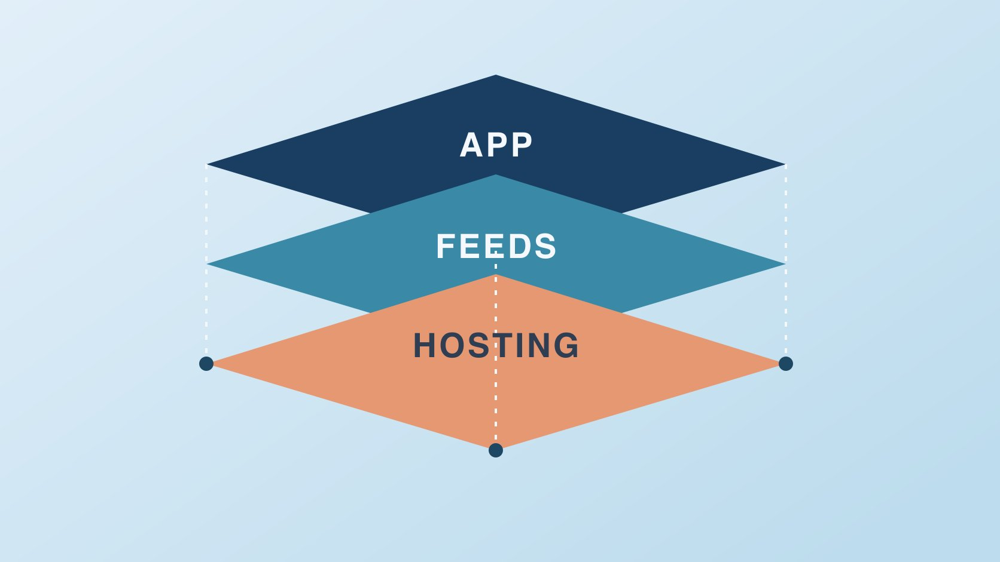

# Bluesky是什么：分清应用和协议

状态：本地审阅稿；正式发布日期待确认。

用品牌运营能核对的场景解释 Bluesky、AT Protocol、账号托管、信息流和公共数据。

QuickKOL 编辑图形；不呈现真实账号指标或平台界面。

Bluesky 是可在网页和移动端使用的社交应用，建立在 AT Protocol 上。应用负责呈现用户体验；协议定义身份和数据等基础结构，账号托管、信息流与其他服务可以有各自运营方。对品牌来说，先分别核对公开账号如何确认、谁控制域名和账号托管、哪些信息流适合阅读，以及报表能覆盖哪些公开记录。开放基础设施有助于理解选择范围，具体能力仍取决于实际应用和服务。

## 从 Bluesky App 与协议两个入口理解

[Bluesky官方介绍](https://bsky.social/about)将 bsky.app 链接为应用入口，并单列 AT Protocol。读帖、关注和发布通常在应用完成。[AT Protocol架构概览](https://atproto.com/guides/overview)描述的是组件如何协作，供多个服务使用。品牌不必为发布一条帖先搭服务器，但需要了解账户由谁管理、在使用哪套客户端。举例：用户可以打开 Bluesky App 阅读内容，而团队可能用另一套经批准的工具看同一公开帖子。不同界面不保证拥有相同功能或取到相同数据。先把问题归到应用使用、账号管理、公开数据或内容分发。

## 谁托管账号，谁提供界面

[Bluesky账号托管说明](https://docs.bsky.app/blog/account-management)区分面向用户的 Bluesky 应用和账号所在的托管服务。[AT Protocol架构概览](https://atproto.com/guides/overview)用 Personal Data Server 描述账号数据所在的一层，还说明中继与应用视图等组件。品牌应记录实际托管方、账号负责人、恢复渠道、已授权客户端。组织迁移前由负责人检查目标服务是否支持相应流程与所需数据。不要把协议设计目标理解成任何服务都能一键完整迁移。试用第三方服务时，先看需要哪种权限、是否可以撤销、谁负责日常运行。

## 把对外账号身份和内部控制分开

[Bluesky域名账号指南](https://bsky.social/about/blog/4-28-2023-domain-handle-tutorial)介绍用自己控制的域名设置可读账号名。[Bluesky与AT Protocol原始论文](https://bsky.social/about/bluesky-and-the-at-protocol-usable-decentralized-social-media-martin-kleppmann.pdf)说明协议另有底层去中心化标识。对外可从品牌官网和公开主页相互核验；对内分别记录能改 DNS 的人、账号持有人和审批人。域名形式可作为关联线索，不能代替合同授权或资质审核。假设总部和地区团队使用不同账号，官网应标明各自服务区域，不要求观众根据名称猜测。换名或迁移前保存旧链接与身份记录，确认客户指引更新。

## 信息流是一个选择，数据采样另做

[Bluesky自定义信息流说明](https://bsky.social/about/blog/7-27-2023-custom-feeds)介绍用户可选不同信息流。一个流可以适合某个话题、社区或语言，但无法据此推断平台整体趋势。采样时保存流名、维护者、筛选方式、时间窗和可见原帖。若报告要说明某个话题是否值得发帖，先定义证据类型。假设团队看到某个本地论坛流里集中讨论包装，先检查讨论是否针对本市场与当前产品版本。用[社交媒体运营计划](https://www.quickkol.com/zh/blog/social-media-marketing-operating-plan/#answer)决定由谁读取、处理或持续观察。项目可同时保留不同信息流的发现，各自标明边界。

## 公开数据依然有范围与责任

[AT Protocol架构概览](https://atproto.com/guides/overview)说明公共记录如何在不同服务中传递。运营团队可记录公开原帖、时间和相关事实，但第三方工具不一定覆盖所有数据，删除、采集延迟、语言和过滤会改变结果。用[活动数据口径指南](https://www.quickkol.com/zh/blog/creator-campaign-measurement/#answer)说明报告来自哪个来源、何时采集、统计什么单位。只收集回答项目问题所需的字段。转发、引用和原创可在报告中分开。引用公开帖子时保留语境，不将批量抓取当作品牌名单的默认来源。

## 为品牌做一个小范围的适配测试

假设团队要判断是否能更快发现用户的安装问题。先由编辑在一周内读取两条相关流，用具体问题分类，记录可引用链接和处理时间。随后验证是否找到资料页需要更正、是否能由负责人给出公开回复。账号开通、团队排班、信息流采样和客服转交分别验收。若发现的内容对该市场不相关，可以改语言或样本，而不是以一次未见推断所有人都不使用这个平台。将学习结果留给下一周决定。

## 账号、托管、分发和报表各留负责人

把账号公开链接、域名管理、托管服务、编辑权限、信息流清单和采样日志写成可维护的记录。遇到问题先看它归属哪一层：账号无法恢复，交给实际托管方与账号负责人；公开身份说明错误，交给官网维护人；信息流不相关，交给编辑；报表缺数据，交给分析人。换代理商或工具前检查公开链接、恢复方式和数据导出。将已确认与待核对分开，避免大家都以为由另一方处理。

## 用一个对照判断问题属于哪里

出现两款客户端展示不同的情况时，记录界面、账号和时间，并找到可公开访问的原始记录。若公开资料一致但报表缺一条，先查报表覆盖；若个人资料无法修改，先核对编辑账号的权限。把多个问题分别交给实际负责人。给每条问题标明希望看到什么结果与可以核对的证据。

## 问清更换服务需要保留哪些东西

品牌可能会换编辑工具或托管方。先清点公开地址、历史内容、关注关系、团队登录方式、恢复联系人和服务记录。分别确认目标服务是否支持，以及如何在小范围测试。保存验证时间与负责方，不直接把产品的计划能力写成实际支持。若组织只需更换编辑工具，先检查是否可以保留原账号托管和对外标识，并在切换前确认撤销旧工具的具体流程。

## Bluesky 层级与负责人

| 层级 | 核验 | 负责人 |
| --- | --- | --- |
| 应用与编辑 | 正式客户端、公开账号与可用操作 | 编辑 |
| 托管与身份 | 托管方、恢复、域名归属 | 账号及域名负责人 |
| 信息流和样本 | 信息流来源、日期与覆盖 | 研究或分析人员 |

表中职责是品牌团队的安排建议。

## Bluesky 品牌核对清单

按问题对应到负责的层级。

- [ ] 记录正式 App 与品牌公开主页。
- [ ] 核对账号托管方及恢复责任。
- [ ] 核对可读域名与组织官网。
- [ ] 标注信息流和报告范围。
- [ ] 给试运行指定一项学习目标。

## 研究日期与使用边界

资料核验于 2026 年 11 月 5 日。文中方法、表格和决策规则为编辑建议，标为假设的示例不是实际客户结果或行业基准。外部资料的适用地区与时期按各段说明；本稿处于独立本地审阅阶段，正式发布日期待确认。

## 用清楚的任务开始达人研究

用 QuickKOL 理解 Brief、发现相关达人并研究作品与联系路径；数据、合作条件和结果仍需核验。

[了解 QuickKOL](https://www.quickkol.com/#capabilities)

## 来源

- [Bluesky官方介绍](https://bsky.social/about)
- [AT Protocol架构概览](https://atproto.com/guides/overview)
- [Bluesky账号托管说明](https://docs.bsky.app/blog/account-management)
- [Bluesky域名账号指南](https://bsky.social/about/blog/4-28-2023-domain-handle-tutorial)
- [Bluesky与AT Protocol原始论文](https://bsky.social/about/bluesky-and-the-at-protocol-usable-decentralized-social-media-martin-kleppmann.pdf)
- [Bluesky自定义信息流说明](https://bsky.social/about/blog/7-27-2023-custom-feeds)
