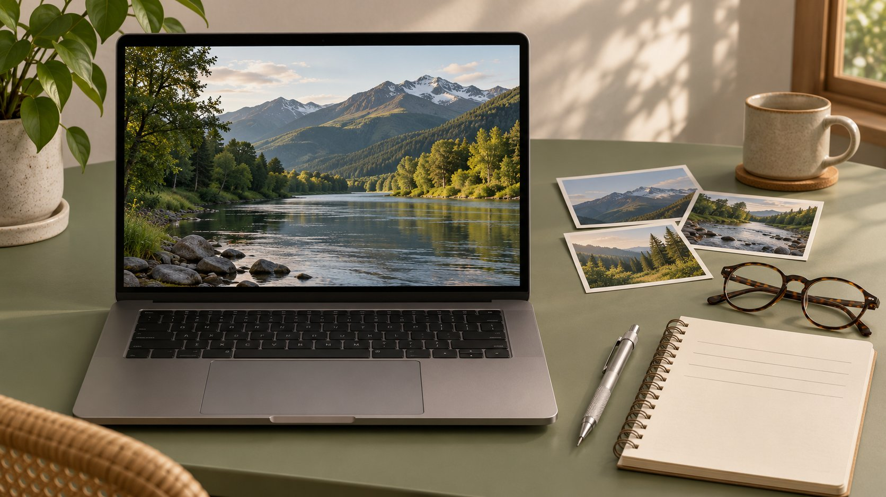

# Youtubed: Trace a Video Back to Its YouTube Source

Status: local review draft; confirm the publication date before release.

When a brief says “youtubed” or gives only a title fragment, find the YouTube source and document it for another reviewer.

AI-generated editorial illustration, not an actual creator, client, product or event.

If a brief only says “youtubed,” ask whether it means found on YouTube, published there or shorthand in an internal note. Until the link is confirmed, use the title, channel, year, distinctive wording and visible details to find plausible candidates. Check who uploaded the video, the surrounding context and timestamp. Keep the original URL, observation date and claim the material supports. Source verification, fact checking and permission to reuse footage are separate decisions.

## Turn the ambiguous note into a search record

Save the note exactly as it appeared and identify the brief, quote or asset it refers to. Ask the author for a URL, channel, full title, approximate timecode or distinctive line. If they say they searched for it, find out whether they meant a factual source, an example or a competitor’s video. Suppose a client says they youtubed a demonstration of outdoor equipment. That alone does not establish who uploaded it or whether the client published anything. Make a candidate list with page title, uploader, date and the clue linking each result to the brief. Label the missing fact the next reviewer needs to resolve, such as filming date, uploader identity or the description of the product. Where there are several similar phrases in a long brief, assign an ID to the source question and keep it next to the relevant sentence. This makes it possible to close one reference without accidentally claiming another has been found. If the exact phrase could be an internal file name, search the authorized project record before treating it as a public brand or product name.

## Use search ranking to find candidates

The [YouTube search guide](https://support.google.com/youtube/answer/16090438?hl=en) describes relevance, engagement and quality as ranking inputs, with possible personalization based on search and watch history. Use the first results as candidates. Try a distinctive line, product version and uploader where available, then compare the result dates and descriptions. Open the actual watch page to test your clues. If a channel has several videos on the subject, check location, participant and sequence against the project note. Record the search date and terms that helped. Failure to find a match establishes only that the query and access tested did not find one. A video could have a different title, limited visibility or a removed page. Suppose one edit opens with an exterior shot and another starts directly with a demonstration. If the brief quotes a spoken line from the latter, use the line and surrounding sequence to distinguish them. Save both candidates if the source is still uncertain, and give the content reviewer a clear pending question. The search result is a way to get to a page that can be checked.

## Record video identity and channel identity separately

Save the full watch link, title, channel link, display name, visible date and language. The [YouTube channel ID guide](https://support.google.com/youtube/answer/3250431?hl=en) describes the unique channel ID and where the primary owner can find it in account settings. When a stable identifier is available through an authorized route, use it to reconcile renames and similar names. Keep credentials out of the request. Use the [YouTube channel contact guide](https://www.quickkol.com/blog/find-youtube-channel-owner-business-email/#answer) to check the public profile, organization site and contact route. An uploader can establish who posted the observed version. It does not automatically establish who shot it, edited it or controls the footage and music. Give the uploader, participant and rights holder separate fields. If a distributor posts a client’s clip on its own channel, confirm the relationship through an appropriate published or authorized source. If the publisher rebrands, the old URL and display name can still help establish what the reviewer saw at a particular time. Add the current link with a date instead of erasing the original record.

## Open the timecode and watch the context

The [YouTube sharing guide](https://support.google.com/youtube/answer/171780?hl=en) describes copying a link and, where available, choosing a start point. Keep the original URL, start and end time, visible action and surrounding context in the project record. Suppose a caption at 2:17 says a product is suitable outdoors, and the presenter adds at 2:22 that it needs shelter from rain. Carry the condition into the note. If captions differ from the audio, identify the language and translation or transcription source. Test whether the intended reviewer can open the link on an appropriate device or signed-out view when the video is meant to be public. Give a demonstration, quote and brand claim their own pointers if they appear in different moments. One line can summarize what the clip supports and another can flag information missing from it. That helps the next reader reproduce the check quickly. If a timestamp link does not start at the intended frame on a device, the written time range still gives the reader an independent way to find the passage.

## Distinguish reposts, shorter cuts and later recordings

The same footage may appear in a long recording, event recap, Short or third-party repost. The earliest visible upload may still be a later copy. Compare runtimes, visible dates, credits and scene changes. For a spoken claim, look for a version with the complete exchange. To review ad copy, preserve the ad version that actually carried it. Keep original release, observed upload and recording dates separate. When the recording date is unknown, mark it that way. Suppose two versions show the same object but only one names its model. A reviewer may cite that model identification from the named version and treat the other as visual context. If a clip was edited after release, include your observation date and keep the approved record under the applicable retention rules. Do not infer intent from a missing sequence. Ask the publisher or client whether an approved full cut is available. A short version can still be a legitimate reference when the claimed point is visible there and the limitations are stated.

## Separate citation and permission to use the asset

Check the agreement and [creator footage usage rights](https://www.quickkol.com/blog/creator-raw-footage-rights/#answer) for screenshots, clips, sound, captions, edits and distribution. A link useful for research gives the reviewer a way to inspect evidence. It does not itself give an editor a license. Point the fact checker to the source and timecode, then list intended asset uses separately. If the client wants to put a clip in an ad, specify runtime, placements, markets, term and the parties whose permissions are needed. Mark outstanding clearance and keep a viable alternative, such as commissioning an independently approved demonstration. Saving a file locally cannot settle that permission. Suppose the creator approves a video excerpt but the original includes a third-party soundtrack. Record the visual approval and keep music clearance open, or propose a properly cleared replacement track. The new cut may need another review because the replacement affects pace and captions. Identify the approval owner for the actual version. Keep the evidence link available to reviewers even when the production plan changes to a new recording.

## Hand off a source note someone can reproduce

Write a handoff with the observed version and time range, what was visible, what remains open and who owns the next check. Suppose support wants to cite the closing action on a clasp. Provide the page, uploader and interval and say that the action was observed in that demonstration. Check the product manual independently before extending the explanation to other models. If the original becomes unavailable, record the date access changed and the approved substitute, if any. Give the reader the remaining limit on the claim. Another reviewer should be able to find the shot quickly and understand what work the evidence performs. End the note with a decision, such as sufficient to describe the reviewed example, rights pending for use, or insufficient to identify the original. If the team later obtains a better version, record why it improves the claim. The source record should be legible to someone who did not attend the research meeting or receive the original ambiguous message.

## Keep the narrowest fact when a link stays unresolved

If the only available evidence is a thumbnail or repost title, describe only what is visible there. Flag the claim that still needs confirmation and cite independently verified material for other claims. Leave the source open instead of adding an inaccessible link merely to complete a list. Put a decision deadline in the brief and hand the question to the person who has the original material or authorized access. If the source still cannot be confirmed by the deadline, narrow the public copy to what the team can substantiate and preserve the pending note for later research.

## Review a quotation across languages

For a translated quotation, keep the original words, time range, translation version and any term awaiting review. Suppose a brand wants to cite one adjective from an interview. Check whether the speaker describes their own experience, relays the manufacturer’s claim or repeats what another person said. Preserve attribution and uncertainty in translation, and have a second reviewer listen to the surrounding passage. Label a summary as a summary. Automatic captions can help locate a phrase and may still require checking against the recording. If a name or measurement is difficult to hear, compare the description or an authorized transcript and mark disagreement rather than choosing the more favorable reading. When the final wording is approved, link it to the version the second reviewer heard. This review is particularly helpful when a short excerpt is being used outside its original language, because a change in attribution can make a cautious observation appear to be a product guarantee.

## YouTube video evidence record

| Field | Evidence | Separate check |
| --- | --- | --- |
| Video and channel | Watch URL, visible date and channel | Filming date and rights holder |
| Timecode | Start, end and surrounding context | Whether the point applies to other versions |
| Asset usage | Approval, edit, media and term | Music and third-party material |

Use this for provenance and handoff. Confirm clearance through its own process.

## YouTube provenance checklist

Help the next reviewer find the same moment in the same version.

- [ ] Save the original note and its location.
- [ ] Check watch URL, channel and observed time.
- [ ] Review context around the timestamp.
- [ ] Record uploader and rights holder separately.
- [ ] Mark open items and assign their owner.

## Research date and limitations

Sources reviewed November 5, 2026. Methods, tables and decision rules are editorial recommendations. Hypothetical examples are not actual client results or industry benchmarks. Source geography and periods are specified where relevant. This draft is in independent local review; confirm its publication date before release.

## Start creator research with a clear task

Use QuickKOL to interpret a brief, discover relevant creators and research their work and contact routes. Verify data, commercial terms and outcomes at their source.

[Explore QuickKOL](https://www.quickkol.com/#capabilities)

## Sources

- [YouTube search guide](https://support.google.com/youtube/answer/16090438?hl=en)
- [YouTube channel ID guide](https://support.google.com/youtube/answer/3250431?hl=en)
- [YouTube sharing guide](https://support.google.com/youtube/answer/171780?hl=en)
