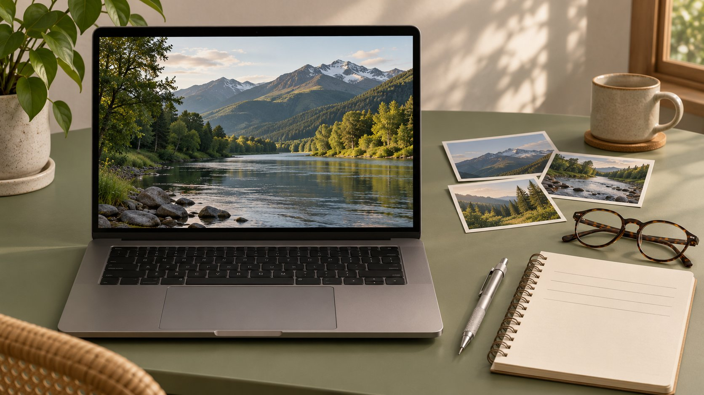

# Youtubed：怎样追溯YouTube视频

状态：本地审阅稿；正式发布日期待确认。

简报里只有 “youtubed” 或一段片名时，怎样查回 YouTube 原视频并保留可复查的出处。

AI 生成的编辑示意图，不是真实达人、客户、产品或活动。

如果简报只写 “youtubed”，请提供者确认它是指从 YouTube 搜到、发布到 YouTube，还是简写的内部备注。在明确链接前，用标题、频道、年份、独特描述及画面线索找候选视频。核对发布者、完整上下文和时间点。保留原片地址、观察日期及可支持的事实。核实出处、核实内容主张与获得剪辑授权需要分别处理。

## 把一句模糊备注变成查询记录

先保留备注原文，并标注在哪份简报、哪段引文或哪项素材中看到。请作者补一个链接、频道名、原始标题、时间点或关键台词。若对方说“我搜过”，继续确认找到的是证据、示例还是竞争对手作品。假设客户只说“我们 youtubed 了那段户外设备演示”，不要把它直接写成已发布。为候选记录分别列出页名、上传者、发布日期和可能匹配的依据。给经手人写明下一步要核对的是拍摄日期、上传者身份还是具体描述。

## 搜索排序只是找候选的工具

[YouTube搜索说明](https://support.google.com/youtube/answer/16090438?hl=en)称排序考虑相关性、互动和质量，并可能根据搜索与观看历史个性化。首条结果不能代替出处。尝试搜索一小段可辨识台词、产品版本和上传者，比较不同候选的发布日期与描述。用实际视频页面检验提示，而非只保存缩略图。若频道有多个同主题视频，查看拍摄地点、出镜人和演示步骤，逐项排除。记录检索日期与用到的关键字。找不到不等于视频不存在，内容可能改名、下架、设为不公开或只在有限范围传播。

## 分别记录视频标识与频道标识

保存完整视频链接、标题、频道地址、可见名称、日期和语言。[YouTube频道标识说明](https://support.google.com/youtube/answer/3250431?hl=en)介绍了独立频道 ID，并说明频道主可在设置中查找。若可合法取得稳定频道标识，可以用来核对改名和同名账号。不要让对方分享登录方式。品牌也可用[核验YouTube频道联系人的方法](https://www.quickkol.com/zh/blog/find-youtube-channel-owner-business-email/#answer)查看官方简介、网站和联系路径。上传者能证明谁发布该版本；它不能自动证明是谁拍摄、编辑或拥有音乐和画面。给“上传者”“出镜方”“素材权利方”各留一列。

## 打开时间点，再查看前后内容

按[YouTube视频分享说明](https://support.google.com/youtube/answer/171780?hl=en)，可用分享按钮复制链接，并在支持的界面选择开始位置。项目记录同时保留原片、起止时间、相关画面和前后语境。假设 2:17 的字幕写“适用于户外”，但 2:22 紧接着给出“仅限遮雨环境”，引用时保留限定。字幕与音频不一致时，说明翻译或转写的来源。用另一台设备或未登录视图检查获准分享的人能打开。为演示、引述、品牌主张分别写出可查位置。

## 识别重传、短版和后来补录

同一段画面可能出现在原始长片、活动剪辑、Shorts 或第三方转载。最早可见上传不一定是首次发布。按版本列出片长、可见日期、描述署名、画面差异和项目可用的证据。若任务是核对讲话，优先找能保留完整问答的版本；若任务是对比广告字幕，则保存实际投放版本。把原始发布时间、所见上传日期与录制日期分别记录。若没有证明录制日期的证据，就保留未知。

## 把引用和实际用素材的权限分开

对照现有合作合同与[创作者素材使用权](https://www.quickkol.com/zh/blog/creator-raw-footage-rights/#answer)，核对截图、片段、音轨、字幕、二次剪辑与投放渠道。能用链接做研究并不授予素材使用权。策划人可给审核人指向原片、时间点和相关事实，并单列是否需要使用。若客户想直接用片段做广告，列出片长、版位、市场、投放期和需许可对象。没有取得的许可应标成待定，保留可用替代方案，例如由品牌重新拍摄经过核准的独立演示。不要用下载记录替代许可。

## 交付一条可以复核的出处备注

备注写成“可见版本及时间点、看到的事实、仍待核验的范围、后续负责人”。假设客服要引用演示中扣件闭合的步骤，附页面、频道和时间范围，说明只观察到该次演示；另核对产品说明书是否适用所有型号。若原链接后来失效，记录失效日期与允许查看的替代材料，并标注证据强弱。接收人应能在几分钟内定位片段、知道为什么使用及哪些话不能从它得出。

## 找不到时保留最窄的事实

候选只有缩略图或转载标题时，记录仅能看到的内容。需要最终确认的句子标成待核对，并用已验证的来源支撑其他句子。不要为补满来源清单引用无法打开的视频。把复核截止时间写进简报，并交给有原始素材或账号权限的同事。

## 审阅一次跨语言的引述

若视频中的引文要翻成另一种语言，保存原句、时间范围、翻译版本和用词待定项。假设品牌要引用英语访谈的一句形容词，先核对主语是试用者自己、制造商，还是主持人复述别人的说法。翻译保留不确定性和人称，再请第二位审稿人听对应片段。若只是概述演示，把它标成概述。不要把机器生成字幕当成已由出镜人确认的文字。

## YouTube 视频证据记录

| 项目 | 可保存的证据 | 单独确认 |
| --- | --- | --- |
| 视频与频道 | 原链接、可见日期与频道地址 | 拍摄时间及权利方 |
| 时间戳 | 起止位置、完整上下文 | 是否适用于其他版本 |
| 使用范围 | 批准记录、剪辑、媒介和期限 | 音乐及第三方素材 |

此表用于核验出处与交接，不替代许可。

## YouTube 出处核验清单

让下一位审阅人能在同一版本找到同一段。

- [ ] 保存原始备注及其位置。
- [ ] 核对完整链接、频道和所见时间。
- [ ] 复核时间点前后的语境。
- [ ] 分开记录上传者与权利方。
- [ ] 标记未确认事项与后续负责人。

## 研究日期与使用边界

资料核验于 2026 年 11 月 5 日。文中方法、表格和决策规则为编辑建议，标为假设的示例不是实际客户结果或行业基准。外部资料的适用地区与时期按各段说明；本稿处于独立本地审阅阶段，正式发布日期待确认。

## 用清楚的任务开始达人研究

用 QuickKOL 理解 Brief、发现相关达人并研究作品与联系路径；数据、合作条件和结果仍需核验。

[了解 QuickKOL](https://www.quickkol.com/#capabilities)

## 来源

- [YouTube搜索说明](https://support.google.com/youtube/answer/16090438?hl=en)
- [YouTube频道标识说明](https://support.google.com/youtube/answer/3250431?hl=en)
- [YouTube视频分享说明](https://support.google.com/youtube/answer/171780?hl=en)
